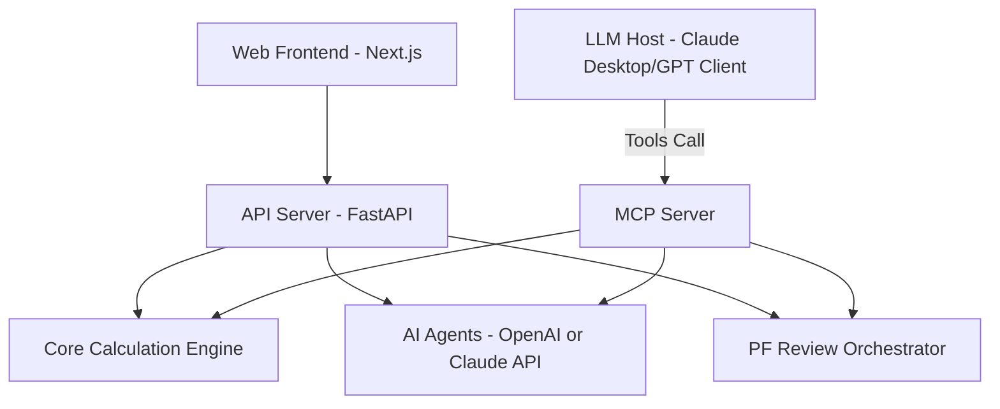

# REALYTICS x PLATFORM9 (Alpha)

AI-driven Real Estate Operating System for Professional PF (Project Financing) Review.

## Overview

REALYTICS x PLATFORM9 is a specialized platform designed for financial institutions and real estate developers to automate and enhance the PF review process. It combines traditional financial engineering with advanced AI agents to provide data-driven insights and professional-grade reports.

## Core Features

- **AI Document Parsing**: Automatically extract financial structures and project schedules from business plans (PDF), with provider-aware OpenAI/Claude metadata.
- **Development Feasibility Agent**: Converts business plans and basic architectural plans into developer-side feasibility, PF readiness, and sensitivity analysis.
- **PF Financial Engine**: Comprehensive calculations for LTV, LTC, DSCR, All-in Cost, and Waterfall simulations.
- **Risk Assessment**: Systematic evaluation of 12+ risk categories with scoring and mitigation strategies.
- **Automated Reporting**: Generates a 20-section industry-standard PF Review Report based on a Hana Financial Investment-style document structure.
- **Marketability Agent**: Validates saleability for apartments, officetels, knowledge industry centers, mixed-use, and other pre-sale real estate assets.
- **Legal/Permit Review Agent**: Performs preliminary Korean real estate PF legal, permit, land-rights, trust-security, and covenant checks with a Korean Law MCP context hook.
- **MCP Integration**: MCP-compatible PF analysis tools and an MVP PF review orchestration run.
- **Persistent MVP State**: SQLite-backed storage for projects, reports, and orchestration runs, with legacy JSON fallback and path overrides via `REALYTICS_SQLITE_FILE` / `REALYTICS_STATE_FILE`.

## Phase 11 Report Template

The Phase 11 report workflow is documented in [`docs/product/phase-11-pf-review-report.md`](docs/product/phase-11-pf-review-report.md).

It covers the full 실무형 PF 심사보고서 flow: cover page, Tr.A/B/C financial terms, bond preservation, discount-sale triggers, Cash-In/Out, land securing, project schedule, financing structure, sales proceeds distribution, summary cash flow, borrower/contractor analysis, marketability, feasibility, exit strategy, drawdown conditions, EOD, and fund execution priority.

Current implementation status and next work are tracked in [`docs/product/current-implementation-status.md`](docs/product/current-implementation-status.md).

## Architecture



## Getting Started

### 1. Web Application
```bash
npm install
npm run dev
```
Access at `http://localhost:3000`.

### 2. API Server
```bash
cd services/api-server
pip install -r requirements.txt
uvicorn main:app --reload
```

### 3. MCP Server (LLM Orchestration)
To use this with Claude Desktop or other MCP-compatible clients:

**Add to your MCP settings:**
```json
{
  "mcpServers": {
    "realytics-pf": {
      "command": "python",
      "args": ["C:/Users/User/Documents/real estate os/realytics-platform9-monorepo/services/mcp-server/server.py"],
      "env": {
        "REALYTICS_AI_PROVIDER": "claude_desktop",
        "MCP_USER_ID": "your-realytics-user-id",
        "ANTHROPIC_API_KEY": "optional-for-direct-claude-api-parsing",
        "OPENAI_API_KEY": "optional-openai-fallback-key",
        "PYTHONPATH": "C:/Users/User/Documents/real estate os/realytics-platform9-monorepo/services/api-server"
      }
    }
  }
}
```

Claude Desktop is the MCP host LLM: Claude decides when to call the REALYTICS tools and can transform tool results into structured project data. In `REALYTICS_AI_PROVIDER=claude_desktop` mode, the MCP server extracts PDF text and returns a `host_llm_extraction` request for Claude Desktop to complete. Configure `ANTHROPIC_API_KEY` only when the server itself must call Claude through the Anthropic API without relying on the Claude Desktop host. Every MCP run can attach `user_id` via `MCP_USER_ID`, the `user_id` tool argument, or `ai_context.user_id`.

## Documentation

Detailed documentation is available in the `/docs` directory.

## License

MIT License - see [LICENSE](LICENSE) for details.
