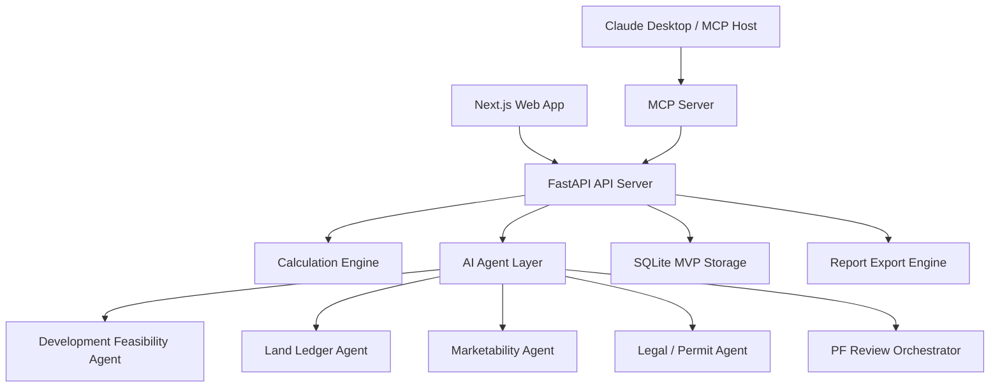

# REALYTICS x PLATFORM9

AI-driven Real Estate Operating System for Korean real estate development, project feasibility, and professional PF review.

REALYTICS x PLATFORM9 is an alpha-stage monorepo for building AI agents that help real estate developers, lenders, and reviewers parse project documents, calculate feasibility, validate land acquisition, assess marketability, structure PF loans, review legal/permit risk, and generate a Hana-style 20-section PF review report.

## Current Development Snapshot

Updated: 2026-05-14

The repository currently includes:

- Next.js web application for project dashboards, land review, risk review, orchestration, report viewing, finance, feasibility, and cash-flow screens.
- FastAPI backend for project CRUD, calculations, agents, orchestration, reports, uploads, and exports.
- SQLite-backed MVP persistence for projects, reports, and orchestration runs.
- MCP server integration for Claude Desktop or other MCP hosts.
- AI connection layer for OpenAI API, Anthropic API, and Claude Desktop host-LLM mode.
- Phase 11 Hana-style PF review report with 20 sections.
- Land Ledger Import Agent with validation lifecycle and PF summary.
- Marketability Analysis Agent v2 baseline with document evidence reconciliation, product mix normalization, comparable pricing, Exit sale rate, absorption, discount trigger, and risk flags.
- Korean Law MCP sidecar integration design and legal-review adapter.

## Main Capabilities

### 1. Project and Storage

- Project create/list/get/update/delete APIs.
- Normalized project records under a `project` envelope.
- SQLite runtime storage by default.
- Legacy JSON fallback and migration path.
- Runtime state excluded from Git.

Key files:

- `services/api-server/routers/projects.py`
- `services/api-server/storage.py`

### 2. Calculation Engine

Implemented P0 calculation functions:

- Feasibility calculation
- Monthly cash flow
- Max Minus
- LTV
- LTC
- DSCR
- Exit sale rate
- Tranche all-in cost
- Basic PF metrics bundle

Key files:

- `services/api-server/core/calculations.py`
- `services/api-server/core/risk_assessment.py`

APIs:

- `POST /projects/{project_id}/feasibility/calculate`
- `POST /projects/{project_id}/cashflow/calculate`
- `POST /projects/{project_id}/pf/structure`
- `POST /projects/{project_id}/risk/assess`

### 3. Development Feasibility Agent

The Development Feasibility Agent parses business plans and basic architectural plans into developer-side feasibility outputs.

Implemented:

- Architectural program
- Revenue assumptions
- Cost breakdown
- Developer return metrics
- PF readiness
- Sensitivity analysis
- Data quality warnings
- `realytics-feasibility-study-v2` backend schema
- Frontend TypeScript schema mirror
- Excel workbook mapping strategy for formula-preserving import/export
- Feasibility workbook validator for required sheets, formulas, key cells, and reconciliation checks

Key files:

- `services/api-server/agents/development_feasibility_agent.py`
- `services/api-server/schemas/feasibility_study.py`
- `services/api-server/agents/feasibility_workbook_validator.py`
- `apps/web/lib/feasibility-study-types.ts`

### 4. Land Ledger Import Agent

The Land Ledger Import Agent parses Korean land acquisition ledgers such as `01.본리동토지조서.xls`.

Implemented:

- Legacy `.xls` parsing
- Parcel, owner, area, purchase amount, payment schedule extraction
- Original-vs-parsed consistency validation
- Korean lot-number normalization
- Duplicate lot detection
- Ownership share validation
- Payment schedule validation
- PNU missing-data detection
- Official land price missing/base-year detection
- Registry evidence readiness check
- Sensitive account masking
- Import metadata with original file name/hash, parser version, sheet, row/column counts, and ledger version
- Land acquisition status summary
- PF review summary
- Lifecycle statuses such as `needs_review`, `needs_enrichment`, `needs_legal_evidence`, and `ready_for_pf_review`

Important rule:

> A land ledger import is only the starting point for land acquisition review. It must not be treated as completed legal review or final PF review evidence until PNU, cadastral characteristics, official land price, registry evidence, ownership, and encumbrance verification are complete.

Sample validation result:

- Parcel count: 9
- Owner/payment record count: 22
- Total area: 4,691.9 sqm
- Total contract amount: KRW 41.374 billion
- Current sample status: `needs_review`
- PF summary status: `needs_enrichment`

Key files:

- `services/api-server/agents/land_ledger_agent.py`
- `docs/product/land-ledger-import-and-enrichment.md`

API:

- `POST /projects/{project_id}/land-ledger/analyze`

### 5. Marketability Analysis Agent

The Marketability Analysis Agent evaluates saleability, pricing adequacy, Exit sale rate, discount-sale sensitivity, and lender-facing marketability risk for saleable real estate projects.

Current implementation:

- Detects whether a project is saleable.
- Classifies product type with a v2-compatible response shape.
- Handles apartment, officetel, mixed-use residential, commercial retail, knowledge industry center, section office, serviced residence, and other strata-sale assets.
- Keeps logistics, operating hotel/lodging, rental office, data center, rental housing, senior housing, and healthcare as non-saleable or separate-Agent assets.
- Treats serviced residence as applicable when it is a strata-sale/presale asset.
- Normalizes product mix, sale price assumptions, total revenue, exclusive ratio, and evidence IDs.
- Ingests manual comparable, transaction, presale, and listing fixture data with source metadata.
- Reconciles uploaded document-derived market evidence through `MarketEvidenceAgent` before Marketability scoring.
- Emits normalized evidence records for product mix, sale comparables, and rent comparables.
- Persists market evidence records in JSON/SQLite runtime state and exposes them through `GET /projects/{project_id}/market-evidence`.
- Supports analyst review of market evidence through `POST /projects/{project_id}/market-evidence/review` and the orchestration UI.
- Links market evidence records to uploaded document provenance metadata, including file name, SHA-256 hash, file size, content type, upload timestamp, and parser version.
- Archives the original uploaded source document under runtime storage and exposes source document list/download APIs for audit review.
- Preserves market evidence `sourceLocator` metadata with page, table, row, column, field, source excerpt, and confidence when extracted from uploaded documents.
- Returns price band, comparable median premium, pricing judgement, data status, missing required data, basic score/grade, Exit sale rate scenarios, absorption forecast, discount triggers, unsold recovery, risk flags, and report paragraph skeletons.

Roadmap:

- Public/partner comparable data adapters
- Product-specific comparable adjustment logic
- Full parser-field evidence locator coverage beyond market evidence records
- Absorption back-testing
- Product-specific scoring model
- Frontend Marketability Review page
- Phase 11 report paragraph integration

Key files:

- `services/api-server/agents/marketability_agent.py`
- `docs/product/marketability-agent-roadmap.md`

API:

- `POST /projects/{project_id}/marketability/analyze`
- `GET /projects/{project_id}/source-documents`
- `GET /projects/{project_id}/source-documents/{archive_id}/download`
- `GET /projects/{project_id}/market-evidence`
- `POST /projects/{project_id}/market-evidence/review`

### 6. Korean Legal / Permit Review Agent

The Legal/Permit Review Agent provides preliminary Korean real estate PF legal and permit checks.

Implemented:

- Zoning/FAR/BCR checks
- Permit schedule checks
- Land rights and encumbrance checks
- Trust/security checks
- Covenant/EOD checks
- Fund execution order checks
- Korean Law MCP sidecar query-plan support
- `realytics-law-context-v1` adapter
- Citation-verification handling

Important reality constraint:

Claude Desktop is an MCP host. An MCP server cannot directly call the Claude model inside the Claude Desktop UI. If the server itself must call Claude, `ANTHROPIC_API_KEY` is required. In `claude_desktop` mode, REALYTICS returns host-LLM extraction instructions for Claude Desktop to complete.

Key files:

- `services/api-server/agents/legal_review_agent.py`
- `services/api-server/agents/korean_law_context.py`
- `docs/integrations/korean-law-mcp.md`

API:

- `POST /projects/{project_id}/legal/review`

### 7. PF Review Orchestration

The PF Review Orchestrator runs a synchronous MVP review workflow:

1. Project load
2. Development feasibility analysis
3. Feasibility calculation
4. PF structure calculation
5. Market evidence reconciliation
6. Marketability analysis
7. Legal/permit review
8. Risk assessment
9. Phase 11 report generation
10. Quality check

Implemented APIs:

- `POST /projects/{project_id}/orchestrations/pf-review`
- `GET /projects/{project_id}/orchestrations`
- `GET /projects/{project_id}/orchestrations/{run_id}`
- `POST /projects/{project_id}/orchestrations/{run_id}/approve`

Key files:

- `services/api-server/agents/orchestration_agent.py`
- `apps/web/app/project/[id]/orchestration/page.tsx`

### 8. Phase 11 PF Review Report

The report engine generates a Hana-style 20-section PF review report.

Sections:

1. Cover
2. Financial terms
3. Claim preservation
4. Discount-sale trigger
5. Funding structure
6. Use of funds
7. Land securing
8. Project schedule
9. Financial structure diagram
10. Sales payment schedule
11. Sales revenue distribution
12. Summary cash flow
13. Borrower analysis
14. Contractor analysis
15. Market analysis
16. Business feasibility
17. Exit strategy and risk
18. Drawdown conditions
19. EOD triggers
20. Fund execution order

Implemented:

- Structured report API
- Markdown compatibility output
- Saved report versions
- Export artifacts for Markdown, JSON, and print-ready HTML
- Download endpoint for export artifacts
- A4 print QA guidance

Key files:

- `services/api-server/agents/report_agent.py`
- `services/api-server/agents/report_export_agent.py`
- `services/api-server/schemas/report.py`
- `apps/web/app/project/[id]/report/page.tsx`
- `docs/product/phase-11-pf-review-report.md`

### 9. Web App Screens

Implemented web areas:

- Dashboard
- Project detail
- File upload and upload-to-run flow
- Land review page split into practical review sections
- Risk review page with 20 PF risk management controls
- Orchestration dashboard
- Phase 11 report view
- Feasibility, finance, cash flow, PF structure, and risk pages

Recently added:

- Land page sections:
  - Basic land data
  - Source/import metadata
  - Acquisition status
  - Zoning/building limits
  - Import consistency
  - Evidence readiness
  - Parcel review
  - PF summary
- Risk page:
  - 20 PF risk management controls
  - Category rows
  - Top risks
  - Recommendations
  - API-assessed grade/score where available

Key files:

- `apps/web/app/project/[id]/land/page.tsx`
- `apps/web/app/project/[id]/risk/page.tsx`
- `apps/web/app/project/[id]/orchestration/page.tsx`
- `apps/web/app/project/[id]/report/page.tsx`

## Architecture



## Getting Started

### 1. Install dependencies

```bash
npm install
```

Python dependencies:

```bash
cd services/api-server
pip install -r requirements.txt
```

### 2. Run the API server

```bash
cd services/api-server
uvicorn main:app --reload --host 127.0.0.1 --port 8000
```

Health check:

```bash
curl http://127.0.0.1:8000/health
```

### 3. Run the web app

```bash
npm run dev --workspace=web
```

Open:

- Web app: `http://localhost:3000`
- Example land review page: `http://localhost:3000/project/1/land`
- Example risk review page: `http://localhost:3000/project/1/risk`

## MCP / Claude Desktop Setup

Example Claude Desktop MCP configuration:

```json
{
  "mcpServers": {
    "realytics-pf": {
      "command": "python",
      "args": [
        "C:/Users/User/Documents/real estate os/realytics-platform9-monorepo/services/mcp-server/server.py"
      ],
      "env": {
        "REALYTICS_AI_PROVIDER": "claude_desktop",
        "MCP_USER_ID": "your-realytics-user-id",
        "ANTHROPIC_API_KEY": "optional-for-direct-claude-api-parsing",
        "OPENAI_API_KEY": "optional-openai-fallback-key",
        "PYTHONPATH": "C:/Users/User/Documents/real estate os/realytics-platform9-monorepo/services/api-server"
      }
    }
  }
}
```

Notes:

- `REALYTICS_AI_PROVIDER=claude_desktop` means Claude Desktop remains the host LLM.
- Server-side Claude calls require `ANTHROPIC_API_KEY`.
- Server-side OpenAI calls require `OPENAI_API_KEY`.
- API upload can attach `X-REALYTICS-USER-ID` and `X-REALYTICS-AI-PROVIDER`.
- MCP tools can attach `user_id`, `ai_provider`, and `ai_context`.

## Useful Documentation

- Current implementation status: [`docs/product/current-implementation-status.md`](docs/product/current-implementation-status.md)
- Product backlog: [`docs/backlog.md`](docs/backlog.md)
- Phase 11 PF review report: [`docs/product/phase-11-pf-review-report.md`](docs/product/phase-11-pf-review-report.md)
- Land ledger import/enrichment: [`docs/product/land-ledger-import-and-enrichment.md`](docs/product/land-ledger-import-and-enrichment.md)
- Marketability Agent roadmap: [`docs/product/marketability-agent-roadmap.md`](docs/product/marketability-agent-roadmap.md)
- Feasibility workbook validation: [`docs/product/feasibility-workbook-validation.md`](docs/product/feasibility-workbook-validation.md)
- Korean Law MCP integration: [`docs/integrations/korean-law-mcp.md`](docs/integrations/korean-law-mcp.md)
- API documentation: [`docs/api.md`](docs/api.md)

## Verification Notes

Recent local checks performed during development:

- Web lint: passed
- Web type check: passed
- Web production build: passed
- Land review page: HTTP 200
- Risk review page: HTTP 200
- Land Ledger Agent targeted tests: passed in prior environment
- API test suite baseline: 60 passed in prior environment
- Marketability Agent v2 smoke/compile check: passed

Note: the current bundled Python runtime in the latest local session did not include `pytest`, so the most recent Marketability change was verified with direct Agent smoke tests and Python compilation rather than a full pytest rerun.

## Current Limitations

- This is still alpha/MVP software.
- Orchestration is synchronous, not a background job queue.
- SQLite is used for MVP persistence; PostgreSQL migration is future work.
- PDF/DOCX binary exports from structured reports are not yet implemented.
- Land ledger enrichment still needs backend batch PNU, official land price, cadastral, registry, and evidence connectors.
- Marketability Agent still needs full parser-field evidence locator coverage, real public/partner comparable data adapters, product-specific scoring weights, stronger absorption/back-testing, and a dedicated frontend review page.
- Korean Law MCP is designed as a sidecar/context adapter, not a vendored dependency.
- Private partner data sources such as Hogangnono, Zigbang, KB, or Real Estate Planet require official API, licensing, or partnership before connector use.

## License

MIT License. See [`LICENSE`](LICENSE) for details.
