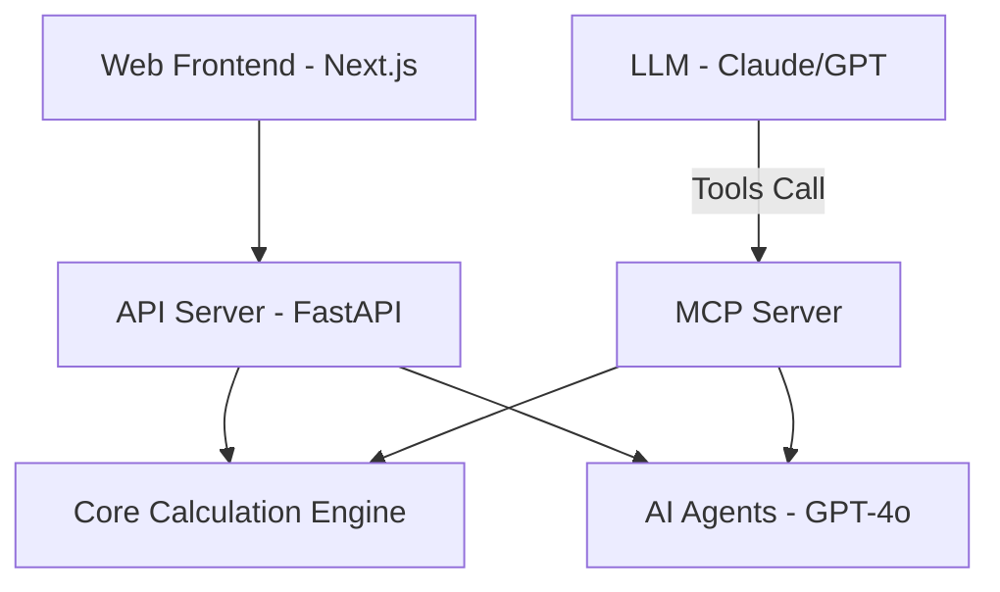

# REALYTICS x PLATFORM9 (Alpha)

AI-driven Real Estate Operating System for Professional PF (Project Financing) Review.

## Overview

REALYTICS x PLATFORM9 is a specialized platform designed for financial institutions and real estate developers to automate and enhance the PF review process. It combines traditional financial engineering with advanced AI agents to provide data-driven insights and professional-grade reports.

## Core Features

- **AI Document Parsing**: Automatically extract financial structures and project schedules from business plans (PDF).
- **PF Financial Engine**: Comprehensive calculations for LTV, LTC, DSCR, All-in Cost, and Waterfall simulations.
- **Risk Assessment**: Systematic evaluation of 12+ risk categories with scoring and mitigation strategies.
- **Automated Reporting**: Generates a 20-section industry-standard PF Review Report (Hana Financial Investment standard).
- **MCP Integration**: Fully compatible with Model Context Protocol for seamless LLM orchestration.

## Architecture



## Getting Started

### 1. Web Application
```bash
npm install
npm run dev
```
Access at `http://localhost:3000`.

### 2. API Server
```bash
cd services/api-server
pip install -r requirements.txt
uvicorn main:app --reload
```

### 3. MCP Server (LLM Orchestration)
To use this with Claude Desktop or other MCP-compatible clients:

**Add to your MCP settings:**
```json
{
  "mcpServers": {
    "realytics-pf": {
      "command": "python",
      "args": ["C:/Users/User/Documents/real estate os/realytics-platform9-monorepo/services/mcp-server/server.py"],
      "env": {
        "OPENAI_API_KEY": "your-key-here",
        "PYTHONPATH": "C:/Users/User/Documents/real estate os/realytics-platform9-monorepo/services/api-server"
      }
    }
  }
}
```

## Documentation

Detailed documentation is available in the `/docs` directory.

## License

MIT License - see [LICENSE](LICENSE) for details.
