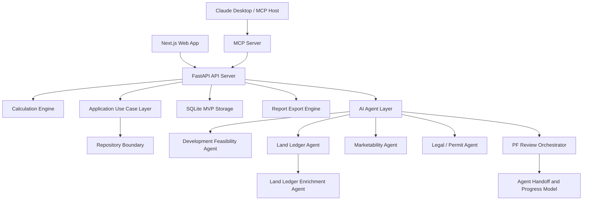

# REALYTICS x PLATFORM9

AI-driven Real Estate Operating System for Korean real estate development, project feasibility, and professional PF review.

REALYTICS x PLATFORM9 is an alpha-stage monorepo for building AI agents that help real estate developers, lenders, and reviewers parse project documents, calculate feasibility, validate land acquisition, assess marketability, structure PF loans, review legal/permit risk, and generate a Hana-style 20-section PF review report.

## Current Development Snapshot

Updated: 2026-05-20

The repository currently includes:

- Next.js web application for project dashboards, land review, risk review, orchestration, report viewing, finance, feasibility, and cash-flow screens.
- FastAPI backend for project CRUD, calculations, agents, orchestration, reports, uploads, and exports.
- Application use-case layer for reusable API, MCP, batch job, and future UI-triggered workflows, including project management, source documents, feasibility, cash flow, PF review, land ledger, marketability, legal review, report, and evidence review flows.
- Repository wrapper layer for project CRUD, source document metadata, upload archives, report, market evidence, and orchestration persistence boundaries.
- SQLite-backed MVP persistence for projects, reports, and orchestration runs.
- MCP server integration for Claude Desktop or other MCP hosts.
- AI connection layer for OpenAI API, Anthropic API, and Claude Desktop host-LLM mode.
- Phase 11 Hana-style PF review report with 20 sections.
- Land Ledger Import Agent with validation lifecycle, PF summary, and batch enrichment handoff for PNU, cadastral characteristics, official land price, and registry evidence.
- Marketability Analysis Agent v2 baseline with document evidence reconciliation, product mix normalization, comparable pricing, Exit sale rate, absorption, discount trigger, and risk flags.
- Baseline Cash Flow Engine run from Development Feasibility Agent through FeasibilityStudyV2 and CashFlowRunRequest.
- Calculation Scenario Engine for waterfall repayment allocation, unsold LTV matrix, tranche recovery, risk flags, and report fragments.
- Korean Law MCP sidecar integration design and legal-review adapter.
- Agent-to-Agent handoff envelopes, progress tracking, human review status, and final approval gating for PF review orchestration.
- Structured report export pipeline with Markdown, JSON, print-ready HTML, PDF, and DOCX artifacts.

## Main Capabilities

### 1. Project and Storage

- Project create/list/get/update/delete APIs.
- Normalized project records under a `project` envelope.
- SQLite runtime storage by default.
- Legacy JSON fallback and migration path.
- Runtime state excluded from Git.

Key files:

- `services/api-server/routers/projects.py`
- `services/api-server/use_cases/`
- `services/api-server/db/repositories/`
- `services/api-server/storage.py`

### 2. Calculation Engine

Implemented P0 calculation functions:

- Feasibility calculation
- Monthly cash flow
- Max Minus
- LTV
- LTC
- DSCR
- Exit sale rate
- Tranche all-in cost
- Basic PF metrics bundle

Key files:

- `services/api-server/core/calculations.py`
- `services/api-server/core/risk_assessment.py`
- `services/api-server/agents/cash_flow_engine.py`

APIs:

- `POST /projects/{project_id}/feasibility/calculate`
- `POST /projects/{project_id}/cashflow/calculate`
- `POST /projects/{project_id}/cash-flow/run`
- `POST /projects/{project_id}/pf/structure`
- `POST /projects/{project_id}/risk/assess`

### 3. Development Feasibility Agent

The Development Feasibility Agent parses business plans and basic architectural plans into developer-side feasibility outputs.

Its canonical downstream path is:

```text
Development Feasibility Agent
  -> realytics-feasibility-study-v2
  -> CashFlowRunRequest
  -> Cash Flow Engine
  -> Calculation Scenario Engine / PF Review Report
```

Implemented:

- Architectural program
- Revenue assumptions
- Cost breakdown
- Developer return metrics
- PF readiness
- Downstream readiness flags for Cash Flow, Waterfall, Unsold LTV, and Scenario Engine delegation
- Asset-type calculation profiles for future Cash FlowRunRequest mapping
- Asset-aware `cashFlowRunRequestDraft` generated from FeasibilityStudyV2 draft
- Baseline `cashFlowRunResult` generated by Cash Flow Engine with product-based sales collection, account allocation, tranche-aware PF draw schedule, Max Minus, risk flags, and report fragments
- Sensitivity analysis
- Data quality warnings
- `realytics-feasibility-study-v2` backend schema
- `feasibilityStudyV2Draft` output from Development Feasibility Agent
- Frontend TypeScript schema mirror
- Excel workbook mapping strategy for formula-preserving import/export
- Feasibility workbook validator for required sheets, formulas, key cells, and reconciliation checks

Key files:

- `services/api-server/agents/development_feasibility_agent.py`
- `services/api-server/schemas/feasibility_study.py`
- `services/api-server/agents/feasibility_workbook_validator.py`
- `apps/web/lib/feasibility-study-types.ts`

### 4. Land Ledger Import Agent

The Land Ledger Import Agent parses Korean land acquisition ledgers such as `01.본리동토지조서.xls`.

Implemented:

- Legacy `.xls` parsing
- Parcel, owner, area, purchase amount, payment schedule extraction
- Original-vs-parsed consistency validation
- Korean lot-number normalization
- Duplicate lot detection
- Ownership share validation
- Payment schedule validation
- PNU missing-data detection
- Official land price missing/base-year detection
- Registry evidence readiness check
- Sensitive account masking
- Import metadata with original file name/hash, parser version, sheet, row/column counts, and ledger version
- Land acquisition status summary
- PF review summary
- Batch enrichment workflow for imported parcels
- PNU resolution with confidence score and match method
- Cadastral characteristics attachment
- Official land price attachment with base year, base date, source, evidence ID, and fetched timestamp
- Registry and encumbrance evidence attachment
- Enrichment run summary with issue counts and data source policy
- Lifecycle statuses such as `needs_review`, `needs_enrichment`, `needs_legal_evidence`, and `ready_for_pf_review`

Important rule:

> A land ledger import is only the starting point for land acquisition review. It must not be treated as completed legal review or final PF review evidence until PNU, cadastral characteristics, official land price, registry evidence, ownership, and encumbrance verification are complete.

Sample validation result:

- Parcel count: 9
- Owner/payment record count: 22
- Total area: 4,691.9 sqm
- Total contract amount: KRW 41.374 billion
- Current sample status: `needs_review`
- PF summary status: `needs_enrichment`

Key files:

- `services/api-server/agents/land_ledger_agent.py`
- `services/api-server/agents/land_ledger_enrichment_agent.py`
- `docs/product/land-ledger-import-and-enrichment.md`

API:

- `POST /projects/{project_id}/land-ledger/analyze`
- `POST /projects/{project_id}/land-ledger/enrich`

Important limitation:

- The enrichment agent can normalize, reconcile, score, and attach supplied connector evidence, but it does not fabricate official land price or registry verification. Live external connector automation remains a separate integration step.

### 5. Marketability Analysis Agent

The Marketability Analysis Agent evaluates saleability, pricing adequacy, Exit sale rate, discount-sale sensitivity, and lender-facing marketability risk for saleable real estate projects.

Current implementation:

- Detects whether a project is saleable.
- Classifies product type with a v2-compatible response shape.
- Handles apartment, officetel, mixed-use residential, commercial retail, knowledge industry center, section office, serviced residence, and other strata-sale assets.
- Keeps logistics, operating hotel/lodging, rental office, data center, rental housing, senior housing, and healthcare as non-saleable or separate-Agent assets.
- Treats serviced residence as applicable when it is a strata-sale/presale asset.
- Normalizes product mix, sale price assumptions, total revenue, exclusive ratio, and evidence IDs.
- Ingests manual comparable, transaction, presale, and listing fixture data with category, source type, price-basis, source metadata, and converted price-unit normalization.
- Reconciles uploaded document-derived market evidence through `MarketEvidenceAgent` before Marketability scoring.
- Merges document-derived market evidence with existing manual market payloads without overwriting analyst-supplied comparables.
- Emits normalized evidence records for product mix, sale comparables, and rent comparables.
- Persists market evidence records in JSON/SQLite runtime state and exposes them through `GET /projects/{project_id}/market-evidence`.
- Supports analyst review of market evidence through `POST /projects/{project_id}/market-evidence/review` and the orchestration UI.
- Links market evidence records to uploaded document provenance metadata, including file name, SHA-256 hash, file size, content type, upload timestamp, and parser version.
- Archives the original uploaded source document under runtime storage and exposes source document list/download APIs for audit review.
- Preserves market evidence `sourceLocator` metadata with page, table, row, column, field, source excerpt, and confidence when extracted from uploaded documents.
- Preserves source metadata with source name, source type, evidence ID or URL, collected date, base date, license note, confidence, metadata status, and missing-field summary.
- Adds field-level market evidence locators so extracted product mix, sale comparable, and rent comparable values carry locator coverage and page/table/row references when available or inferable from evidence IDs.
- Returns price band, comparable median premium, pricing judgement, data status, missing required data, product-specific score breakdown, grade, Exit sale rate discount scenarios, tranche thresholds, absorption coverage, discount triggers with reasons, unsold recovery scenarios, tranche recovery, lender risk flag details, and report paragraphs.

Roadmap:

- Public/partner comparable data adapters
- Product-specific comparable adjustment logic
- Full parser-field evidence locator coverage beyond market evidence records
- Absorption back-testing
- Product-specific scoring model
- Frontend Marketability Review page
- Phase 11 report paragraph integration

Key files:

- `services/api-server/agents/marketability_agent.py`
- `docs/product/marketability-agent-roadmap.md`

API:

- `POST /projects/{project_id}/marketability/analyze`
- `GET /projects/{project_id}/source-documents`
- `GET /projects/{project_id}/source-documents/{archive_id}/download`
- `GET /projects/{project_id}/market-evidence`
- `POST /projects/{project_id}/market-evidence/review`

### 6. Korean Legal / Permit Review Agent

The Legal/Permit Review Agent provides preliminary Korean real estate PF legal and permit checks.

Implemented:

- Zoning/FAR/BCR checks
- Permit schedule checks
- Land rights and encumbrance checks
- Trust/security checks
- Covenant/EOD checks
- Fund execution order checks
- Korean Law MCP sidecar query-plan support
- `realytics-law-context-v1` adapter
- Citation-verification handling

Important reality constraint:

Claude Desktop is an MCP host. An MCP server cannot directly call the Claude model inside the Claude Desktop UI. If the server itself must call Claude, `ANTHROPIC_API_KEY` is required. In `claude_desktop` mode, REALYTICS returns host-LLM extraction instructions for Claude Desktop to complete.

Key files:

- `services/api-server/agents/legal_review_agent.py`
- `services/api-server/agents/korean_law_context.py`
- `docs/integrations/korean-law-mcp.md`

API:

- `POST /projects/{project_id}/legal/review`

### 7. Calculation Scenario Engine

The Calculation Scenario Engine converts product mix and PF structure into lender-side stress tests.

Implemented:

- Waterfall repayment allocation scenarios
- Unsold LTV matrix across sale-rate and discount-rate vectors
- Tranche-level recovery matrix
- Scenario risk flags
- Korean PF review report fragments
- Saved recovery scenario results under project state

Key files:

- `services/api-server/agents/scenario_engine_agent.py`
- `services/api-server/schemas/scenario.py`
- `services/api-server/tests/test_scenarios.py`

APIs:

- `POST /projects/{project_id}/scenarios/waterfall`
- `POST /projects/{project_id}/scenarios/unsold-ltv-matrix`
- `POST /projects/{project_id}/scenarios/recovery`

### 8. PF Review Orchestration

The PF Review Orchestrator runs a synchronous MVP review workflow:

1. Project load
2. Land acquisition and evidence review
3. Development feasibility analysis
4. Feasibility calculation
5. PF structure calculation
6. Market evidence reconciliation
7. Marketability analysis
8. Data quality review
9. Cross-agent reconciliation gate
10. Legal/permit review
11. Risk assessment
12. Risk register generation
13. Credit review decision
14. Phase 11 report generation
15. Evidence graph generation
16. Quality check

Implemented APIs:

- `POST /projects/{project_id}/orchestrations/pf-review`
- `GET /projects/{project_id}/orchestrations`
- `GET /projects/{project_id}/orchestrations/{run_id}`
- `GET /projects/{project_id}/snapshots`
- `GET /projects/{project_id}/snapshots/{snapshot_id}`
- `POST /projects/{project_id}/snapshots/similar`
- `POST /projects/{project_id}/snapshots/diff`
- `POST /projects/{project_id}/orchestrations/{run_id}/handoffs/{handoff_id}/review`
- `POST /projects/{project_id}/orchestrations/{run_id}/risk-register/{risk_id}/review`
- `POST /projects/{project_id}/orchestrations/{run_id}/approve`

Implemented interaction model:

- `AgentHandoffEnvelope` schema for structured Agent-to-Agent handoffs.
- `AgentProgress` schema for per-Agent status, dependency, artifact, and review visibility.
- Handoffs currently include land to feasibility/legal/PF, development feasibility to cash flow, market evidence to marketability, marketability to feasibility, legal review to credit review, risk register to credit review, and credit review to report.
- Data Quality Agent checks project name, land area, GFA, sales revenue, PF amount, unit count, sqm/py conversion, VAT basis, schedule, and tranche structure conflicts before final report and approval gates.
- Risk Register Agent consolidates Land, Marketability, Legal, Cash Flow, PF Structure, Scenario, Data Quality, and Risk Matrix issues into one credit-review table with approval-condition candidates.
- Risk Register row review supports `approved`, `waived`, `needs_revision`, and `resolved` with reviewer, comment, waiver reason, and audit history. Final approval is blocked while material risk rows remain unresolved.
- Risk Register is now persisted as server-side JSON/SQLite `risk_registers` records by project/run, with list/get APIs and row-review synchronization for audit and historical review.
- Credit Review Agent converts the risk register and key upstream artifacts into approve, conditional approval, rework, or reject guidance with reasons, mitigants, waivers, and report paragraphs.
- Each saved PF review run now creates an immutable `realytics-project-snapshot-v1` record for audit, historical comparison, and future similar-case retrieval.
- Historical Similar Case Search now compares saved snapshots by project type, location, scale, PF amount, LTV/LTC, Exit sale rate, land/market/reconciliation status, and Risk Register overlap, then returns how similar historical risks were handled.
- Snapshot Diff now compares two saved snapshots from the same project and highlights changed assumptions, Risk Register rows, Credit Review decision, artifacts, report sections, and re-review recommendations.
- A first end-to-end Daegu mixed-use PF pilot run is documented, including orchestration, Risk Register, Evidence Graph, Snapshot Diff, Similar Case Search, and identified hardening gaps.
- Approval Readiness Gate now separates report/artifact completeness from actual credit approval readiness, checking blocking risks, rejected/rework credit decisions, unresolved reviews, and missing evidence warnings.
- Each PF review run now creates a deterministic `realytics-evidence-graph-v1` artifact linking source documents, evidence IDs, agent artifacts, handoffs, claims, Risk Register rows, source locators, and Phase 11 report sections.
- Each Risk Register row now stores `evidenceGraphLinks` so reviewers can trace a risk back to its document, Excel cell/API locator, Agent artifact, evidence ID, and supporting claim nodes.
- Human review statuses include `pending`, `approved`, `rejected`, and `needs_revision`.
- Final approval is blocked when required handoffs remain unresolved, rejected, or marked as needing revision.
- Orchestration UI shows progress, handoff status, open reviews, and review actions.
- Baseline user activity logging stores API request and login events in JSON/SQLite runtime state and exposes `POST /audit/login-event` plus `GET /audit/user-activity` for troubleshooting who did what, when, and against which project/run.
- Audit review screens are available at `/audit` and `/project/{id}/audit` to inspect event mix, sensitive document/report actions, slow requests, and recent user activity.
- Identity/session MVP stores tenants, users, and sessions in JSON/SQLite and exposes `/auth/tenants`, `/auth/users`, `/auth/session`, and `/auth/me`; RBAC checks now cover audit reads, source document downloads, and report export/download with optional strict mode.
- Land Evidence records are now persisted separately from the land ledger via `land_evidence` JSON/SQLite storage and `GET/POST /projects/{id}/land-evidence`; `/land-ledger/enrich` can persist PNU, cadastral, official land price, and registry evidence when `persistEvidence` is enabled.
- PF review runs hydrate persisted Land Evidence into the orchestration payload so Land Agent readiness, Legal Review, Risk Register source locators, and Evidence Graph links can reflect stored PNU, official-price, and registry records.
- Approval Readiness Gate now treats land readiness as explicit blocker checks: PNU, official land price, registry evidence, and land acquisition readiness.

Key files:

- `services/api-server/agents/orchestration_agent.py`
- `services/api-server/schemas/orchestration.py`
- `services/api-server/use_cases/orchestration_approval.py`
- `services/api-server/routers/audit.py`
- `services/api-server/routers/auth.py`
- `services/api-server/core/authz.py`
- `services/api-server/tests/test_land_evidence_storage.py`
- `apps/web/components/audit/activity-log-panel.tsx`
- `apps/web/app/project/[id]/orchestration/page.tsx`

### 9. Phase 11 PF Review Report

The report engine generates a Hana-style 20-section PF review report.

Sections:

1. Cover
2. Financial terms
3. Claim preservation
4. Discount-sale trigger
5. Funding structure
6. Use of funds
7. Land securing
8. Project schedule
9. Financial structure diagram
10. Sales payment schedule
11. Sales revenue distribution
12. Summary cash flow
13. Borrower analysis
14. Contractor analysis
15. Market analysis
16. Business feasibility
17. Exit strategy and risk
18. Drawdown conditions
19. EOD triggers
20. Fund execution order

Implemented:

- Structured report API
- Markdown compatibility output
- Saved report versions
- Export artifacts for Markdown, JSON, print-ready HTML, PDF, and DOCX
- Download endpoint for export artifacts
- A4 print QA guidance
- Automated PDF structure and visual regression QA with A4, overflow, overlap, empty-page, approval-block, and baseline comparison checks

Key files:

- `services/api-server/agents/report_agent.py`
- `services/api-server/agents/report_export_agent.py`
- `services/api-server/agents/visual_qa_agent.py`
- `services/api-server/schemas/report.py`
- `apps/web/app/project/[id]/report/page.tsx`
- `docs/product/phase-11-pf-review-report.md`

### 10. Web App Screens

Implemented web areas:

- Dashboard
- Project detail
- File upload and upload-to-run flow
- Land review page split into practical review sections
- Risk review page with 20 PF risk management controls
- Orchestration dashboard
- Phase 11 report view
- Feasibility, finance, cash flow, PF structure, and risk pages

Recently added:

- Land page sections:
  - Basic land data
  - Source/import metadata
  - Acquisition status
  - Zoning/building limits
  - Import consistency
  - Evidence readiness
  - Parcel review
  - PF summary
- Risk page:
  - 20 PF risk management controls
  - Category rows
  - Top risks
  - Recommendations
  - API-assessed grade/score where available

Key files:

- `apps/web/app/project/[id]/land/page.tsx`
- `apps/web/app/project/[id]/risk/page.tsx`
- `apps/web/app/project/[id]/orchestration/page.tsx`
- `apps/web/app/project/[id]/report/page.tsx`

## Architecture



## Getting Started

### 1. Install dependencies

```bash
npm install
```

Python dependencies:

```bash
cd services/api-server
pip install -r requirements.txt
```

### 2. Run the API server

```bash
cd services/api-server
uvicorn main:app --reload --host 127.0.0.1 --port 8000
```

Health check:

```bash
curl http://127.0.0.1:8000/health
```

### 3. Run the web app

```bash
npm run dev --workspace=web
```

Open:

- Web app: `http://localhost:3000`
- Example land review page: `http://localhost:3000/project/1/land`
- Example risk review page: `http://localhost:3000/project/1/risk`

## MCP / Claude Desktop Setup

Example Claude Desktop MCP configuration:

```json
{
  "mcpServers": {
    "realytics-pf": {
      "command": "python",
      "args": [
        "C:/Users/User/Documents/real estate os/realytics-platform9-monorepo/services/mcp-server/server.py"
      ],
      "env": {
        "REALYTICS_AI_PROVIDER": "claude_desktop",
        "MCP_USER_ID": "your-realytics-user-id",
        "ANTHROPIC_API_KEY": "optional-for-direct-claude-api-parsing",
        "OPENAI_API_KEY": "optional-openai-fallback-key",
        "PYTHONPATH": "C:/Users/User/Documents/real estate os/realytics-platform9-monorepo/services/api-server"
      }
    }
  }
}
```

Notes:

- `REALYTICS_AI_PROVIDER=claude_desktop` means Claude Desktop remains the host LLM.
- Server-side Claude calls require `ANTHROPIC_API_KEY`.
- Server-side OpenAI calls require `OPENAI_API_KEY`.
- API upload can attach `X-REALYTICS-USER-ID` and `X-REALYTICS-AI-PROVIDER`.
- MCP tools can attach `user_id`, `ai_provider`, and `ai_context`.

## Useful Documentation

- Architecture and migration plan: [`docs/architecture.md`](docs/architecture.md)
- Current implementation status: [`docs/product/current-implementation-status.md`](docs/product/current-implementation-status.md)
- Product backlog: [`docs/backlog.md`](docs/backlog.md)
- Phase 11 PF review report: [`docs/product/phase-11-pf-review-report.md`](docs/product/phase-11-pf-review-report.md)
- Land ledger import/enrichment: [`docs/product/land-ledger-import-and-enrichment.md`](docs/product/land-ledger-import-and-enrichment.md)
- Agent interaction operating model: [`docs/product/agent-interaction-operating-model.md`](docs/product/agent-interaction-operating-model.md)
- Server-side project snapshots: [`docs/product/project-snapshots.md`](docs/product/project-snapshots.md)
- Historical Similar Case Search: [`docs/product/historical-similar-case-search.md`](docs/product/historical-similar-case-search.md)
- Daegu mixed-use PF pilot run: [`docs/product/pilot-run-daegu-mixed-use-pf.md`](docs/product/pilot-run-daegu-mixed-use-pf.md)
- Pilot hardening notes: [`docs/product/pilot-hardening-notes.md`](docs/product/pilot-hardening-notes.md)
- Evidence Graph Agent: [`docs/product/evidence-graph-agent.md`](docs/product/evidence-graph-agent.md)
- Data Quality Agent: [`docs/product/data-quality-agent.md`](docs/product/data-quality-agent.md)
- Risk Register Agent: [`docs/product/risk-register-agent.md`](docs/product/risk-register-agent.md)
- Credit Review Agent: [`docs/product/credit-review-agent.md`](docs/product/credit-review-agent.md)
- Marketability Agent roadmap: [`docs/product/marketability-agent-roadmap.md`](docs/product/marketability-agent-roadmap.md)
- Cash Flow Engine / Agent roadmap: [`docs/product/cash-flow-engine-agent.md`](docs/product/cash-flow-engine-agent.md)
- Calculation Scenario Engine roadmap: [`docs/product/calculation-scenario-engine.md`](docs/product/calculation-scenario-engine.md)
- Feasibility workbook validation: [`docs/product/feasibility-workbook-validation.md`](docs/product/feasibility-workbook-validation.md)
- Korean Law MCP integration: [`docs/integrations/korean-law-mcp.md`](docs/integrations/korean-law-mcp.md)
- API documentation: [`docs/api.md`](docs/api.md)

## Verification Notes

Recent local checks performed during development:

- Web lint: passed
- Web type check: passed
- Web production build: passed
- Land review page: HTTP 200
- Risk review page: HTTP 200
- Land Ledger Agent targeted tests: passed in prior environment
- API test suite baseline: 60 passed in prior environment
- Marketability Agent v2 smoke/compile check: passed
- Cash Flow Engine direct smoke check: passed against the Daegu Bondong example, generating monthly cash flow and PF draw rows
- Orchestration handoff/progress smoke check: passed, including review gate behavior
- Land ledger enrichment direct smoke check: passed with supplied connector-style records

Note: the current bundled Python runtime in the latest local session did not include `pytest`, `fastapi`, or `xlrd`, so the most recent backend changes were verified with Python compilation and direct Agent/use-case smoke tests rather than a full endpoint pytest rerun.

## Current Limitations

- This is still alpha/MVP software.
- Orchestration is synchronous, not yet a background job queue.
- SQLite is used for MVP persistence; PostgreSQL migration is future work.
- Report exports now produce structured Markdown/JSON/HTML/PDF/DOCX artifacts, but enterprise-grade styling QA and advanced renderer hardening remain ongoing.
- Land ledger enrichment supports batch enrichment from supplied connector records, but live public/registry connector automation and production credential handling remain future work.
- Marketability Agent still needs full parser-field evidence locator coverage, real public/partner comparable data adapters, product-specific scoring weights, stronger absorption/back-testing, and a dedicated frontend review page.
- Korean Law MCP is designed as a sidecar/context adapter, not a vendored dependency.
- Private partner data sources such as Hogangnono, Zigbang, KB, or Real Estate Planet require official API, licensing, or partnership before connector use.

## License

MIT License. See [`LICENSE`](LICENSE) for details.
