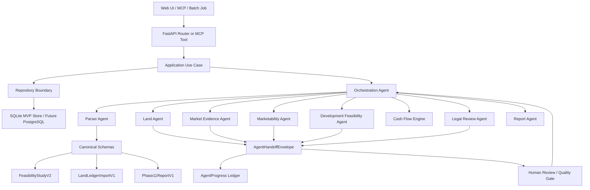
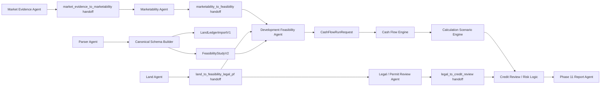

# REALYTICS x PLATFORM9 Architecture

Updated: 2026-05-20

## 1. Purpose

This document records the current repository structure, the target architecture, and a safe migration plan.

The project already contains most of the core REALYTICS and PLATFORM9 functions, but the folder layout is still MVP-oriented. The immediate goal is not to move files aggressively. The goal is to create a clear map so future refactoring can be done in small, testable steps.

## 2. Current Repository Structure

Current root:

```text
realytics-platform9-monorepo/
|-- apps/
|   `-- web/
|       |-- app/
|       |-- components/
|       |-- lib/
|       `-- package.json
|
|-- services/
|   `-- api-server/
|       |-- agents/
|       |-- core/
|       |-- data/
|       |-- db/
|       |-- routers/
|       |-- schemas/
|       |-- tests/
|       |-- use_cases/
|       |-- main.py
|       `-- storage.py
|
|-- packages/
|   |-- eslint-config/
|   |-- typescript-config/
|   `-- ui/
|
|-- docs/
|   |-- integrations/
|   |-- product/
|   |-- api.md
|   |-- architecture.md
|   `-- backlog.md
|
`-- README.md
```

Important current implementation locations:

| Domain | Current Location | Notes |
|---|---|---|
| Web app | `apps/web` | Next.js app with dashboard, project, land, risk, orchestration, report, feasibility, finance, and cash-flow screens |
| API routes | `services/api-server/routers` | Main project API router is currently concentrated in `projects.py` |
| Use cases | `services/api-server/use_cases` | Application workflow layer shared by API, MCP tools, and future background jobs |
| Agents | `services/api-server/agents` | Development feasibility, cash flow, marketability, land ledger, legal, parser, orchestration, and report agents |
| Calculations | `services/api-server/core` | Pure calculation functions, logistics helpers, and risk assessment |
| Schemas | `services/api-server/schemas` | Feasibility Study v2, report, orchestration, agent handoff/progress, and Valuemap schemas |
| Storage | `services/api-server/storage.py` | SQLite/JSON-backed MVP persistence |
| Repositories | `services/api-server/db/repositories` | Wrapper layer over current MVP runtime stores for projects, source document metadata, upload archives, reports, market evidence, and orchestration runs |
| Runtime data | `services/api-server/data/runtime` | SQLite state and uploaded document archive; ignored by Git |
| Product docs | `docs/product` | Agent roadmaps and implementation status |
| Integration docs | `docs/integrations` | Korean Law MCP and external integration notes |

## 3. Target Architecture

The long-term target can be expressed as:

```text
realytics-ai-lab/
|-- apps/
|   `-- web/
|       |-- app/
|       |-- components/
|       |-- lib/
|       `-- package.json
|
|-- services/
|   `-- api-server/
|       |-- use_cases/
|       |-- agents/
|       |-- schemas/
|       |-- calculators/
|       |-- integrations/
|       |-- reports/
|       |-- db/
|       |-- routers/
|       |-- tests/
|       `-- main.py
|
|-- packages/
|   |-- shared-types/
|   `-- realytics-contracts/
|
|-- docs/
|   |-- architecture.md
|   |-- feasibility_schema.md
|   |-- pf_cashflow_logic.md
|   `-- agent_design.md
|
|-- docker-compose.yml
`-- README.md
```

This target is directionally correct, but it should be reached through compatibility wrappers rather than large file moves.

## 4. Current vs Target Gap

| Target Item | Current Status | Recommended Action |
|---|---|---|
| `apps/web/app` | Exists | Keep |
| `apps/web/components` | Exists | Keep |
| `apps/web/lib` | Exists | Keep; later move shared API contracts to package |
| `services/api-server/agents` | Exists | Keep, but gradually split large agents into domain modules |
| `services/api-server/use_cases` | Exists as baseline | Expand this as the application workflow layer for API, MCP, batch jobs, and UI-triggered actions |
| `services/api-server/schemas` | Exists | Expand schema coverage for project, parcel, regulation, cashflow, PF, and DB DTOs |
| `services/api-server/calculators` | Missing | Add wrappers that re-export stable functions from `core` before moving implementation |
| `services/api-server/integrations` | Missing | Add sidecar/client adapters for VWorld, MOLEG/Korean Law MCP, Valuemap, and public data |
| `services/api-server/reports` | Missing | Move report generation behind wrappers from `agents/report_agent.py` and `agents/report_export_agent.py` |
| `services/api-server/db` | Exists as baseline | Expand repository wrappers for persistent job state before moving `storage.py` implementation |
| `packages/shared-types` | Missing | Add later for generated or hand-maintained frontend/backend shared types |
| `packages/realytics-contracts` | Missing | Add later for canonical JSON schemas, workbook contracts, and API contracts |
| Root `docker-compose.yml` | Missing | Add after API/web/dev services are stable enough for root orchestration |
| `docs/feasibility_schema.md` | Missing | Can be generated from current Feasibility Study v2 docs |
| `docs/pf_cashflow_logic.md` | Missing | Can summarize Cash Flow Engine and Calculation Scenario Engine docs |
| `docs/agent_design.md` | Missing | Can summarize all agent boundaries and orchestration flow |
| `docs/product/agent-interaction-operating-model.md` | Exists | Defines target agent-to-agent handoff, progress ledger, market-to-feasibility, land-to-legal/PF, and orchestration quality gates |

## 5. Recommended Migration Principles

1. Do not rename or move heavily imported files without compatibility wrappers.
2. Keep existing API responses stable while moving internals.
3. Move one domain at a time and run targeted tests after each move.
4. Prefer wrapper modules first, implementation moves second.
5. Update docs, backlog, tests, and import paths together.
6. Keep runtime data, uploaded documents, and SQLite files out of Git.
7. Keep calculation code deterministic and auditable.
8. Keep agent orchestration separate from pure calculation functions.
9. Keep API, MCP, batch jobs, and future UI actions behind the same use-case functions.

## 6. Application Layer Design

The preferred dependency direction is:

```text
Router / MCP Tool / Batch Job / UI Action
  -> Use Case
     -> Agent
     -> Calculator
     -> Integration Adapter
     -> Repository
        -> Schema / Domain Model
```

The anti-pattern to avoid is:

```text
Router
  -> direct Agent orchestration
  -> direct DB persistence
  -> direct external API calls
  -> direct numerical calculations
```

Use cases should be small, explicit functions that can be called from multiple runtimes:

| Runtime | Should Call |
|---|---|
| FastAPI endpoint | `use_cases.*` |
| MCP tool | `use_cases.*` |
| Background worker | `use_cases.*` |
| Scheduled job | `use_cases.*` |
| Future admin action | `use_cases.*` |

Current baseline use cases:

| Use Case | File | Responsibility |
|---|---|---|
| Development feasibility analysis | `services/api-server/use_cases/development_feasibility.py` | Merge project state with overrides and call Development Feasibility Agent |
| Project management | `services/api-server/use_cases/project_management.py` | Create, list, fetch, update, delete, and apply parsed project records through the project repository |
| Source document metadata | `services/api-server/use_cases/source_documents.py` | Save, list, and locate uploaded source document metadata through the source document repository |
| Cash Flow Engine run | `services/api-server/use_cases/cash_flow.py` | Accept direct CashFlowRunRequest or derive one from Development Feasibility Agent output |
| PF review orchestration | `services/api-server/use_cases/pf_review.py` | Run the PF review workflow without binding it to FastAPI |
| Land ledger import/enrichment | `services/api-server/use_cases/land_ledger_import.py` | Analyze uploaded workbook files and enrich land ledger outputs with PNU, official price, cadastral, and registry evidence records |
| Marketability review | `services/api-server/use_cases/marketability_review.py` | Merge project state with market overrides and call Marketability Agent |
| Legal and permit review | `services/api-server/use_cases/legal_review.py` | Merge project overrides and law context before calling Legal Review Agent |
| Report generation/export | `services/api-server/use_cases/report_generation.py` | Generate structured PF report/markdown and export saved report records |
| Market evidence review | `services/api-server/use_cases/evidence_review.py` | Filter evidence records and apply analyst review status |
| Orchestration approval | `services/api-server/use_cases/orchestration_approval.py` | Review handoffs and approve completed orchestration runs without binding approval logic to FastAPI |

Current baseline repositories:

| Repository | File | Responsibility |
|---|---|---|
| Project repository | `services/api-server/db/repositories/project_repository.py` | Create, list, fetch, update, delete, normalize, and apply parsed project records |
| Source document repository | `services/api-server/db/repositories/source_document_repository.py` | Store, list, and locate uploaded source document metadata attached to projects |
| Upload archive repository | `services/api-server/db/repositories/upload_archive_repository.py` | Store source document binary files, resolve archive paths, verify SHA-256 integrity, return download metadata, and clean up project archive folders |
| Report repository | `services/api-server/db/repositories/report_repository.py` | Create, list, fetch, and export saved report records |
| Market evidence repository | `services/api-server/db/repositories/market_evidence_repository.py` | Store, list, fetch, and sort market evidence records |
| Project snapshot repository | `services/api-server/db/repositories/project_snapshot_repository.py` | Store immutable orchestration-time project snapshots for audit, comparison, and similar-case search |
| Orchestration repository | `services/api-server/db/repositories/orchestration_repository.py` | Save PF review runs and related report/evidence artifacts |

Use-case rules:

1. A use case may call multiple agents or calculators.
2. A use case should not depend on FastAPI request/response objects.
3. A use case should receive plain dictionaries or typed schemas and return plain dictionaries or typed results.
4. A use case may call repositories, but routers should not.
5. A use case should own workflow branching such as direct `CashFlowRunRequest` vs feasibility-derived request.
6. A use case should be deterministic where possible and preserve source metadata.

## 7. Interaction-First Architecture

REALYTICS should operate as a Real Estate OS, not as a loose collection of isolated agents. The architecture should make every cross-agent assumption explicit, reviewable, and reusable for future similar-case analysis.

The preferred interaction model is:



Core rules:

1. Routers and MCP tools call use cases, not agents directly.
2. Use cases may call agents, calculators, integrations, and repositories.
3. Agents exchange typed handoff envelopes instead of silently mutating project state.
4. The Orchestration Agent stores `agentProgress`, handoffs, blockers, assumptions, data limitations, and review status.
5. Final approval must be blocked when required handoffs are unresolved, rejected, or marked as needing revision.
6. Canonical schemas are the common language across agents; internal agent models are allowed, but cross-agent outputs must be translated before handoff.
7. Every important number should preserve provenance, source metadata, confidence, and, where possible, evidence locator.
8. Server-side project snapshots should preserve assumptions and decisions so future review runs can compare against prior cases.

Current baseline implementation:

| Interaction Capability | Status |
|---|---|
| `AgentHandoffEnvelope` schema | Implemented in `services/api-server/schemas/orchestration.py` |
| `AgentProgress` schema | Implemented in `services/api-server/schemas/orchestration.py` |
| Orchestration run handoffs | Implemented for land-to-feasibility/legal/PF, feasibility-to-cash-flow, market-evidence-to-marketability, marketability-to-feasibility, legal-to-credit-review, risk-register-to-credit-review, and credit-review-to-report |
| Handoff review endpoint | Implemented at `POST /projects/{project_id}/orchestrations/{run_id}/handoffs/{handoff_id}/review` |
| Final approval gate | Implemented in `services/api-server/use_cases/orchestration_approval.py` |
| Orchestration UI | Shows progress, handoffs, review status, and approval blocking |
| Land enrichment handoff | Implemented as a first-class `land_agent_review` PF orchestration step with `land_to_feasibility_legal_pf` handoff payloads |
| Data quality gate | Implemented as `data_quality_review` to detect project name, land area, GFA, sales revenue, PF amount, unit count, sqm/py conversion, VAT basis, schedule, and tranche structure conflicts |
| Risk register | Implemented as `risk_register_generation` to consolidate Land, Marketability, Legal, Cash Flow, PF Structure, Scenario, Data Quality, and Risk Matrix issues into one credit-review table |
| Risk register review workflow | Implemented at `POST /projects/{project_id}/orchestrations/{run_id}/risk-register/{risk_id}/review` with row-level approve, waive, needs-revision, resolve, audit history, and approval blocking |
| Credit review decision | Implemented as `credit_review_decision` to convert risk, legal, data quality, marketability, and PF metrics into approve/conditional/rework/reject guidance |
| Cross-agent reconciliation gate | Implemented as `cross_agent_reconciliation` to compare feasibility revenue, marketability revenue, project land area, Land Agent parcel area, official price readiness, registry evidence readiness, market evidence readiness, and PF metric availability |
| Evidence graph | Implemented as `evidence_graph_generation` to link project inputs, source documents, evidence IDs, agent artifacts, handoffs, extracted claims, and Phase 11 report sections |

## 8. Migration Plan

### Phase A: Documentation and Application Layer Alignment

Status: In progress.

Deliverables:

- `docs/architecture.md`
- README link to architecture document
- Backlog item for structure migration
- `services/api-server/use_cases` baseline workflow layer
- Future docs:
  - `docs/feasibility_schema.md`
  - `docs/pf_cashflow_logic.md`
  - `docs/agent_design.md`

### Phase B: Use Case Expansion

Goal:

Move workflow assembly out of `routers/projects.py` before deeper folder migration.

Planned use cases:

```text
services/api-server/use_cases/
|-- development_feasibility.py
|-- cash_flow.py
|-- pf_review.py
|-- land_ledger_import.py
|-- marketability_review.py
|-- legal_review.py
|-- report_generation.py
|-- evidence_review.py
`-- orchestration_approval.py
```

Migration rule:

Routers should validate project existence, parse request payloads, call use cases, and save returned results if needed. They should not directly coordinate agents, calculators, or external integrations.

### Phase C: Calculator Package Wrappers

Goal:

Introduce `services/api-server/calculators` without breaking existing imports.

Planned files:

```text
services/api-server/calculators/
|-- feasibility_calculator.py
|-- cashflow_calculator.py
|-- ltv_ltc_calculator.py
|-- tranche_waterfall.py
`-- sensitivity.py
```

Initial implementation should re-export or thinly wrap functions from `core.calculations`.

Example:

```python
from core.calculations import calculate_feasibility_metrics
```

After wrappers are stable, routers and agents can gradually import from `calculators`.

### Phase D: Reports Package Wrappers

Goal:

Introduce `services/api-server/reports` while preserving current report agents.

Planned files:

```text
services/api-server/reports/
|-- ic_memo_generator.py
|-- pf_review_report_generator.py
`-- feasibility_report_generator.py
```

Initial mapping:

| Target File | Current Source |
|---|---|
| `pf_review_report_generator.py` | `agents/report_agent.py` |
| `ic_memo_generator.py` | Phase 11 report fragments and future lender memo generator |
| `feasibility_report_generator.py` | Development Feasibility Agent outputs |

### Phase E: Integrations Package

Goal:

Centralize external data clients and sidecar adapters.

Planned files:

```text
services/api-server/integrations/
|-- vworld_client.py
|-- moleg_client.py
|-- valuemap_client.py
|-- public_data_client.py
`-- korean_law_mcp_client.py
```

Current related code:

| Current Location | Future Direction |
|---|---|
| `schemas/valuemap.py` | Keep schema, add `integrations/valuemap_client.py` |
| `routers/valuemap.py` | Use Valuemap client wrapper |
| `agents/korean_law_context.py` | Keep normalization, add MCP client wrapper if direct client automation is needed |
| `docs/integrations/korean-law-mcp.md` | Keep sidecar deployment guide |

### Phase F: DB Package

Goal:

Move persistence behind a clearer DB package.

Planned files:

```text
services/api-server/db/
|-- models.py
|-- session.py
|-- repository.py
`-- migrations/
```

Current source:

- `services/api-server/storage.py`

Migration rule:

First create repository wrappers around the current runtime stores and `save_state`. Only later move implementation from `storage.py`.

Status:

- Project, source document metadata, upload archive, report, market evidence, and orchestration repository wrappers are implemented.
- Remaining repository wrappers: future async job state.

### Phase G: Shared Packages

Goal:

Separate shared contracts from application code.

Planned packages:

```text
packages/shared-types/
packages/realytics-contracts/
```

Recommended contents:

| Package | Contents |
|---|---|
| `shared-types` | TypeScript types consumed by web app |
| `realytics-contracts` | JSON schemas, workbook contracts, API payload contracts |

Do this after backend schema stabilizes, especially Feasibility Study v2, Cash Flow Run Request, Marketability Analysis v2, Land Ledger Import v1, and Phase 11 Report v1.

## 9. Agent Boundary Model

Current agent boundaries should remain conceptually stable, but the runtime model should be a reviewed interaction graph rather than a one-way chain:



Important rule:

Development Feasibility Agent is an orchestrator for feasibility readiness. It should not directly own every calculation. Cash Flow, Waterfall, Unsold LTV, and Tranche Recovery should remain specialized engines.

Agent interaction rule:

Marketability, Land, Legal, Feasibility, Cash Flow, and PF Review agents should communicate through typed handoff artifacts, not silent mutation of shared project data. The target handoff, progress, and quality gate model is documented in `docs/product/agent-interaction-operating-model.md`.

Canonical schema rule:

The system should maintain a small family of stable schemas that are shared by API, MCP, batch jobs, UI, report generation, and future historical case comparison:

| Schema | Purpose |
|---|---|
| `FeasibilityStudyV2` | Developer feasibility, site/program/product mix, revenue, cost, financing, schedule, scenarios, workbook provenance, formulas, and metrics |
| `CashFlowRunRequest` | Monthly cash flow, PF draw, account allocation, waterfall, Max Minus, and report fragment input |
| `LandLedgerImportV1` | Parcel, owner, payment, PNU, official land price, registry evidence, land acquisition status, and PF land summary |
| `MarketabilityAnalysisV2` | Product classification, comparables, price band, absorption, Exit sale rate, discount trigger, unsold recovery, score, and risk flags |
| `AgentHandoffEnvelopeV1` | Cross-agent patch, evidence, confidence, blockers, assumptions, limitations, and review status |
| `AgentProgressV1` | Per-agent progress, dependencies, artifacts, handoff IDs, review requirement, and blocker status |

Real Estate OS rule:

REALYTICS should treat canonical schemas, controlled vocabulary, source evidence, server-side project snapshots, and historical review data as core platform infrastructure. The system should learn from prior reviewed projects by storing assumptions, decisions, approval conditions, and actual outcomes in a form that future agents can query and compare.

## 10. Immediate Next Steps

Recommended next coding sequence:

1. Harden Snapshot Diff and Historical Similar Case Search with actual outcomes, field-level evidence locators, and vector retrieval.
2. Add `services/api-server/calculators` wrappers.
3. Update a small number of tests to import calculators directly.
4. Keep old `core` imports working.
5. Continue thinning `routers/projects.py` by moving remaining workflow assembly into use cases.
6. Add repository/use-case wrappers for async job state.
7. Add `docs/pf_cashflow_logic.md` from the Cash Flow Engine and Calculation Scenario Engine docs.
8. Add `docs/agent_design.md` from the current agent boundaries.
9. Add `services/api-server/reports` wrappers.

The safest first code move is the use-case layer because it creates a shared application boundary before deeper package migration.
