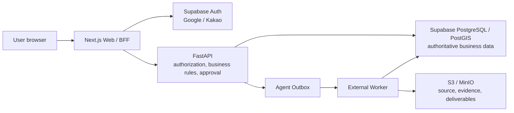

# REALYTICS Runtime Architecture Boundary

Updated: 2026-07-22
Status: Approved architecture contract
Applies to: production and external pilot deployments

## 1. Decision

REALYTICS uses the following operating boundary.



This is the default architecture. A new Supabase product or a second service
may be introduced only through an explicit architecture decision record that
identifies the missing capability, data authority, failure model, security
boundary, migration path, and rollback plan.

## 2. Scope

This contract defines:

- which component owns identity, authorization, business data, binary objects,
  asynchronous execution, approval, and audit;
- which paths are allowed between the browser, BFF, API, database, worker, and
  object store;
- which shortcuts are forbidden in production;
- how execution state and approval state remain independent;
- the release gates for treating the deployment as operational.

This contract does not select a payment provider, define commercial prices,
replace domain schemas, or permit an LLM to calculate financial values or make
approval decisions.

## 3. Component ownership

| Component | Owns | Must not own |
|---|---|---|
| Next.js Web/BFF | Browser UX, HttpOnly Auth cookies, same-origin mutation boundary, verified bearer forwarding | Business authorization, tenant role authority, database credentials, service-role keys |
| Supabase Auth | Google/Kakao authentication, Supabase user identity, OAuth session and token lifecycle | REALYTICS tenant membership, project permissions, approval authority, billing entitlement |
| FastAPI | JWT verification, live membership resolution, RBAC, use cases, validation, state transition policy, audit emission, signed object access | OAuth provider password/token storage, browser session storage, direct UI state authority |
| PostgreSQL/PostGIS | Canonical transactional state, tenant membership, project ownership, workflow state, evidence metadata, approval records, usage and audit ledgers | Source document bytes, temporary UI-only state, unverifiable LLM conclusions |
| Agent Outbox | Durable intent to execute asynchronous work, lease/retry/idempotency metadata | Business result authority or approval authority |
| External Worker | Parsing, PF review, report generation, controlled external calls, durable result persistence | Human approval, tenant selection, use of end-user refresh tokens |
| S3/MinIO | Immutable or versioned binary objects and recovery copies | Tenant/RBAC decisions, document metadata authority, workflow status |

## 4. Authority matrix

| Question | Authoritative source |
|---|---|
| Who authenticated? | Signed Supabase JWT `issuer + subject` |
| Which tenant may the principal use? | PostgreSQL `tenant_memberships` |
| Which role and permissions apply? | Live PostgreSQL membership plus server permission map |
| Which project owns a record? | PostgreSQL project and tenant foreign-key lineage |
| Which document bytes were reviewed? | S3/MinIO object version plus PostgreSQL SHA-256 metadata |
| Did a worker finish? | PostgreSQL outbox/run records, not a browser poll result |
| Is a result approved? | Domain approval record and applicable Approval Gate |
| Which financial number is authoritative? | Versioned deterministic calculation run bound to approved inputs |
| May a feature be used? | PostgreSQL entitlement evaluation through FastAPI |

No browser payload, route parameter, JWT user metadata, LLM response, or object
key alone can establish any authority in this table.

## 5. Allowed request flows

### 5.1 Authentication

```text
Browser
  -> Next.js Supabase OAuth route
  -> Supabase Google/Kakao consent
  -> Next.js callback and code exchange
  -> verified HttpOnly session cookies
  -> FastAPI bearer validation
  -> PostgreSQL principal and tenant membership resolution
```

The BFF may call `getSession()` only to retrieve an access token after the
identity-bearing JWT has been verified. Authorization must never be based on a
cookie payload or the `getSession()` user object alone.

### 5.2 Business command

```text
Browser -> same-origin Next.js BFF -> FastAPI -> use case -> repository -> PostgreSQL
```

FastAPI strips or ignores caller-supplied identity authority fields. Tenant,
actor, role, approval authority, server timestamps, and authoritative status
are derived server-side.

### 5.3 File upload and asynchronous analysis

```text
Browser -> BFF -> FastAPI
  -> quarantine object write
  -> malware/type/size/integrity decision
  -> document metadata + hash persistence
  -> outbox event
  -> external worker lease
  -> deterministic/controlled processing
  -> result + evidence lineage persistence
  -> outbox completion
```

The API response that accepted an upload does not mean parsing, approval, or
report eligibility completed.

### 5.4 Object download

FastAPI first verifies live tenant membership, project access, object lineage,
retention state, and download permission. It then streams the object or issues
a short-lived signed URL. Bucket URLs are not treated as authorization.

## 6. PostgreSQL and PostGIS boundary

- The private application schema is `realytics`.
- PostGIS extensions live in the dedicated `extensions` schema.
- Migration, API, identity lookup, PF worker, legal review, legal sync, and
  legal operations use distinct roles where their privileges differ.
- Migration uses a direct administrative connection. Long-lived API and worker
  processes use bounded role-specific pools.
- Every tenant-scoped transaction sets the verified tenant context, safe
  `search_path`, statement timeout, lock timeout, and idle-in-transaction
  timeout with transaction-local settings.
- RLS is enabled and forced on tenant-bearing relations. Repository predicates
  repeat the tenant condition as defense in depth.
- Identity-directory lookup occurs before the tenant transaction is opened.
- Browser code does not connect to business tables. If no Supabase Data API is
  required, it should be disabled. If an API schema is added later, it is
  opt-in, minimal, separately reviewed, and protected by grants and RLS.
- `service_role`, migration credentials, direct DSNs, and worker credentials
  never enter the browser bundle or user-visible logs.

See `docs/architecture/postgres-runtime-authority.md` for the implemented RLS
and pool boundary.

## 7. State-axis separation

REALYTICS must not collapse independent concerns into one generic `status`.

| Axis | Meaning | Example values |
|---|---|---|
| `executionStatus` | Whether work ran | planned, pending, running, completed, blocked, failed, needs_recalculation |
| `approvalStatus` | Human or policy decision | not_requested, pending, needs_revision, conditionally_approved, approved, rejected, superseded |
| `evidenceStatus` | Evidence strength and lineage | missing, candidate, source_attested, verified_snapshot, human_reviewed |
| `dataQualityStatus` | Completeness and reconciliation | unknown, partial, conflicting, reconciled, failed |
| `reportEligibility` | Whether output may enter a report | false, conditional, true |

These are semantic namespaces, not a migration that silently changes existing
domain enums. Each domain schema must map its values explicitly. In particular:

- `executionStatus=completed` never implies approval;
- `approvalStatus=approved` requires the applicable evidence and maker-checker
  gates;
- `mcp.connected=true` describes connectivity only;
- fallback or estimated data remains `reportEligibility=false` unless a
  separately authorized policy says otherwise.

## 8. Asynchronous worker contract

- Transport and business execution states are separate. The current outbox
  transport uses `pending | processing | retrying | published | dead_letter |
  cancelled`; the domain run/job owns its own `pending/running/completed/failed`
  lifecycle. `published` means the outbox message was handled, not that a PF
  review, parser run, or report is human-approved.
- Every event has an immutable ID and idempotency key.
- Claiming uses a lease and database concurrency control.
- Retry count, next-attempt time, error class, and last error are persisted.
- A worker writes results and completes the event atomically or through an
  auditable compensating transition.
- Duplicate delivery must not duplicate calculation runs, reports, uploads,
  payments, or approval events.
- Permanent failure moves to a durable dead-letter state with controlled replay.
- Jobs carry tenant/project IDs and immutable input references, not browser
  cookies, refresh tokens, or unrestricted secrets.
- Service principals receive only the role and object prefixes required by the
  job type.

## 9. Object storage contract

- PostgreSQL owns object metadata; S3/MinIO owns bytes.
- Every authoritative object reference contains bucket/backend, key, immutable
  version where supported, SHA-256, size, media type, tenant ID, project ID,
  document version, uploader, and timestamps.
- Source documents enter quarantine before becoming parser-readable.
- The implemented source path uses
  `tenants/{tenant}/projects/{project}/quarantine/{sha256}` and promotes only a
  hash-verified clean scan to the corresponding `active` prefix. Hardened
  deployments have no scanner bypass.
- Object keys are opaque and do not contain unnecessary personal information.
- Encryption in transit and at rest is mandatory.
- Public buckets are forbidden for project documents, evidence, reports, and
  exports.
- Lifecycle, Object Lock/legal hold, backup, restore, malware scanning, and
  deletion proof follow `docs/product/privacy-retention-support-policy.md`.
- Hardened S3 configuration requires explicit server-side encryption and a
  paired Object Lock mode/duration. These configuration gates do not replace
  the required live IAM, bucket-versioning, restore, hold and deletion drills.

Supabase Storage is not part of the current runtime. Replacing or supplementing
S3/MinIO requires an explicit migration and dual-authority prevention plan.

## 10. Explicit non-goals and forbidden shortcuts

The current architecture does not require:

- Supabase Edge Functions;
- Supabase Storage;
- Supabase Realtime;
- browser access to REALYTICS business tables;
- a second Google/Kakao OAuth implementation in FastAPI;
- a payment gateway during the institutional pilot;
- a marketing automation Agent in the sensitive deal workspace.

Production-forbidden shortcuts include:

- storing access/refresh tokens or REALYTICS session IDs in `localStorage`;
- accepting tenant or role from `user_metadata` or request headers;
- using the Supabase publishable key as proof of user authorization;
- embedding service-role or direct database credentials in Next.js public env;
- writing source bytes to API-local disk in a multi-worker deployment;
- treating an outbox publish/HTTP 202 response as completed work;
- treating an AI explanation as a calculation or approval record;
- silently falling back from PostgreSQL/S3 to local state in production.

## 11. Operational release gates

The architecture is operational only when all applicable gates pass:

1. Real Google and Kakao accounts complete callback, refresh, logout, and
   disabled-membership tests on the deployed origin.
2. Dedicated database roles and secrets are provisioned and rotated.
3. Cross-tenant read/write denial and multi-worker lease tests pass from the
   deployed network.
4. S3/MinIO quarantine, malware scanning, hash verification, signed download,
   lifecycle, Object Lock where required, backup, and restore drills pass.
5. Outbox retry, duplicate delivery, dead-letter, replay, and worker crash
   recovery are observable.
6. Approval, evidence, calculation, and report gates fail closed under stale,
   missing, conflicting, superseded, or unauthorized input.
7. Audit events reach durable storage without secrets or document bodies.
8. Privacy, retention, incident response, and support owners are named.

## 12. Change control

Any change that moves an authority boundary must update:

- this document;
- the relevant product contract;
- `docs/architecture.md`;
- `docs/backlog.md`;
- migration and rollback notes if persistence changes;
- targeted authorization, RLS, worker, and browser tests.
