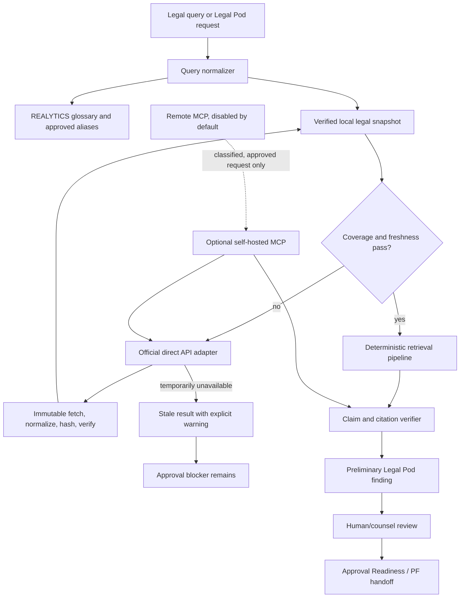

# ADR: Legal Intelligence Core

Status: Accepted — implementation in progress

Decision date: 2026-07-18

Applies to: API server, Legal Pod, Approval Readiness, glossary, PostgreSQL, worker, web

Related documents:

- [`docs/product/legal-pod-roadmap.md`](../product/legal-pod-roadmap.md)
- [`docs/integrations/korean-law-mcp.md`](../integrations/korean-law-mcp.md)
- [`docs/product/term-standard-database-operating-model.md`](../product/term-standard-database-operating-model.md)
- [`docs/product/agent-interaction-operating-model.md`](../product/agent-interaction-operating-model.md)

## 1. Decision summary

REALYTICS will introduce a **Legal Intelligence Core** under the existing Legal
Pod. The core owns legal-source ingestion, versioning, retrieval, citation
verification, provenance, and project linkage. The Legal Pod continues to own
preliminary project review, permit/risk findings, PF handoff, and human review.

The architecture is:

1. Official legal systems are the source providers.
2. PostgreSQL holds a verified, versioned operational snapshot and search
   index. It is a replica/read model, not the original legal authority.
3. The official direct API is the authoritative refresh and gap-fill path.
4. MCP is an optional tool/orchestration transport. MCP is not a source
   authority and is not required for normal operation.
5. Remote MCP is disabled by default and cannot receive confidential project
   data without an explicit data-classification decision.
6. Official text, machine extraction, AI summary, human annotation, and counsel
   opinion are separate content classes.
7. A verified citation does not make an AI conclusion a verified legal opinion.
   Final legal conclusions require the configured human/counsel approval.

This ADR supersedes any earlier implication that `mcp.connected=true` is proof
that legal evidence is complete, or that every legal reference has
`sourceType=korean_law_mcp`.

## 2. Context and problem statement

The current Legal Pod already performs deterministic preliminary checks,
persists project reviews, creates risk issues, and hands readiness information
to PF-Credit. It can also consume a caller-supplied `lawContext` or attempt a
Korean Law MCP/Law.go.kr transport.

That integration is useful for a pilot, but it is not a production legal
knowledge system:

- a transient connection result is mixed with evidence authority;
- a caller can supply a context that has not been server-attested;
- a generic Law.go.kr search cannot model every resource type, version, article,
  precedent, interpretation, or effective date;
- there is no verified local corpus with immutable fetch history;
- source authority, transport, content type, and verification state are not
  first-class independent fields;
- project legal records do not yet follow the normalized tenant/RLS model;
- an MCP outage can unnecessarily remove legal research capability;
- exact legal locators and source hashes are not consistently required before a
  finding can affect an approval gate.

REALYTICS is a real-estate development and PF operating system, not a legal
opinion generator. The system must make legal evidence easier to find, date,
compare, link, and review while remaining fail-closed when authority or
provenance is missing.

## 3. Goals

- Search statutes, regulations, administrative rules, local ordinances,
  precedents, decisions, interpretations, and approved tenant documents without
  making an external MCP a runtime dependency.
- Reproduce which legal source version was used for a project review at a
  specified `asOfDate`.
- Link every material legal claim to an exact source version and locator.
- Preserve immutable source fetches and normalization lineage.
- Reuse the institutional REALYTICS glossary and its human approval workflow.
- Keep global public legal material separate from tenant/project-confidential
  overlays.
- Support deterministic exact/lexical retrieval first, then optional semantic
  recall and relation expansion.
- Keep the existing Legal Pod and PF handoff contract while replacing weak MCP
  connection checks with evidence-completeness checks.
- Allow a self-hosted MCP sidecar for complex research without granting it
  source-authority status.
- Provide measurable freshness, retrieval, citation, isolation, and operational
  acceptance gates.

## 4. Non-goals

- REALYTICS does not issue a final legal opinion.
- The first release does not automatically determine that a precedent is
  overruled, followed, distinguished, or otherwise still controlling.
- The first release does not require OpenSearch, Neo4j, or a separate
  microservice per parser/tool.
- The local database does not become an independent official source merely
  because its records were fetched from an official endpoint.
- AI summaries never overwrite official text.
- A stale last-known-good snapshot never clears an approval blocker by itself.
- Tenant-uploaded contracts and counsel opinions are not added to the global
  public corpus.

## 5. Terminology and normative language

The terms **MUST**, **MUST NOT**, **SHOULD**, and **MAY** are normative.

| Term | Meaning |
|---|---|
| Source authority | The organization or document owner from which the content derives |
| Transport | How REALYTICS obtained or read the content |
| Resource | A statute, regulation, rule, ordinance, precedent, interpretation, decision, notice, or tenant document |
| Resource version | An immutable normalized representation for a legal/effective period and observed source payload |
| Provision | An addressable article, paragraph, item, sub-item, addendum, annex, or form inside a resource version |
| Verified snapshot | A local record whose official identifier, payload hash, schema validation, and source lineage passed verification |
| Freshness policy | Resource-specific policy deciding whether a verified snapshot may answer a query without refresh |
| Legal claim | A proposition produced by a rule, agent, reviewer, or counsel that must cite evidence |
| Citation check | Verification that a citation resolves to the asserted resource version and locator |
| Counsel approval | Human legal approval that is independent from citation verification |

## 6. Authority, transport, content class, and verification

These dimensions MUST remain independent.

### 6.1 `sourceAuthority`

Initial canonical values:

- `LAW_GO_KR`
- `SUPREME_COURT`
- `CONSTITUTIONAL_COURT`
- `CENTRAL_GOVERNMENT`
- `LOCAL_GOVERNMENT`
- `PUBLIC_AGENCY`
- `TENANT_DOCUMENT`
- `COUNSEL_OPINION`
- `UNKNOWN`

`sourceAuthority` identifies origin/ownership, not the HTTP client or MCP tool.
A resource distributed through Law.go.kr MAY retain the more specific authority
when the official metadata supports it.

### 6.2 `transport`

Initial canonical values:

- `LOCAL_VERIFIED_SNAPSHOT`
- `OFFICIAL_DIRECT_API`
- `SELF_HOSTED_MCP`
- `REMOTE_MCP`
- `TENANT_UPLOAD`
- `INTERNAL_WORKER`

The same official source can be observed through different transports.
Transport precedence MUST NOT be interpreted as legal-authority precedence.

### 6.3 `contentClass`

Initial canonical values:

- `OFFICIAL_TEXT`
- `OFFICIAL_METADATA`
- `MACHINE_EXTRACTION`
- `AI_SUMMARY`
- `HUMAN_ANNOTATION`
- `COUNSEL_OPINION`

The UI and API MUST expose this value. Official text and AI summary MUST be
stored in separate records/fields and rendered with different badges.

### 6.4 Verification states

Initial canonical values:

- `UNVERIFIED`
- `SCHEMA_VALID`
- `SOURCE_ATTESTED`
- `CITATION_VERIFIED`
- `HUMAN_REVIEWED`
- `COUNSEL_APPROVED`
- `REJECTED`
- `SUPERSEDED`

Verification is monotonic only within an immutable record. A later correction
creates a superseding record; it does not silently rewrite the audit history.

`CITATION_VERIFIED` means that the cited resource/version/provision exists and
matches the stored locator. It does **not** mean that the legal interpretation
or project conclusion is correct.

## 7. Target architecture



### 7.1 Logical components

1. **Legal Query Normalizer**
   - normalizes legal identifiers, case numbers, article references, spacing,
     Hangul/number forms, and approved aliases;
   - resolves terms through the existing REALYTICS glossary;
   - does not auto-approve newly discovered aliases.

2. **Legal Source Provider Adapters**
   - map source-specific API contracts to an internal fetch result;
   - have separate adapters per official resource family/target;
   - never return a project conclusion.

3. **Legal Corpus Repository**
   - stores immutable fetch metadata, normalized resource versions,
     provisions, citations, and sync checkpoints;
   - exposes only source-attested versions as verified local snapshots.

4. **Legal Retrieval Service**
   - applies deterministic staged retrieval;
   - records query, ranking-policy version, result IDs, freshness, and hashes;
   - returns abstention/partial results when coverage is not sufficient.

5. **Citation Verifier**
   - resolves a claim citation to an immutable resource version and provision;
   - rejects generic home-page URLs and non-addressable locators as complete
     evidence;
   - records verification rules/version.

6. **Legal Intelligence Orchestrator**
   - coordinates local retrieval, official refresh, optional MCP research,
     retry/circuit behavior, and evidence packaging;
   - treats every externally supplied `lawContext` as an untrusted candidate.

7. **Legal Pod**
   - remains the project-facing preliminary review workflow;
   - creates findings, risks, permit checks, evidence requests, review
     decisions, and PF-Credit handoffs;
   - cannot claim final legal approval without a counsel decision.

## 8. Read and refresh path

The canonical read path is:

1. Normalize query and requested `asOfDate`.
2. Resolve exact official identifiers and approved aliases.
3. Query local source-attested versions.
4. Evaluate resource-specific coverage and freshness.
5. If coverage/freshness passes, retrieve from the local snapshot.
6. If missing, incomplete, or stale, call the relevant official direct API
   adapter.
7. Persist the raw fetch immutably, validate schema, normalize, hash, and record
   lineage.
8. Publish a new local version only after source attestation succeeds.
9. Re-run retrieval and citation checks.
10. Return evidence with `asOfDate`, freshness, source authority, transport,
    identifiers, version ID, exact locator, and hashes.

If the official API is temporarily unavailable:

- a verified last-known-good version MAY be displayed as `stale`;
- the system MUST show `lastVerifiedAt`, requested `asOfDate`, and failure
  reason;
- a stale result MUST NOT resolve a new blocker or clear an approval gate;
- retries apply only to idempotent reads and MUST use bounded exponential
  backoff with jitter;
- a circuit breaker prevents repeated saturation and emits an operational
  alert.

Freshness is a versioned policy by resource type and project lifecycle. A
single hard-coded TTL for every legal source is prohibited. Event/checkpoint
sync is preferred when the official source supports it.

## 9. MCP policy

### 9.1 Self-hosted MCP

A self-hosted MCP MAY be used as an optional sidecar for multi-step research,
tool composition, citation checking, or source-specific conveniences.

Before production use it MUST have:

- a pinned commit and lockfile;
- a container image pinned by digest;
- an internally controlled artifact registry;
- an SBOM and dependency/vulnerability scan;
- retained license notices;
- reproducible build and rollback instructions;
- contract tests against the normalized Legal Intelligence interfaces;
- outbound network allowlists;
- request/response size limits and timeouts;
- prompt-injection and untrusted-output handling.

Forking is required only when REALYTICS must maintain changes that cannot be
supplied upstream or safely wrapped. Pinning and internal artifact control are
required even without a fork.

### 9.2 Remote MCP

Remote MCP is `disabled` by default in every production profile.

It MUST NOT receive:

- tenant-uploaded contracts or counsel opinions;
- project addresses/PNU lists unless explicitly classified and approved;
- borrower/sponsor/participant identities;
- financing terms, covenant details, or proprietary feasibility data;
- secrets, access tokens, raw audit logs, or unrestricted source payloads.

Enabling a remote MCP requires an approved data-flow record, purpose, fields,
retention policy, provider agreement, egress allowlist, and audit event. Remote
MCP output remains untrusted until official source attestation succeeds.

### 9.3 MCP availability

The following scenario MUST pass:

> Disable every MCP endpoint, keep the official direct API and local snapshot
> available, then run legal search, citation verification, Legal Pod review, and
> Approval Readiness without functional loss other than MCP-specific optional
> research.

MCP connection status MUST NOT be used as an approval criterion.

## 10. Persistence model

The database is divided into a global official corpus and tenant/project
overlay. They MUST NOT be combined by making `tenant_id` nullable in a single
table.

### 10.1 Global official corpus

Only the source-sync role may write these records. Application runtime roles
have read-only access to published, source-attested versions.

| Table | Purpose |
|---|---|
| `legal_source_providers` | Provider configuration identity and adapter contract version |
| `legal_resources` | Stable identity for a statute, rule, ordinance, precedent, interpretation, or decision |
| `legal_resource_identifiers` | Official IDs, case numbers, names, aliases, issuing authority |
| `legal_resource_versions` | Immutable normalized versions and legal/system time |
| `legal_provisions` | Article/paragraph/item/addendum/annex addressable nodes |
| `legal_source_fetches` | Immutable raw-object pointer, request metadata, payload hash, schema status |
| `legal_citations` | Source-to-source citation edges with exact locators |
| `legal_relation_assertions` | Versioned, evidence-backed relation candidates |
| `legal_sync_runs` | Run status, counts, adapter/rules version, checksum |
| `legal_sync_checkpoints` | Resumable provider/resource checkpoints |

Raw source payloads SHOULD be stored as immutable objects. The database stores
the object key/version, SHA-256, byte size, content type, source endpoint
identity, adapter/schema version, and retention metadata. Large mutable raw
JSON duplicated across normalized rows is prohibited.

### 10.2 Tenant/project overlay

All overlay tables MUST include `tenant_id`. Project-scoped rows MUST have a
composite foreign key to `(project_id, tenant_id)`.

| Table | Purpose |
|---|---|
| `project_legal_matters` | Project/matter scope and lifecycle |
| `project_legal_resource_links` | Project link to exact global resource version/provision |
| `legal_query_runs` | Tenant query, normalized form, policy version, results, hashes |
| `legal_findings` | Preliminary deterministic/AI/human findings |
| `legal_evidence_snapshots` | Sealed evidence set used by a finding or gate |
| `legal_review_decisions` | Append-only approve/waive/needs-revision/reject decisions |
| `legal_waivers` | Time-bounded authorized exception with reason and evidence |
| `counsel_opinions` | Tenant document metadata and approval, never globalized |
| `project_legal_annotations` | Project-specific notes and classifications |

Sensitive tenant document bodies use the project document/object-storage
controls. The legal corpus may store a tenant-document reference and hash, but
must not copy it into the public corpus.

### 10.3 Bitemporal and version fields

`legal_resource_versions` MUST distinguish at least:

- `promulgated_at` or official publication date, where applicable;
- `valid_from` and `valid_to` for legal/effective time;
- `announced_effective_at` for a known future effective date;
- `observed_at` for the first system observation;
- `retrieved_at` for the concrete source fetch;
- `verified_at` for source attestation;
- `supersedes_version_id`;
- `source_payload_sha256`;
- `normalization_schema_version`;
- `normalization_rules_version`.

Corrections create a superseding version. They do not update a prior immutable
source version in place.

For a query with `asOfDate`, legal validity is evaluated against legal time,
while reproducibility/audit uses observed/retrieved system time. Both are
returned to the caller.

### 10.4 Relation assertions and precedent treatment

`OVERRULES`, `FOLLOWS`, `DISTINGUISHES`, `LIMITS`, and similar relations MUST
be stored as assertions, not unquestioned scalar truth.

Each assertion contains:

- source and target resource/version IDs;
- assertion type;
- exact supporting locator/excerpt hash;
- source authority and transport;
- algorithm/rule/model version;
- confidence;
- `asOfDate`;
- `humanReviewStatus`;
- reviewer and review time;
- superseding assertion ID.

The default subsequent-treatment status is `UNKNOWN`. Machine-inferred
treatment may prioritize research but cannot independently clear an approval
gate.

## 11. Glossary integration

The Legal Intelligence Core reuses the existing REALYTICS controlled
vocabulary:

- `glossary_terms` remains canonical identity;
- approved aliases remain the exact alias resolution layer;
- discovered unknown terms enter `glossary_term_candidates`;
- merge/new-term/free-text/reject remains a human decision;
- tenant aliases do not silently become global aliases.

Legal-specific information is added through extension tables rather than a
second competing term registry:

- `legal_term_definitions`
- `legal_term_source_links`
- `legal_term_provision_links`
- `legal_term_relations`
- `tenant_legal_term_aliases`

A definition is versioned and linked to its defining source/provision. An
official definition, industry/PF definition, user-friendly explanation, and
tenant usage are distinct definition types. Discovery never implies approval.

## 12. Retrieval and ranking policy

Search is a staged, lexicographic pipeline. Exact identifiers cannot be
demoted by a vector score.

1. **Identifier stage**
   - official law/resource ID;
   - case number;
   - canonical article/paragraph/item locator;
   - exact official name plus requested date.

2. **Approved alias stage**
   - canonical glossary term;
   - approved official/practical/user alias;
   - normalized Hangul/number/spacing form.

3. **Lexical stage**
   - PostgreSQL full-text search;
   - resource title/provision heading/body fields;
   - version/as-of filters applied before presentation.

4. **Similarity stage**
   - `pg_trgm` for typo, spacing, and close-form recovery;
   - it must not replace exact case-number or article matching.

5. **Semantic recall stage**
   - optional pgvector candidate expansion;
   - enabled only after golden-corpus evaluation;
   - source authority, version, and validity filters remain deterministic.

6. **Relation expansion**
   - explicit citations and approved/qualified relation assertions;
   - unreviewed inferred edges are visibly marked.

Each result includes:

- `retrievalStage`;
- `rankingPolicyVersion`;
- normalized query and `asOfDate`;
- resource/version/provision identifiers;
- source authority and transport;
- verification/freshness states;
- exact locator and source URL, when available;
- source and normalized-content hashes;
- reason/explanation for the match.

Raw scores from different stages MUST NOT be added without calibrated
normalization. Search evaluation determines weights inside a stage. Exact
identifier precedence is a contract, not an adjustable weight.

OpenSearch/Nori is deferred until PostgreSQL measurements show a documented
limit in corpus size, query latency, morphology/recall, or operational
requirements. A separate ADR is required before adoption. Neo4j or another
graph database likewise requires demonstrated query/scale need; initial
relations remain in PostgreSQL.

## 13. API and event contracts

### 13.1 Canonical query input

```json
{
  "tenantId": "tenant-id",
  "projectId": "optional-project-id",
  "query": "건축법 제11조",
  "asOfDate": "2026-07-18",
  "resourceTypes": ["STATUTE", "PRECEDENT", "INTERPRETATION"],
  "jurisdiction": "KR",
  "purpose": "PRELIMINARY_PROJECT_REVIEW"
}
```

`tenantId` is derived from authenticated runtime context, not trusted from a
caller body. Project access is authorized before retrieval history or tenant
overlays are read.

### 13.2 Canonical legal reference

```json
{
  "resourceId": "stable-resource-id",
  "resourceVersionId": "immutable-version-id",
  "provisionId": "optional-provision-id",
  "resourceType": "STATUTE",
  "sourceAuthority": "LAW_GO_KR",
  "transport": "LOCAL_VERIFIED_SNAPSHOT",
  "contentClass": "OFFICIAL_TEXT",
  "verificationStatus": "CITATION_VERIFIED",
  "freshnessStatus": "CURRENT",
  "officialIdentifiers": {},
  "citation": "건축법 제11조",
  "asOfDate": "2026-07-18",
  "validFrom": "2026-01-01",
  "validTo": null,
  "observedAt": "2026-07-18T01:00:00Z",
  "verifiedAt": "2026-07-18T01:00:02Z",
  "sourceUrl": "exact-official-resource-url",
  "locator": {},
  "sourcePayloadSha256": "sha256",
  "normalizedContentSha256": "sha256"
}
```

### 13.3 Untrusted legacy context

`realytics-law-context-v1` remains temporarily accepted for compatibility, but
it is ingested as `UNTRUSTED_CANDIDATE`. Caller-provided fields such as
`connected`, `verified`, and `citationVerification.status` are informational
only.

The server MUST:

1. strip or ignore caller authority assertions;
2. resolve official identifiers;
3. fetch or locate an official source-attested version;
4. re-run citation verification;
5. record candidate-to-verified lineage;
6. reject or abstain when verification cannot complete.

### 13.4 Execution and approval status

Legal sync/query/review execution status and approval status are separate:

- execution: `pending`, `running`, `completed`, `failed`, `cancelled`;
- approval: `not_requested`, `in_review`, `approved`, `needs_revision`,
  `rejected`, `waived`.

`completed` execution does not imply legal approval.

## 14. Evidence and Approval Readiness

Every material Legal Pod claim MUST be backed by a sealed evidence snapshot.
An evidence snapshot contains exact resource version/provision links, source
hashes, freshness state, validation results, and snapshot hash.

The following are not sufficient evidence:

- `mcp.connected=true`;
- a generic Law.go.kr home-page URL;
- a Legal Pod review record citing itself;
- an AI-generated article number or effective date;
- a source title without version/provision identity;
- caller-supplied `verified=true`;
- a stale snapshot without an approved policy and required review.

A legal approval gate may pass only when:

- required claim categories are complete;
- every blocking claim has exact verified evidence;
- requested `asOfDate` is covered;
- no required source is stale beyond policy;
- no unresolved citation mismatch or source conflict remains;
- required tenant documents are present and approved;
- required counsel/human review is approved;
- all waivers are authorized, scoped, time-bounded, and auditable.

Fallback assumptions remain `analysisOnly=true` and
`reportEligible=false`. A citation verification pass cannot promote an AI
conclusion to counsel approval.

## 15. Security, RBAC, and RLS

### 15.1 Roles

Minimum production roles:

- `legal_sync`: write immutable fetch/sync records and publish verified global
  versions;
- `legal_runtime`: read published global corpus, read/write authorized tenant
  overlays;
- `legal_reviewer`: append review decisions within authorized projects;
- `legal_counsel_approver`: append counsel approval/rejection;
- `legal_admin`: manage provider/freshness/ranking policies with audit;
- migration owner: schema changes only, never used by application runtime.

No application runtime role may own tables or bypass tenant RLS.

### 15.2 RLS

- Every tenant overlay table has RLS enabled and forced.
- Policies use the authenticated tenant session context and fail closed when it
  is missing.
- Project rows use composite `(project_id, tenant_id)` foreign keys.
- Tenant A cannot observe Tenant B query text, annotations, documents,
  evidence, decisions, or identifiers through joins, errors, counts, search
  facets, or timing-sensitive endpoints.
- Global corpus reads expose only published/source-attested versions.

### 15.3 Threat controls

| Threat | Required control |
|---|---|
| Caller fabricates `lawContext` | Treat as candidate; server re-attests source |
| Prompt injection in legal text/MCP response | Treat source as data; schema validate; no tool instructions from content |
| Secret leakage in URL/error/audit | Central redaction; no raw credential-bearing URL logging |
| SSRF/host substitution | Fixed provider allowlist, TLS validation, bounded redirects |
| Cross-tenant search leakage | Forced RLS, authorized joins, negative tests |
| MCP exfiltration | Remote disabled, field-level data policy, egress allowlist |
| Source schema drift | Quarantine fetch; adapter contract alarm; do not publish |
| AI overwrites official source | Separate content class/table and immutable official version |
| Stale legal data clears a gate | Freshness-aware fail-closed gate |
| Duplicate/replayed source payload | Idempotency and payload hash uniqueness |

Official APIs that require credentials in a query parameter MUST have the full
request URL redacted from application logs, exception messages, traces, and
audit payloads. Secrets are stored in the production secret manager and are
never committed.

## 16. Observability and audit

Required metrics:

- query volume and latency by retrieval stage;
- exact-match success and abstention rate;
- local snapshot hit rate;
- freshness pass/fail by resource type;
- official adapter success, timeout, rate-limit, and schema-drift rates;
- sync lag and checkpoint age;
- citation pass/mismatch/unresolvable counts;
- stale last-known-good usage;
- MCP optional-tool availability and failure, separately from source health;
- RLS denial and authorization failure counts;
- human/counsel review turnaround;
- approval blockers by evidence cause.

Every query/sync/review event records:

- actor/service identity and tenant/project context;
- request ID, trace ID, idempotency key;
- policy, adapter, schema, ranking, rule, prompt/model versions where relevant;
- input/output hashes without exposing secrets or unauthorized document bodies;
- source authority, transport, resource/version identifiers;
- execution and approval status;
- created/occurred/observed/verified timestamps.

## 17. Implementation phases

### 17.0 구현 현황 — 2026-07-18

이 표는 “코드가 존재함”과 “운영 환경에서 검증됨”을 구분한다. 아래의
운영 미완료 항목이 남아 있으므로 이 ADR의 전체 상태는 여전히
`implementation in progress`이며 production-ready로 판정하지 않는다.

| 영역 | 현재 판정 | 구현·검증 근거 |
|---|---|---|
| 권위/전송/검증 계약 | 코드 완료 | source authority, transport, trust, freshness, data classification을 독립 모델로 분리했다. Direct API 목록과 MCP·caller 결과는 candidate이며 로컬 검증 스냅샷·human-reviewed 근거만 authoritative evidence가 된다. |
| 기밀정보 egress | 코드 완료 | `PROJECT_CONFIDENTIAL`·`LEGALLY_PRIVILEGED` 질의는 공식 외부 API와 remote MCP 호출을 0회로 차단하고 진단을 남긴다. 프로젝트 주소·PNU는 법령 일반질의에 포함하지 않는다. 전역 법령검색만 `PUBLIC`으로 명시한다. |
| 공식 corpus 저장 계약 | 코드 완료 / live 미검증 | 2xx 응답, 원문 SHA, 공식 authority/identifier, parser schema, transport별 verification basis와 verifier를 확인한 뒤에만 게시한다. provider/scope checkpoint CAS, append-only fenced lease, 다중 record/page 원자 commit, replay, terminal page coordinator를 구현했다. 완료 시 checkpoint 연속성·페이지 hash·fetch/run·version manifest를 Python과 PostgreSQL deferred trigger가 재검증한 `legal_corpus_scope_completion_attestations`만 생성한다. |
| 원본 object storage | 코드 완료 / live 미검증 | 전용 S3/MinIO adapter가 versioning과 Object Lock을 먼저 확인하고, content-addressed key·`If-None-Match`·SHA-256 checksum·version ID·보존기한을 검증한다. inventory cursor, delete-marker 거부, orphan 보존 및 append-only reconciliation worker를 구현했으며 삭제 API는 의도적으로 없다. 실제 bucket/IAM과 복구 훈련은 남아 있다. |
| PostgreSQL schema/RLS | 정적 구현 완료 / live 미검증 | global corpus와 tenant overlay, forced RLS, runtime privilege/readiness, append-only 및 승인용 deferred constraint trigger를 구현했다. 실제 PostgreSQL/PostGIS에 migration을 적용한 cross-tenant·pooling·다중 worker 시험은 남아 있다. |
| resource identity·유효시점 계보 | 코드 완료 / live 미검증 | 공식 resource identity를 provider revision과 분리하고 provider별 식별자는 crosswalk로 보존한다. predecessor, overlap, undocumented gap, same-window source correction을 fail-closed 검증하고 open-ended predecessor의 파생 종료일을 append-only lineage로 남긴다. runtime 검색·상세·증거 조회는 실제 version provider revision과 최신 source correction을 사용한다. |
| 로컬 검색 | 코드 완료 / live corpus 미적재 | exact identifier/name/approved alias → PostgreSQL FTS/`pg_trgm` 순위를 적용하고 exact provision 본문·hash·locator를 함께 반환한다. 모든 최신 active 공식 provider에 대해 DB가 검증한 full-corpus completion attestation이 있어야 coverage가 complete다. freshness는 attestation 작성 시간이 아니라 terminal checkpoint 게시 시각으로 계산한다. |
| 동기화 권한 경계 | 코드 완료 / live 미검증 | `REALYTICS_LEGAL_SYNC_DATABASE_URL`이 없으면 runtime/migration DSN으로 폴백하지 않는다. `realytics_legal_sync`는 허용 테이블의 `SELECT, INSERT`만 가지며 `UPDATE`, `DELETE`, DDL, schema `CREATE`, superuser, inheritance, `BYPASSRLS`를 금지한다. |
| Citation snapshot | 코드 완료 | exact provision ID, fetch/version lineage, normalized hash, verified time, locator, 공식 조문 본문과 excerpt의 일치, DB에서 파생한 freshness/open issue, citation coverage와 required-claim coverage를 원자적으로 봉인한다. 일부 근거만 봉인해 수를 부풀리는 snapshot은 gate-eligible이 될 수 없다. |
| 승인 결정 무결성 | 코드 완료 | 별도 `legal:review` 권한과 법무 역할을 사용한다. `approve`는 같은 tenant/project/review의 gate-eligible snapshot ID/version/hash를 Python repository와 PostgreSQL deferred trigger가 재검증한 뒤 append-only decision으로 저장한다. 일반 reviewer와 spoofed principal은 차단된다. |
| Legal Pod·Permit Gate | 코드 완료 | caller `lawContext`는 candidate로만 취급한다. 법률 상태, exact verified citation, 전체 쟁점 coverage, non-stale/non-conflict snapshot, 법무 human approval을 독립 gate로 검사한다. Permit gate는 승인된 parser output과 정확한 원문 locator가 없거나 parser가 unavailable이면 fail-closed다. |
| Web review surface | 코드 완료 | 공식 원문/AI 요약/human opinion을 구분하고 source·transport·freshness badge를 표시한다. Chief Deal Room에서 인용 수, 필수 쟁점 coverage, snapshot, 최신성, conflict, human decision을 확인하고 승인·수정요청·거절·조건부 waive를 수행한다. |
| 자동 회귀 | 구현 및 로컬 통과 | authority/egress/provider/schema drift/corpus sync/lease/checkpoint/completion/identity/effective-time/raw reconciliation/migration/RLS/search/snapshot/decision/Legal Pod/Approval Gate 계약을 자동 검증한다. 2026-07-18 최종 수치는 아래 검증 기록을 따른다. |
| Golden corpus·법무 기준 | 미완료 | 실제 법령·판례·해석·인허가/PF 질문 corpus, locator/version 정확도, 적절한 abstention, counsel-approved precision/recall 기준이 필요하다. |
| 운영·재해복구 | 미완료 | 실제 provider 자격증명, secret manager, initial/backfill sync, DLQ·모니터링·알람, backup/restore, schema-drift replay, outage/rollback 훈련이 필요하다. |

이번 구현의 fail-closed 원칙은 다음과 같다.

1. 외부에서 받은 법률 텍스트나 MCP 결과는 자동으로 권위 근거가 되지 않는다.
2. 프로젝트 기밀 질의는 외부 provider로 전송하지 않는다.
3. 정확한 조문·버전·fetch 계보·원문 excerpt가 없으면 snapshot을 승인 근거로
   승격하지 않는다.
4. 검색된 인용 일부만으로 필수 법률 쟁점 전체를 충족한 것처럼 표시하지 않는다.
5. citation 검증과 법무 human/counsel 승인은 서로 대체할 수 없다.
6. 실제 DB·object store·provider·복구 훈련이 끝나기 전에는
   production-ready로 표시하지 않는다.

#### 17.0.1 구현 후에도 남은 구조적 작업

구조적 코드 잔여와 운영 검증을 구분해 관리한다.

1. Law.go.kr의 각 resource family별 실제 initial/backfill page source는
   운영 OC, 공식 응답 fixture, 이용조건, 호출량 기준으로 release해야 한다.
   범용 search-list candidate를 곧바로 검증 corpus로 승격해서는 안 된다.
2. DLQ·provider별 rate limit·metrics/alert exporter와 scheduler 배포는 실제
   worker 플랫폼에 연결해야 한다. checkpoint/lease/reconciliation 저장
   계약과 운영 runbook은 준비되어 있다.
3. 실제 PostgreSQL/PostGIS/Supabase에 migration과 세 역할을 적용하고,
   cross-tenant RLS, session pooling, stale checkpoint 경합, lease fencing,
   다중 worker crash/retry를 검증해야 한다.
4. 실제 S3/MinIO bucket에서 versioning, Object Lock, IAM, inventory,
   backup/restore와 orphan 보존 훈련을 수행해야 한다.
5. 실제 법령·판례·해석·인허가/PF golden corpus와 법무 승인 threshold를
   확정해야 한다. semantic/OpenSearch 확대는 이 측정 이후 별도 ADR로 한다.

운영 절차와 증거 양식은
[`docs/engineering/legal-corpus-operations.md`](../engineering/legal-corpus-operations.md)
를 따른다.

#### 17.0.2 로컬 검증 기록 — 2026-07-18

검증은 테스트 간 공유 SQLite 경합을 피하기 위해 파일군별 고유
`REALYTICS_SQLITE_FILE`과 `--basetemp`를 사용해 순차 또는 격리 실행했다.
공유 SQLite를 사용한 최초 오케스트레이션 실행의 timeout은 격리 재실행에서
재현되지 않았으며, 해당 23건은 모두 통과했다.

| 검증 | 결과 | 비고 |
|---|---|---|
| API 전체 수집 | 1,465 tests | `pytest tests --collect-only` |
| API 전체 분할 회귀 | 1,450 passed, 15 skipped, 0 failed | A–F 416 passed, G–O 453 passed + 최종 search-path 사례 2 passed, P–Z 578 passed + 수정된 wrapper 1 passed; 14건은 Parser V2 PostgreSQL live, 1건은 typed PostgreSQL integration이며 모두 `REALYTICS_TEST_DATABASE_URL` 미설정으로 skip |
| 최종 Legal Intelligence 집중 회귀 | 278 passed | 20개 legal/role/migration 파일의 corpus sync, authority/egress, runtime, router, migration, runtime privilege 계약 |
| Web type 검사 | 통과 | `next typegen && tsc --noEmit` |
| Web lint | 통과 | ESLint, warning 0 |
| Web production build | 통과 | Next.js optimized production build 및 25개 static page 생성 |
| Supabase migration wrapper | current | 저장소 가상환경 Python으로 `render_supabase_migrations.py --check` 실행 |

이 기록은 로컬 코드·계약 회귀의 증거다. 실제 Supabase/PostgreSQL에
`0008_legal_intelligence_core.sql`을 적용한 결과, runtime role/RLS,
connection pooling, 다중 worker, 공식 provider 자격증명, S3/MinIO
Object Lock, backup/restore 및 장애 복구 훈련의 증거를 대신하지 않는다.

### Phase 0 — Authority and security contract

- Create this ADR and reconcile existing MCP/Legal Pod documentation.
- Add canonical enums for authority, transport, content class, verification,
  freshness, execution, and approval.
- Separate provider adapters from MCP tool adapters.
- Mark caller-supplied `lawContext` as untrusted candidate input.
- Remove `mcp.connected` from Approval Readiness evidence logic.
- Require exact evidence completeness for legal gates.
- Enforce RBAC on legacy and canonical Legal Pod routes.
- Add secret/URL redaction and outbound provider allowlist.
- Define feature flags and compatibility mapping.

Exit gate:

- fabricated caller context cannot clear a gate;
- no unauthenticated/permissive legal mutation path remains;
- direct API and MCP results expose independent authority/transport fields;
- secret-redaction regression tests pass.

### Phase 1 — Verified corpus and official adapters

- Add global corpus and tenant overlay migrations.
- Add immutable raw fetch/object hashing.
- Implement provider-specific official adapters for required resource families.
- Add sync run/checkpoint/retry/circuit behavior.
- Implement bitemporal version publishing and supersession.
- Implement exact identifier/name/article/case-number retrieval.
- Extend the existing glossary instead of duplicating it.
- Provision least-privilege PostgreSQL roles and forced RLS.

Exit gate:

- same official payload is idempotent and hash-reproducible;
- a changed payload produces a new version, not an in-place rewrite;
- past/current/future-effective versions resolve correctly by date;
- official adapter fixture/contract tests pass;
- live PostgreSQL cross-tenant/RLS tests pass.

### Phase 2 — Retrieval, citation, viewer, and Legal Pod integration

- Add PostgreSQL FTS and `pg_trgm`.
- Build a representative legal/PF golden query corpus.
- Implement staged ranking and evaluation reports.
- Implement citation verifier and sealed evidence snapshots.
- Add statute/precedent/interpretation viewer with source/version badges.
- Show official text, AI summary, and counsel opinion separately.
- Replace legacy Legal Pod/MCP reference persistence with normalized links.
- Convert Approval Readiness to evidence/freshness/human-review checks.
- Add optional pgvector recall only after baseline measurement.

Exit gate:

- exact identifiers always rank first;
- every report-eligible claim has an exact verified locator;
- weak/unresolved/stale evidence fails closed;
- viewer reproduces the review's exact source version;
- golden-corpus precision/recall/abstention thresholds are approved.

### Phase 3 — Optional self-hosted MCP and operational hardening

- Package a pinned self-hosted MCP sidecar.
- Add SBOM, internal registry, license, scanning, and contract tests.
- Add field-level data classification and egress enforcement.
- Add provider/MCP outage, failover, and disaster-recovery drills.
- Add human-review workflow and counsel approval UI.

Exit gate:

- complete legal workflow passes while all MCP endpoints are disabled;
- MCP response cannot assert source authority without attestation;
- remote MCP remains disabled in production defaults;
- outage and rollback drills satisfy the runbook.

### Phase 4 — Measured scale expansion

- Evaluate OpenSearch/Nori only if PostgreSQL has a documented limit.
- Develop human-reviewed precedent-treatment/citator assertions.
- Add relation expansion and impact analysis.
- Evaluate a graph database only if PostgreSQL relation queries show a measured
  operational or performance need.

Exit gate:

- a separate benchmark and ADR justify every new infrastructure component;
- relation assertions expose evidence, date, confidence, and review state;
- no inferred precedent treatment is rendered as authoritative fact.

## 18. Test strategy and acceptance gates

### 18.1 Unit and contract tests

- source authority and transport cannot be conflated;
- provider target/resource mappings;
- schema validation and quarantine;
- identifier/article/case-number normalization;
- source and normalized-content hashes;
- bitemporal/as-of resolution;
- glossary candidate/approval behavior;
- staged search precedence;
- citation exact-locator verification;
- stale/freshness policy;
- secret redaction.

### 18.2 Integration tests

- local snapshot hit;
- missing/stale local snapshot followed by official refresh;
- official timeout and last-known-good behavior;
- official schema drift quarantine;
- sync replay/idempotency/checkpoint resume;
- MCP available/unavailable equivalence for core workflow;
- caller-supplied fake context rejection;
- Legal Pod evidence snapshot and PF handoff;
- Approval Readiness fail-closed behavior;
- immutable object hash and database lineage.

### 18.3 Live PostgreSQL tests

- global corpus write denied to runtime role;
- published global corpus readable to runtime role;
- overlay CRUD limited to the active tenant/project;
- cross-tenant joins, counts, search, and error paths reveal nothing;
- missing tenant context fails closed;
- migration owner and runtime roles are distinct;
- RLS remains effective under application connection pooling.

### 18.4 Retrieval golden corpus

The corpus includes at least:

- exact law IDs and official names;
- article/paragraph/item forms;
- Korean case-number variants;
- abbreviations, approved aliases, spacing, and common typos;
- effective-date and historical-version questions;
- real-estate development, zoning, permit, trust/security, PF covenant, sale,
  construction, and tenancy questions;
- adversarial ambiguous questions requiring abstention;
- citations that deliberately reference a wrong article/version;
- superseded and future-effective sources.

Measure:

- exact identifier accuracy;
- top-k lexical/semantic recall;
- locator accuracy;
- version/as-of accuracy;
- citation mismatch detection;
- appropriate abstention;
- freshness correctness;
- cross-tenant isolation.

Thresholds are versioned and approved before a retrieval policy is promoted.
The local-hit percentage is an observed KPI, not a promised fixed value.

## 19. Operational runbook requirements

Before production, the runbook MUST cover:

### 19.1 Official provider outage

- confirm circuit state and last successful checkpoint;
- expose last-known-good age and source-specific status;
- stop gate-clearing operations that require fresh evidence;
- continue permitted read-only stale display;
- retry with bounded backoff;
- notify operators and record recovery.

### 19.2 Source schema drift

- quarantine incompatible payloads;
- preserve raw object/hash;
- do not publish a normalized version;
- alert with adapter/schema versions and affected resource family;
- update fixture/contract tests;
- replay quarantined fetches after adapter release.

### 19.3 Sync backlog or partial run

- resume from durable checkpoint;
- verify idempotency and payload hashes;
- report per-resource success/failure rather than one misleading success;
- reconcile additions, changes, removals, and future-effective records;
- seal and audit the completed run.

### 19.4 Secret exposure or rotation

- revoke/rotate in the secret manager;
- purge or restrict affected logs/traces according to incident policy;
- verify URL/error redaction;
- restart only the dependent provider workers;
- run credential-negative and recovery smoke tests.

### 19.5 Tenant isolation incident

- disable affected endpoints/roles;
- preserve audit evidence;
- identify connection/session-context scope;
- rotate credentials if necessary;
- run full cross-tenant RLS regression before restoration.

### 19.6 MCP outage or compromise

- disable MCP feature flag and egress immediately;
- keep local/direct-official workflows running;
- quarantine unverified MCP outputs;
- compare pinned image/SBOM and audit calls;
- restore only after contract/security verification.

### 19.7 Search/index degradation

- fall back to exact/lexical retrieval;
- disable semantic or relation expansion independently;
- rebuild optional indexes without changing source records;
- compare golden-corpus results before promotion.

### 19.8 Rollback

- rollback application/provider adapters independently;
- do not delete immutable source fetches or audit events;
- unpublish a faulty normalized version by a superseding status/event;
- retain database migration forward-repair instructions;
- verify Legal Pod and gate behavior after rollback.

## 20. Migration and compatibility

- Existing `legal_reviews` and `permit_reviews` remain readable during
  transition.
- New Legal Pod runs dual-write normalized references/evidence links behind a
  feature flag, then switch reads after parity tests.
- Existing `mcp` fields remain a compatibility projection only. They are not
  authoritative storage.
- Existing `realytics-law-context-v1` requests remain accepted as candidates
  during a defined deprecation window.
- Backfill creates links only where official identifiers and source hashes can
  be verified. Unverifiable legacy references remain visibly unverified.
- Data migration never upgrades a legacy `connected` or `verified` boolean into
  source attestation without re-verification.
- Approval Readiness switches only after dual-run results and blocker
  differences are reviewed.

## 21. Consequences

### Positive

- Legal research remains available without an MCP.
- Source authority and operational transport become auditable.
- Project decisions can reproduce the exact legal version and basis.
- Tenant data remains separated from the public legal corpus.
- The existing glossary and review workflows are reused.
- Search infrastructure grows only when measurements justify it.
- AI and tooling can assist research without masquerading as legal authority.

### Costs and trade-offs

- Source-specific adapters and versioning are more work than a single generic
  search call.
- Immutable fetches and bitemporal records require storage/retention planning.
- Fail-closed freshness and citation rules may surface more blockers during
  rollout.
- A useful golden corpus and counsel-reviewed acceptance thresholds require
  domain-expert time.
- Dual-write/backfill is required to preserve existing Legal Pod behavior.

These costs are accepted because legal evidence affects development
feasibility, permit risk, PF conditions precedent, approval gates, and final
reports.

## 22. Official and primary references

- Korean Ministry of Government Legislation, OPEN API list:
  <https://open.law.go.kr/LSO/openApi/guideList.do>
- Korean Ministry of Government Legislation, OPEN API usage guidance:
  <https://open.law.go.kr/LSO/information/guide.do>
- Korean Ministry of Government Legislation, precedent list API:
  <https://open.law.go.kr/LSO/openApi/guideResult.do?htmlName=precListGuide>
- Korean Ministry of Government Legislation, precedent detail API:
  <https://open.law.go.kr/LSO/openApi/guideResult.do?htmlName=precInfoGuide>
- PostgreSQL `pg_trgm`:
  <https://www.postgresql.org/docs/current/pgtrgm.html>
- pgvector:
  <https://github.com/pgvector/pgvector>
- Elasticsearch Nori analysis plugin:
  <https://www.elastic.co/docs/reference/elasticsearch/plugins/analysis-nori>
- Korean Law MCP upstream:
  <https://github.com/chrisryugj/korean-law-mcp>

Official provider terms, approval scope, attribution requirements, rate limits,
and endpoint contracts MUST be rechecked when an adapter version is released.

## 23. Definition of done

The Legal Intelligence Core is production-ready only when all of the following
are true:

- MCP can be fully disabled without breaking core legal retrieval or Legal Pod
  execution.
- Caller-supplied context cannot claim authoritative status or clear a gate.
- Every report-eligible material legal claim has an exact official
  resource/version/provision locator and source hash.
- Historical, current, and future-effective sources resolve correctly for the
  requested date.
- Stale, unverified, inferred, AI-generated, and counsel-approved states are
  visibly distinct.
- Official source text cannot be overwritten by AI or reviewer content.
- Global source corpus and tenant overlays satisfy live least-privilege/RLS
  tests.
- Exact legal identifiers always outrank fuzzy and semantic candidates.
- Open citation conflicts and unsupported precedent-treatment assertions block
  authoritative presentation.
- Official adapter contract, sync replay, outage, schema-drift, secret
  redaction, and recovery tests pass.
- Approval Readiness evaluates evidence completeness, freshness, and required
  human approval rather than MCP connectivity.
- Operational monitoring, alerting, backup/restore, and incident runbooks have
  been exercised in a live-like environment.
