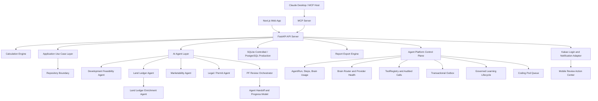

# 2026-09-28 문서 통합 이전 기록

아래는 통합 전 문서의 보존본이다. 당시 기능·검증·미완료 상태가 함께 있으므로 현재 구현 판정이나 실행 순서로 사용하지 않는다. 현재 기준은 [구현 현황](../product/current-implementation-status.md)과 [제품 실행 계획](../product/realytics-os-next-work-roadmap.md)이다. 로컬 링크만 새 위치에 맞게 조정했다.


---

## 원래 문서: `README.md`

# REALYTICS x PLATFORM9

AI-driven Real Estate Operating System for Korean real estate development, project feasibility, and professional PF review.

REALYTICS x PLATFORM9 is an alpha-stage monorepo for building AI agents that help real estate developers, lenders, and reviewers parse project documents, calculate feasibility, validate land acquisition, assess marketability, structure PF loans, review legal/permit risk, and generate a Hana-style 20-section PF review report.

## Current Development Snapshot

Updated: 2026-07-15

The repository currently includes:

- Next.js web application for project dashboards, pilot input package upload, land review, risk review, orchestration, report viewing, finance, feasibility, and cash-flow screens.
- FastAPI backend for project CRUD, calculations, agents, orchestration, reports, uploads, and exports.
- Application use-case layer for reusable API, MCP, batch job, and future UI-triggered workflows, including project management, source documents, feasibility, cash flow, PF review, land ledger, marketability, legal review, report, and evidence review flows.
- Repository wrapper layer for project CRUD, source document metadata, upload archives, report, market evidence, and orchestration persistence boundaries.
- SQLite-backed controlled local persistence plus typed PostgreSQL tables for durable Agent runs, steps, Brain usage, outbox events, CalculationRun, handoff, and Deal State records. The legacy `app_state` compatibility document remains during migration.
- MCP server integration for Claude Desktop or other MCP hosts.
- AI connection layer for OpenAI API, Anthropic API, and Claude Desktop host-LLM mode.
- Phase 11 Hana-style PF review report with 20 sections.
- Land Ledger Import Agent with validation lifecycle, PF summary, and batch enrichment handoff for PNU, cadastral characteristics, official land price, and registry evidence.
- Marketability Analysis Agent v2 baseline with document evidence reconciliation, product mix normalization, comparable pricing, Exit sale rate, absorption, discount trigger, and risk flags.
- Baseline Cash Flow Engine run from Development Feasibility Agent through FeasibilityStudyV2 and CashFlowRunRequest.
- Calculation Scenario Engine for waterfall repayment allocation, unsold LTV matrix, tranche recovery, risk flags, and report fragments.
- Korean Law MCP sidecar integration design and legal-review adapter.
- Agent-to-Agent handoff envelopes, progress tracking, human review status, and final approval gating for PF review orchestration.
- Structured report export pipeline with Markdown, JSON, print-ready HTML, PDF, and DOCX artifacts.
- Project-level real pilot input package UI for archiving business plans, land ledgers, feasibility workbooks, land evidence JSON, and approved data-quality overrides before PF review runs.
- Kakao Login and KakaoTalk notification baseline with mobile file intake, mobile review action center, Kakao OAuth callback, REALYTICS session handoff, safe message preview, and audit logging.
- Agent Platform control plane with typed Agent/Brain/Tool contracts, six-Pod durable execution, child Domain Agent runs, deadline/budget/lease controls, transactional outbox, provider health and routing audit, governed learning candidates, and isolated Coding Pod jobs.
- Hardened runtime profiles that fail startup in staging/production when strict RBAC, tenant isolation, OIDC/JWKS, PostgreSQL, S3, external workers, Secret Manager, or HTTPS CORS configuration is missing.
- Durable PF review jobs with persisted cancellation, retry/recovery leases, and an external-worker mode; `ThreadPoolExecutor` is no longer accepted as an operational execution mode.
- Source-document binaries behind an Object Storage repository with SHA-256 verification, S3/local parity, UTF-8-safe downloads, and remote PDF address-mining support.
- First-class `assumption_proposals` and immutable `project_versions` records so consensus changes require reviewer approval before they become a new project version.
- CI gates for Python tests, PostgreSQL migrations, TypeScript, zero-warning ESLint, production build, and desktop/mobile Playwright login coverage.

### Implementation Level

The current repository is a **controlled internal-pilot build**, not a production-ready credit decision system.

- Deterministic calculations and source evidence remain authoritative; LLM output is used for evidence-aware review, reconciliation, and report drafting.
- Agent and Pod execution can be persisted through the Durable Agent Runtime, with idempotency, retry, cancellation, lease recovery, Brain usage audit, and transactional outbox support.
- Synthetic product, PF tranche, PNU, and land-data fallbacks have been removed from the reviewed critical paths. Missing inputs return `insufficient_input` or `sourceUnavailable` and do not create report-grade evidence.
- Production deployment still requires a live PostgreSQL migration/concurrency rehearsal, real S3/MinIO and Secret Manager credentials, external worker deployment, organization IdP configuration, and approved cost/allocation schedules for report-grade Cash Flow.
- Approval Readiness is separate from execution completion. A completed run must not be interpreted as an approved deal.

## Main Capabilities

### 1. Project and Storage

- Project create/list/get/update/delete APIs.
- Normalized project records under a `project` envelope.
- SQLite runtime storage by default.
- Legacy JSON fallback and migration path.
- Runtime state excluded from Git.

Key files:

- `services/api-server/routers/projects.py`
- `services/api-server/use_cases/`
- `services/api-server/db/repositories/`
- `services/api-server/storage.py`

### 2. Calculation Engine

Implemented baseline calculation functions:

- Feasibility calculation
- Monthly cash flow
- Max Minus
- LTV
- LTC
- DSCR
- Exit sale rate
- Tranche all-in cost
- Basic PF metrics bundle

Important calculation boundary:

- Leverage is separated by basis: `sales_value_ltv`, `appraisal_ltv`, `unsold_ltv`, `senior_ltv`, and `total_ltv`. A generic `ltv` alias is retained only for migration compatibility and must not be presented without its denominator.
- Tranche all-in cost supports dated cash-flow XIRR. A nominal rate-plus-fee proxy is explicitly marked non-report-grade when draw/repayment dates are unavailable.
- Cash Flow applies schedule precedence in this order: approved workbook schedule, evidence-backed explicit schedule, then marked estimation. Estimated cost timing or collection allocation makes the result ineligible for report-grade promotion.
- Missing source inputs must produce an incomplete-data state, not invented product units, PF tranches, prices, or land evidence.

Key files:

- `services/api-server/core/calculations.py`
- `services/api-server/core/risk_assessment.py`
- `services/api-server/agents/cash_flow_engine.py`

APIs:

- `POST /projects/{project_id}/feasibility/calculate`
- `POST /projects/{project_id}/cashflow/calculate`
- `POST /projects/{project_id}/cash-flow/run`
- `POST /projects/{project_id}/pf/structure`
- `POST /projects/{project_id}/risk/assess`

### 3. Development Feasibility Agent

The Development Feasibility Agent parses business plans and basic architectural plans into developer-side feasibility outputs.

Its canonical downstream path is:

```text
Development Feasibility Agent
  -> realytics-feasibility-study-v2
  -> CashFlowRunRequest
  -> Cash Flow Engine
  -> Calculation Scenario Engine / PF Review Report
```

Implemented:

- Architectural program
- Revenue assumptions
- Cost breakdown
- Developer return metrics
- PF readiness
- Downstream readiness flags for Cash Flow, Waterfall, Unsold LTV, and Scenario Engine delegation
- Asset-type calculation profiles for future Cash FlowRunRequest mapping
- Asset-aware `cashFlowRunRequestDraft` generated from FeasibilityStudyV2 draft
- Baseline `cashFlowRunResult` generated by Cash Flow Engine with product-based sales collection, account allocation, tranche-aware PF draw schedule, Max Minus, risk flags, and report fragments
- Sensitivity analysis
- Data quality warnings
- `realytics-feasibility-study-v2` backend schema
- `feasibilityStudyV2Draft` output from Development Feasibility Agent
- Frontend TypeScript schema mirror
- Excel workbook mapping strategy for formula-preserving import/export
- Feasibility workbook validator for required sheets, formulas, key cells, and reconciliation checks

Key files:

- `services/api-server/agents/development_feasibility_agent.py`
- `services/api-server/schemas/feasibility_study.py`
- `services/api-server/agents/feasibility_workbook_validator.py`
- `apps/web/lib/feasibility-study-types.ts`

### 4. Land Ledger Import Agent

The Land Ledger Import Agent parses Korean land acquisition ledgers such as `01.본리동토지조서.xls`.

Implemented:

- Legacy `.xls` parsing
- Parcel, owner, area, purchase amount, payment schedule extraction
- Original-vs-parsed consistency validation
- Korean lot-number normalization
- Duplicate lot detection
- Ownership share validation
- Payment schedule validation
- PNU missing-data detection
- Official land price missing/base-year detection
- Registry evidence readiness check
- Sensitive account masking
- Import metadata with original file name/hash, parser version, sheet, row/column counts, and ledger version
- Land acquisition status summary
- PF review summary
- Batch enrichment workflow for imported parcels
- PNU resolution with confidence score and match method
- Cadastral characteristics attachment
- Official land price attachment with base year, base date, source, evidence ID, and fetched timestamp
- Registry and encumbrance evidence attachment
- Enrichment run summary with issue counts and data source policy
- Lifecycle statuses such as `needs_review`, `needs_enrichment`, `needs_legal_evidence`, and `ready_for_pf_review`

Important rule:

> A land ledger import is only the starting point for land acquisition review. It must not be treated as completed legal review or final PF review evidence until PNU, cadastral characteristics, official land price, registry evidence, ownership, and encumbrance verification are complete.

Sample validation result:

- Parcel count: 9
- Owner/payment record count: 22
- Total area: 4,691.9 sqm
- Total contract amount: KRW 41.374 billion
- Current sample status: `needs_review`
- PF summary status: `needs_enrichment`

Key files:

- `services/api-server/agents/land_ledger_agent.py`
- `services/api-server/agents/land_ledger_enrichment_agent.py`
- `docs/product/land-ledger-import-and-enrichment.md`

API:

- `POST /projects/{project_id}/land-ledger/analyze`
- `POST /projects/{project_id}/land-ledger/enrich`

Important limitation:

- The enrichment agent can normalize, reconcile, score, and attach supplied connector evidence, but it does not fabricate official land price or registry verification. Live external connector automation remains a separate integration step.

### 5. Marketability Analysis Agent

The Marketability Analysis Agent evaluates saleability, pricing adequacy, Exit sale rate, discount-sale sensitivity, and lender-facing marketability risk for saleable real estate projects.

Current implementation:

- Detects whether a project is saleable.
- Classifies product type with a v2-compatible response shape.
- Handles apartment, officetel, mixed-use residential, commercial retail, knowledge industry center, section office, serviced residence, and other strata-sale assets.
- Keeps logistics, operating hotel/lodging, rental office, data center, rental housing, senior housing, and healthcare as non-saleable or separate-Agent assets.
- Treats serviced residence as applicable when it is a strata-sale/presale asset.
- Normalizes product mix, sale price assumptions, total revenue, exclusive ratio, and evidence IDs.
- Ingests manual comparable, transaction, presale, and listing fixture data with category, source type, price-basis, source metadata, and converted price-unit normalization.
- Reconciles uploaded document-derived market evidence through `MarketEvidenceAgent` before Marketability scoring.
- Merges document-derived market evidence with existing manual market payloads without overwriting analyst-supplied comparables.
- Emits normalized evidence records for product mix, sale comparables, and rent comparables.
- Persists market evidence records in JSON/SQLite runtime state and exposes them through `GET /projects/{project_id}/market-evidence`.
- Supports analyst review of market evidence through `POST /projects/{project_id}/market-evidence/review` and the orchestration UI.
- Links market evidence records to uploaded document provenance metadata, including file name, SHA-256 hash, file size, content type, upload timestamp, and parser version.
- Archives the original uploaded source document under runtime storage and exposes source document list/download APIs for audit review.
- Preserves market evidence `sourceLocator` metadata with page, table, row, column, field, source excerpt, and confidence when extracted from uploaded documents.
- Preserves source metadata with source name, source type, evidence ID or URL, collected date, base date, license note, confidence, metadata status, and missing-field summary.
- Adds field-level market evidence locators so extracted product mix, sale comparable, and rent comparable values carry locator coverage and page/table/row references when available or inferable from evidence IDs.
- Returns price band, comparable median premium, pricing judgement, data status, missing required data, product-specific score breakdown, grade, Exit sale rate discount scenarios, tranche thresholds, absorption coverage, discount triggers with reasons, unsold recovery scenarios, tranche recovery, lender risk flag details, and report paragraphs.

Roadmap:

- Public/partner comparable data adapters
- Product-specific comparable adjustment logic
- Full parser-field evidence locator coverage beyond market evidence records
- Absorption back-testing
- Product-specific scoring model
- Frontend Marketability Review page
- Phase 11 report paragraph integration

Key files:

- `services/api-server/agents/marketability_agent.py`
- `docs/product/marketability-agent-roadmap.md`

API:

- `POST /projects/{project_id}/marketability/analyze`
- `GET /projects/{project_id}/source-documents`
- `GET /projects/{project_id}/source-documents/{archive_id}/download`
- `GET /projects/{project_id}/market-evidence`
- `POST /projects/{project_id}/market-evidence/review`

### 6. Korean Legal / Permit Review Agent

The Legal/Permit Review Agent provides preliminary Korean real estate PF legal and permit checks.

Implemented:

- Zoning/FAR/BCR checks
- Permit schedule checks
- Land rights and encumbrance checks
- Trust/security checks
- Covenant/EOD checks
- Fund execution order checks
- Korean Law MCP sidecar query-plan support
- `realytics-law-context-v1` adapter
- Citation-verification handling

Important reality constraint:

Claude Desktop is an MCP host. An MCP server cannot directly call the Claude model inside the Claude Desktop UI. If the server itself must call Claude, `ANTHROPIC_API_KEY` is required. In `claude_desktop` mode, REALYTICS returns host-LLM extraction instructions for Claude Desktop to complete.

Key files:

- `services/api-server/agents/legal_review_agent.py`
- `services/api-server/agents/korean_law_context.py`
- `docs/integrations/korean-law-mcp.md`

API:

- `POST /projects/{project_id}/legal/review`

### 7. Calculation Scenario Engine

The Calculation Scenario Engine converts product mix and PF structure into lender-side stress tests.

Implemented:

- Waterfall repayment allocation scenarios
- Unsold LTV matrix across sale-rate and discount-rate vectors
- Tranche-level recovery matrix
- Scenario risk flags
- Korean PF review report fragments
- Saved recovery scenario results under project state

Key files:

- `services/api-server/agents/scenario_engine_agent.py`
- `services/api-server/schemas/scenario.py`
- `services/api-server/tests/test_scenarios.py`

APIs:

- `POST /projects/{project_id}/scenarios/waterfall`
- `POST /projects/{project_id}/scenarios/unsold-ltv-matrix`
- `POST /projects/{project_id}/scenarios/recovery`

### 8. PF Review Orchestration

The PF Review Orchestrator runs a synchronous MVP review workflow:

1. Project load
2. Land acquisition and evidence review
3. Development feasibility analysis
4. Feasibility calculation
5. PF structure calculation
6. Market evidence reconciliation
7. Marketability analysis
8. Data quality review
9. Cross-agent reconciliation gate
10. Legal/permit review
11. Risk assessment
12. Risk register generation
13. Credit review decision
14. Phase 11 report generation
15. Evidence graph generation
16. Quality check

Implemented APIs:

- `POST /projects/{project_id}/orchestrations/pf-review`
- `GET /projects/{project_id}/orchestrations`
- `GET /projects/{project_id}/orchestrations/{run_id}`
- `GET /projects/{project_id}/snapshots`
- `GET /projects/{project_id}/snapshots/{snapshot_id}`
- `POST /projects/{project_id}/snapshots/similar`
- `POST /projects/{project_id}/snapshots/diff`
- `POST /projects/{project_id}/orchestrations/{run_id}/handoffs/{handoff_id}/review`
- `POST /projects/{project_id}/orchestrations/{run_id}/risk-register/{risk_id}/review`
- `POST /projects/{project_id}/orchestrations/{run_id}/approve`

Implemented interaction model:

- `AgentHandoffEnvelope` schema for structured Agent-to-Agent handoffs.
- `AgentProgress` schema for per-Agent status, dependency, artifact, and review visibility.
- Handoffs currently include land to feasibility/legal/PF, development feasibility to cash flow, market evidence to marketability, marketability to feasibility, legal review to credit review, risk register to credit review, and credit review to report.
- Data Quality Agent checks project name, land area, GFA, sales revenue, PF amount, unit count, sqm/py conversion, VAT basis, schedule, and tranche structure conflicts before final report and approval gates.
- Data Quality override workflow persists approved assumption overrides so reviewers can select an authoritative revenue, PF amount, land area, or similar baseline without deleting the original conflict metadata.
- Risk Register Agent consolidates Land, Marketability, Legal, Cash Flow, PF Structure, Scenario, Data Quality, and Risk Matrix issues into one credit-review table with approval-condition candidates.
- Risk Register row review supports `approved`, `waived`, `needs_revision`, and `resolved` with reviewer, comment, waiver reason, and audit history. Final approval is blocked while material risk rows remain unresolved.
- Risk Register is now persisted as server-side JSON/SQLite `risk_registers` records by project/run, with list/get APIs and row-review synchronization for audit and historical review.
- Credit Review Agent converts the risk register and key upstream artifacts into approve, conditional approval, rework, or reject guidance with reasons, mitigants, waivers, and report paragraphs.
- Each saved PF review run now creates an immutable `realytics-project-snapshot-v1` record for audit, historical comparison, and future similar-case retrieval.
- Historical Similar Case Search now compares saved snapshots by project type, location, scale, PF amount, LTV/LTC, Exit sale rate, land/market/reconciliation status, and Risk Register overlap, then returns how similar historical risks were handled.
- Historical outcome fields can now be attached to snapshots so similar-case search can show actual sales rate, discount rate, repayment/EOD/loss status, and recovery rates after approval.
- Snapshot Diff now compares two saved snapshots from the same project and highlights changed assumptions, Risk Register rows, Credit Review decision, artifacts, report sections, and re-review recommendations.
- A first end-to-end Daegu mixed-use PF pilot run is documented, including orchestration, Risk Register, Evidence Graph, Snapshot Diff, Similar Case Search, and identified hardening gaps.
- Approval Readiness Gate now separates report/artifact completeness from actual credit approval readiness, checking blocking risks, rejected/rework credit decisions, unresolved reviews, and missing evidence warnings.
- Each PF review run now creates a deterministic `realytics-evidence-graph-v1` artifact linking source documents, evidence IDs, agent artifacts, handoffs, claims, Risk Register rows, source locators, and Phase 11 report sections.
- Evidence Graph is now persisted as server-side JSON/SQLite `evidence_graphs` records by project/run, with list/get APIs for audit graph retrieval.
- Each Risk Register row now stores `evidenceGraphLinks` so reviewers can trace a risk back to its document, Excel cell/API locator, Agent artifact, evidence ID, and supporting claim nodes.
- Human review statuses include `pending`, `approved`, `rejected`, and `needs_revision`.
- Final approval is blocked when required handoffs remain unresolved, rejected, or marked as needing revision.
- Orchestration UI shows progress, handoff status, open reviews, and review actions.
- Baseline user activity logging stores API request and login events in JSON/SQLite runtime state and exposes `POST /audit/login-event` plus `GET /audit/user-activity` for troubleshooting who did what, when, and against which project/run.
- Audit review screens are available at `/audit` and `/project/{id}/audit` to inspect event mix, sensitive document/report actions, slow requests, and recent user activity.
- Identity/session MVP stores tenants, users, and sessions in JSON/SQLite and exposes `/auth/tenants`, `/auth/users`, `/auth/session`, and `/auth/me`; RBAC checks now cover audit reads, source document downloads, and report export/download with optional strict mode.
- Land Evidence records are now persisted separately from the land ledger via `land_evidence` JSON/SQLite storage and `GET/POST /projects/{id}/land-evidence`; `/land-ledger/enrich` can persist PNU, cadastral, official land price, and registry evidence when `persistEvidence` is enabled.
- PF review runs hydrate persisted Land Evidence into the orchestration payload so Land Agent readiness, Legal Review, Risk Register source locators, and Evidence Graph links can reflect stored PNU, official-price, and registry records.
- Approval Readiness Gate now treats land readiness as explicit blocker checks: PNU, official land price, registry evidence, and land acquisition readiness.

Key files:

- `services/api-server/agents/orchestration_agent.py`
- `services/api-server/schemas/orchestration.py`
- `services/api-server/use_cases/orchestration_approval.py`
- `services/api-server/routers/audit.py`
- `services/api-server/routers/auth.py`
- `services/api-server/core/authz.py`
- `services/api-server/tests/test_land_evidence_storage.py`
- `apps/web/components/audit/activity-log-panel.tsx`
- `apps/web/app/project/[id]/orchestration/page.tsx`

### 9. Phase 11 PF Review Report

The report engine generates a Hana-style 20-section PF review report.

Sections:

1. Cover
2. Financial terms
3. Claim preservation
4. Discount-sale trigger
5. Funding structure
6. Use of funds
7. Land securing
8. Project schedule
9. Financial structure diagram
10. Sales payment schedule
11. Sales revenue distribution
12. Summary cash flow
13. Borrower analysis
14. Contractor analysis
15. Market analysis
16. Business feasibility
17. Exit strategy and risk
18. Drawdown conditions
19. EOD triggers
20. Fund execution order

Implemented:

- Structured report API
- Markdown compatibility output
- Saved report versions
- Export artifacts for Markdown, JSON, print-ready HTML, PDF, and DOCX
- Download endpoint for export artifacts
- A4 print QA guidance
- Automated PDF structure and visual regression QA with A4, overflow, overlap, empty-page, approval-block, and baseline comparison checks

Key files:

- `services/api-server/agents/report_agent.py`
- `services/api-server/agents/report_export_agent.py`
- `services/api-server/agents/visual_qa_agent.py`
- `services/api-server/schemas/report.py`
- `apps/web/app/project/[id]/report/page.tsx`
- `docs/product/phase-11-pf-review-report.md`

### 10. Web App Screens

Implemented web areas:

- Dashboard
- Project detail
- File upload and upload-to-run flow
- Land review page split into practical review sections
- Risk review page with 20 PF risk management controls
- Orchestration dashboard
- Phase 11 report view
- Feasibility, finance, cash flow, PF structure, and risk pages

Recently added:

- Land page sections:
  - Basic land data
  - Source/import metadata
  - Acquisition status
  - Zoning/building limits
  - Import consistency
  - Evidence readiness
  - Parcel review
  - PF summary
- Risk page:
  - 20 PF risk management controls
  - Category rows
  - Top risks
  - Recommendations
  - API-assessed grade/score where available

Key files:

- `apps/web/app/project/[id]/land/page.tsx`
- `apps/web/app/project/[id]/risk/page.tsx`
- `apps/web/app/project/[id]/orchestration/page.tsx`
- `apps/web/app/project/[id]/report/page.tsx`

### 11. Kakao Login and KakaoTalk Mobile Review Flow

The platform now includes a pilot-grade Kakao integration for external collaborator login and mobile review notifications.

Implemented:

- Kakao integration status API that reports readiness without exposing REST API key, client secret, or message access token.
- Kakao OIDC authorization URL generation with state and nonce.
- HMAC-signed OAuth state generation and verification for pilot callback flow.
- Kakao authorization-code callback at `GET /auth/kakao/callback`.
- Kakao token exchange and Kakao user-info lookup.
- REALYTICS user/session creation after Kakao callback.
- Mobile/web session handoff page at `/auth/kakao/session`.
- Mobile-first Kakao action center at `/project/{project_id}/mobile`.
- Mobile Kakao file intake page at `/project/{project_id}/kakao-intake`.
- Kakao event routing for `document_upload_requested`, `document_analysis_started`, and `document_analysis_completed`.
- Kakao message preview endpoint that blocks sensitive PF data before any future live send path.
- `kakao_message_preview` and `kakao_login_callback` user activity audit events.
- Settings UI panel for Kakao login/message readiness and notification policy.

KakaoTalk message body policy:

- Allowed: short notification summary and REALYTICS action link.
- Prohibited: PF amount, loan/tranche amount, owner name, account number, PNU, registry/encumbrance details, resident registration number, phone/email-like personal data, legal opinion details, and risk memo details.

Key files:

- `services/api-server/integrations/kakao.py`
- `services/api-server/routers/kakao.py`
- `services/api-server/routers/auth.py`
- `apps/web/app/project/[id]/mobile/page.tsx`
- `apps/web/app/project/[id]/kakao-intake/page.tsx`
- `apps/web/app/auth/kakao/session/page.tsx`
- `apps/web/app/settings/page.tsx`

APIs:

- `GET /integrations/kakao/status`
- `POST /integrations/kakao/login/authorize-url`
- `POST /integrations/kakao/messages/preview`
- `GET /auth/kakao/callback`

Recommended Kakao intake flow:

```text
KakaoTalk upload request
  -> REALYTICS Kakao Intake page
  -> business plan / land ledger / feasibility workbook upload
  -> Parser, Land, Feasibility, Marketability, and PF Review agents
  -> KakaoTalk safe summary notification
  -> detailed report and evidence stay inside REALYTICS
```

Important limitation:

- The current callback flow is pilot-grade. Production hardening still requires JWKS/RS256 Kakao ID token signature validation, replay-state persistence, Kakao unlink handling, live-send delivery status records, and Kakao permission/BizMessage/AlimTalk review before actual external message sending.

## Architecture



## Getting Started

### 1. Install dependencies

```bash
npm install
```

Python dependencies:

```bash
cd services/api-server
pip install -r requirements.txt
```

### 2. Run the API server

```bash
cd services/api-server
uvicorn main:app --reload --host 127.0.0.1 --port 8000
```

Health check:

```bash
curl http://127.0.0.1:8000/health
```

Optional Agent Platform workers:

```bash
cd services/api-server
python scripts/run_agent_platform_worker.py
python scripts/run_coding_pod_worker.py
```

`run_agent_platform_worker.py` dispatches leased outbox events and recovers expired
Agent leases. `run_coding_pod_worker.py` requires a separately deployed isolated
executor configured by `REALYTICS_CODING_EXECUTOR_URL`; it never runs repository
shell commands inside the API process.

### 3. Run the web app

```bash
npm run dev --workspace=web
```

Open:

- Web app: `http://localhost:3000`
- Example land review page: `http://localhost:3000/project/1/land`
- Example risk review page: `http://localhost:3000/project/1/risk`

## MCP / Claude Desktop Setup

Example Claude Desktop MCP configuration:

```json
{
  "mcpServers": {
    "realytics-pf": {
      "command": "python",
      "args": [
        "C:/Users/User/Documents/real estate os/realytics-platform9-monorepo/services/mcp-server/server.py"
      ],
      "env": {
        "REALYTICS_AI_PROVIDER": "claude_desktop",
        "MCP_USER_ID": "your-realytics-user-id",
        "ANTHROPIC_API_KEY": "optional-for-direct-claude-api-parsing",
        "OPENAI_API_KEY": "optional-openai-fallback-key",
        "PYTHONPATH": "C:/Users/User/Documents/real estate os/realytics-platform9-monorepo/services/api-server"
      }
    }
  }
}
```

Notes:

- `REALYTICS_AI_PROVIDER=claude_desktop` means Claude Desktop remains the host LLM.
- Server-side Claude calls require `ANTHROPIC_API_KEY`.
- Server-side OpenAI calls require `OPENAI_API_KEY`.
- API upload can attach `X-REALYTICS-USER-ID` and `X-REALYTICS-AI-PROVIDER`.
- MCP tools can attach `user_id`, `ai_provider`, and `ai_context`.

## Useful Documentation

- Architecture and migration plan: [`docs/architecture.md`](../architecture.md)
- Current implementation status: [`docs/product/current-implementation-status.md`](../product/current-implementation-status.md)
- IR deck vs implementation gap: [`docs/product/ir-deck-implementation-gap.md`](../product/ir-deck-implementation-gap.md)
- Product backlog: [`docs/backlog.md`](../backlog.md)
- Phase 11 PF review report: [`docs/product/phase-11-pf-review-report.md`](../product/phase-11-pf-review-report.md)
- Land ledger import/enrichment: [`docs/product/land-ledger-import-and-enrichment.md`](../product/land-ledger-import-and-enrichment.md)
- Agent interaction operating model: [`docs/product/agent-interaction-operating-model.md`](../product/agent-interaction-operating-model.md)
- Server-side project snapshots: [`docs/product/project-snapshots.md`](../product/project-snapshots.md)
- Historical Similar Case Search: [`docs/product/historical-similar-case-search.md`](../product/historical-similar-case-search.md)
- Daegu mixed-use PF pilot run: [`docs/product/pilot-run-daegu-mixed-use-pf.md`](../product/pilot-run-daegu-mixed-use-pf.md)
- Pilot hardening notes: [`docs/product/pilot-hardening-notes.md`](../product/pilot-hardening-notes.md)
- Evidence Graph Agent: [`docs/product/evidence-graph-agent.md`](../product/evidence-graph-agent.md)
- Data Quality Agent: [`docs/product/data-quality-agent.md`](../product/data-quality-agent.md)
- Risk Register Agent: [`docs/product/risk-register-agent.md`](../product/risk-register-agent.md)
- Credit Review Agent: [`docs/product/credit-review-agent.md`](../product/credit-review-agent.md)
- Marketability Agent roadmap: [`docs/product/marketability-agent-roadmap.md`](../product/marketability-agent-roadmap.md)
- Cash Flow Engine / Agent roadmap: [`docs/product/cash-flow-engine-agent.md`](../product/cash-flow-engine-agent.md)
- Agent Platform control plane: [`docs/product/agent-platform-control-plane-v1.md`](../product/agent-platform-control-plane-v1.md)
- Durable Agent Runtime: [`docs/product/durable-agent-runtime-v1.md`](../product/durable-agent-runtime-v1.md)
- Chief Pod runtime integrity: [`docs/product/chief-pod-runtime-integrity.md`](../product/chief-pod-runtime-integrity.md)
- Calculation Scenario Engine roadmap: [`docs/product/calculation-scenario-engine.md`](../product/calculation-scenario-engine.md)
- Feasibility workbook validation: [`docs/product/feasibility-workbook-validation.md`](../product/feasibility-workbook-validation.md)
- Korean Law MCP integration: [`docs/integrations/korean-law-mcp.md`](../integrations/korean-law-mcp.md)
- Kakao Login and KakaoTalk Message integration: [`docs/product/kakao-login-message-integration.md`](../product/kakao-login-message-integration.md)
- Mobile Kakao review UX: [`docs/product/mobile-kakao-review-ux.md`](../product/mobile-kakao-review-ux.md)
- Kakao Intake Workflow: [`docs/product/kakao-intake-workflow.md`](../product/kakao-intake-workflow.md)
- API documentation: [`docs/api.md`](../api.md)

## Verification Notes

Recent local checks performed during development:

- Agent Platform, Durable Runtime, product collection schedule, and approved-schedule Cash Flow focused suite: 35 passed, 1 failed on 2026-07-14.
- The remaining failure is a known `CalculationRun` materialization regression: `run_source_locator` is referenced before definition in `services/api-server/storage.py`. This is the first P0 follow-up and is not being represented as production-ready.

- Web lint: passed
- Web type check: passed
- Web production build: passed
- Land review page: HTTP 200
- Risk review page: HTTP 200
- Land Ledger Agent targeted tests: passed in prior environment
- API test suite baseline: 60 passed in prior environment
- Marketability Agent v2 smoke/compile check: passed
- Cash Flow Engine direct smoke check: passed against the Daegu Bondong example, generating monthly cash flow and PF draw rows
- Orchestration handoff/progress smoke check: passed, including review gate behavior
- Land ledger enrichment direct smoke check: passed with supplied connector-style records
- Kakao integration tests: passed locally with Kakao authorize URL, safe message preview, mobile action URL, callback session handoff, and audit log coverage
- Web type check: passed after adding Kakao mobile action center and Kakao session connector

Most recent Kakao-related local checks:

- `pytest tests\test_kakao_integration.py tests\test_auth_identity.py tests\test_audit_activity.py -q`
- `npm run check-types`
- `py_compile integrations\kakao.py routers\kakao.py routers\auth.py main.py`

## Current Limitations

- This is controlled internal-pilot software, not a production credit-approval system.
- The Durable Agent Runtime, worker entry points, leases, retries, cancellation, and transactional outbox are implemented. Some legacy PF jobs still run through an in-process `ThreadPoolExecutor` and must be migrated to the common runtime.
- Typed PostgreSQL operational tables are implemented, but project state still uses SQLite/local runtime paths and a PostgreSQL `app_state` compatibility document in parts of the application. Native tenant-scoped PostgreSQL repositories are not yet the sole source of truth.
- Local development defaults remain permissive for RBAC, tenant isolation, and IdP operation. Production must fail closed with explicit origins, strict RBAC, verified OIDC/JWKS identity, and tenant-scoped repository queries.
- The scenario builder still contains controlled-pilot synthetic fallbacks when product mix or PF structure is missing. These must be removed before report-grade use.
- The web PNU lookup route currently has a mock fallback when configuration or the upstream API fails. Mock land evidence must be restricted to an explicitly marked demo mode and must never enter an approval or report evidence graph.
- Cash Flow supports approved product collection schedules, but fallback construction/financial/other costs are still evenly distributed and the baseline pre-completion collection allocation uses a fixed 75% operating / 25% repayment split. Approved schedules and covenant rules must take precedence before production use.
- Financial metric contracts still need explicit denominator variants for sales-value LTV, appraisal LTV, unsold LTV, senior LTV, and total LTV, plus tranche cash-date XIRR for all-in cost.
- Consensus patches and execution/approval/report statuses require stronger immutable versioning so that reconciliation proposals cannot be confused with approved assumptions.
- There is no repository CI workflow yet. Python tests, web lint/type/build, migrations, contract checks, and browser E2E must be enforced before protected-branch production releases.
- Report exports now produce structured Markdown/JSON/HTML/PDF/DOCX artifacts, but enterprise-grade styling QA and advanced renderer hardening remain ongoing.
- Land ledger enrichment supports batch enrichment from supplied connector records, but live public/registry connector automation and production credential handling remain future work.
- Marketability Agent still needs full parser-field evidence locator coverage, real public/partner comparable data adapters, product-specific scoring weights, stronger absorption/back-testing, and a dedicated frontend review page.
- Korean Law MCP is designed as a sidecar/context adapter, not a vendored dependency.
- Private partner data sources such as Hogangnono, Zigbang, KB, or Real Estate Planet require official API, licensing, or partnership before connector use.
- Kakao integration is pilot-grade: live KakaoTalk sending is disabled until Kakao permission, consent, BizMessage/AlimTalk provider, delivery logging, and production token/security hardening are completed.
- Kakao ID token parsing in the callback path is not yet production-grade JWKS/RS256 signature verification.

## License

MIT License. See [`LICENSE`](../../LICENSE) for details.


---

## 원래 문서: `docs/product/current-implementation-status.md`

# REALYTICS x PLATFORM9 Current Implementation Status

Updated: 2026-06-16

## Summary

The platform has an MVP-level PF review orchestration flow that can serve both financial institution PF review and real estate developer feasibility review.
2026-06-20 AI Work Order UX update: the project entry screen now starts from a practical user flow rather than a raw module list: business material upload, AI diagnosis, required updates, next actions, AI Work Order, and detailed module links. `OrchestrationPlannerAgent` now returns output options, validation options, and an Excel/AI prompt draft for Claude in Excel, ChatGPT, or internal Agent use. The reusable web intent menu was refactored into an "AI 업무 주문서" panel with workflow selection, missing-material hints, output choices, validation checks, and prompt-copy support. The shared finance term map was cleaned so machine keys render as Korean real estate/PF finance terms. The UX strategy and backlog are documented in `docs/product/ai-work-order-ux.md`.
2026-06-20 prompt artifact persistence update: AI Work Order prompt drafts are now persisted as first-class `prompt_artifact` records. `POST /projects/{project_id}/orchestration/plan` automatically saves the generated work order, returns its artifact ID, and emits a `prompt_artifact_created` audit event. The web copy button stores copied prompt drafts as `copied_prompt` artifacts, and the API exposes list/get/upsert endpoints under `/projects/{project_id}/prompt-artifacts`. The next hardening step is Evidence Graph node/edge integration for prompt artifacts.
2026-06-22 template gallery and Kakao work-order update: added a shared real estate template catalog and `/templates` page covering apartment PF, officetel PF, logistics PF, land-ledger review, REIT review, risk report, refinancing, and retail marketability templates. Each template lists required materials, recommended workflows, final outputs, and validation checks. The sidebar now exposes the template gallery with Korean finance labels. The Kakao intake screen was rebuilt as a mobile AI Work Order action center: users can upload business plans, land ledgers, and feasibility workbooks, load the same OrchestrationPlanner work-order model, see selected outputs/validation checks, and run only the chosen workflow from mobile.
2026-06-20 Korean text hardening update: after the Claude-side IR deck feature update, user-facing Korean strings were normalized in the new Cash Sweep, Credit Enhancement, Stress Test, and Orchestration Planner agents, plus the shared web intent-plan menu. The IR deck implementation gap document was rewritten with readable Korean/English terminology, and tests were updated to assert the restored Korean stress-test status labels. Targeted backend tests and web type-check pass.
2026-06-18 glossary/canonical field update: REALYTICS now has a persisted real estate/PF glossary baseline for standardizing new terms across Parser, Data Quality, Evidence Graph, Report, Cash Flow, Marketability, Land, and PF agents. Seed terms are stored in `services/api-server/data/fixtures/real_estate_glossary_seed.json`; the API exposes `/glossary/terms`, `/glossary/resolve`, and `/glossary/canonical-field-map`; SQLite/JSON runtime storage now includes `glossary_terms`; approved automation terms require canonical field mappings; and the frontend finance terminology map was repaired with Korean PF workflow labels. Next work is a reviewer UI for glossary candidates and Parser integration for non-market fields such as land, regulation, cost, schedule, PF, and covenants.
2026-06-22 glossary domain expansion update: the standard vocabulary was expanded from core feasibility terms to 32 approved terms spanning Korean real estate development finance, real asset finance, and legal/security review. The seed now covers Tranche hierarchy, All-in Cost, DSCR, DSRA, Cash Sweep, 책임준공, 채무인수, 관리형토지신탁, 우선수익권증서, Covenant, 기한이익상실 사유, 건축허가, 토지확보율, NOI, Cap Rate, and 선매각. `/glossary/canonical-field-map` now returns term and category counts, and the frontend finance term map recognizes the same canonical keys. This makes the glossary a control layer for Parser, Data Quality, Evidence Graph, Report, PF, Legal, and real-asset finance workflows rather than only a UI label dictionary.
2026-06-16 logistics/template/parser fixture update: the P1 logistics module now has a first Development Feasibility integration. For logistics assets, `DevelopmentFeasibilityAgent` returns `logisticsAnalysis` with NOI, cap-rate Exit value, forward-sale LTV, appraisal LTV, tenant stability score, location/spec scores, formulas, and logistics risk flags; this analysis is also preserved in the FeasibilityStudyV2 draft `raw_import`. A project-scoped report template editor is now available through `GET/POST /projects/{project_id}/report-templates`, `GET /projects/{project_id}/report-templates/{template_id}`, and the web route `/project/{id}/report-templates`, with editable Phase 11 sections, section order, source Agent mapping, required evidence, variables/style/approval blocks, version history, and audit logging. Report generation can now apply a saved `templateId`, persist applied template ID/version, expose section coverage/unmapped/disabled sections, and show the applied template result in `/project/{id}/report`. Parser QA now has anonymized regression fixtures in `services/api-server/data/fixtures/parser_regression_cases.json` covering business plan and basic architectural plan fields plus required non-market source locator paths.
2026-06-11 pilot auth UI update: the web app now has a local pilot login/session screen at `/settings`. The screen creates tenant, user, and session records through `/auth/tenants`, `/auth/users`, and `/auth/session`, stores the returned session in browser local storage, resolves `/auth/me`, and displays role-derived permissions in Korean finance workflow language. A shared web auth client now sends `X-REALYTICS-SESSION-ID` and `X-REALYTICS-USER-ID` from the stored session on pilot-critical screens, including document upload, real project input package, PF orchestration, evidence review, handoff/risk review, assumption overrides, restructuring cures, historical outcome, snapshot comparison, and Evidence Graph auditor views. This improves auditability for pilot users, but it is still not production SSO; external IdP integration, tenant isolation enforcement, hardened session validation, secret manager integration, and broader RBAC coverage remain planned.
2026-06-12 latest pilot execution update: the current pilot fixture was rerun as `pilot-latest` and completed all 18 PF review orchestration steps with zero runtime errors. The report quality gate passed, but `approvalReadinessGate` remains `not_ready_for_approval` with six blockers: legal blocking status, Data Quality blocking status, Risk Register blocking status, Credit Review `rework_required`, five unresolved handoff reviews, and six unresolved material risk reviews. Land evidence is ready in the current fixture package, senior shortfall is clear, and the remaining financial cure is Unsold LTV with a required PF reduction/equity increase of KRW 48.815bn or additional collateral of KRW 54.239bn. The blocker package script now renders safe owner labels and includes pending handoff/material-risk tables, and `docs/product/pilot-latest-execution-status.md` records the durable pilot status.
2026-06-12 Data Quality pilot blocker resolution update: `services/api-server/scripts/apply_pilot_data_quality_override.py` now applies approved Data Quality assumptions to a pilot payload and immediately validates the rerun. The first use case applied `UNIT_COUNT_CONSISTENCY` using `product_mix.units.sum=260` as the authoritative value, preserving the conflicting architectural-plan value as source evidence. The rerun `pilot-latest-dq-cleared` changed Data Quality from `blocking` to `needs_review`, reduced `blockingCount` from 1 to 0, applied override `ovr-pilot-unit-count-consistency-260`, removed `DATA_QUALITY_NOT_BLOCKING` from Approval Readiness, and reduced pending material risk reviews from 6 to 5.
2026-06-12 Unsold LTV cure rerun update: `services/api-server/scripts/apply_pilot_financial_cure.py` now applies source-backed restructuring cures to a pilot payload and validates the rerun. The first pilot use case applied additional collateral support of KRW 54.239bn through `scenarioDrivers.additionalCollateralValue`, preserving the cure as `cure-pilot-unsold-ltv-additional-collateral-54239316239` with evidence/source locator metadata. Scenario Engine now calculates collateral-adjusted Unsold LTV matrix rows and treats fully sold cells as zero LTV. The rerun `pilot-latest-dq-collateral-cure` reduced max Unsold LTV from 2.9739 to 0.9, cleared `UNSOLD_LTV_BREACH`, removed the Unsold LTV approval warning, reduced pending handoff reviews from 5 to 4, and reduced pending material risk reviews from 5 to 3. Approval readiness remains blocked by legal/permit/covenant package risks and unresolved reviewer actions, not by the cured Data Quality or Unsold LTV items.
2026-06-12 legal/risk review action workflow update: `services/api-server/scripts/apply_pilot_review_actions.py` now generates a source-backed review template for the remaining pilot handoffs and material risks, and can apply filled review actions back to a full run. The generated template for `pilot-latest-dq-collateral-cure` contains four pending handoffs and three material risks: `PERMIT_SCHEDULE_READINESS`, `LEGAL_LAND_RIGHTS`, and `COVENANT_AND_LEGAL_PACKAGE_COMPLETENESS`. The script intentionally does not fabricate clearance: `approved` and `resolved` actions require evidence IDs or source locators, `waived` actions require a waiver reason plus evidence/source context, and `needs_revision` records follow-up without clearing the approval gate. Applying valid actions refreshes `approvalReadinessGate` and can rebuild the blocker package.
2026-06-12 legal evidence package workflow update: `services/api-server/scripts/build_pilot_legal_evidence_package.py` now converts the remaining legal/permit/covenant review template into a dedicated evidence package. The latest pilot package requires 13 source-backed evidence rows across permit schedule, permit receipt, approval date evidence, delay buffer analysis, registry record, encumbrance release condition, ownership transfer, trust registration, loan agreement draft, trust agreement, responsible completion letter, covenant/EOD checklist, and legal opinion. Empty or incomplete evidence rows generate only `needs_revision`; complete source-backed packages generate `resolved` risk actions and approve only legal-scope handoffs. Marketability or restructuring handoffs remain outside this package and must be cleared by their own evidence.
2026-06-12 identity provider integration update: the API now supports `Authorization: Bearer` identity before local pilot session/header identity. `REALYTICS_IDP_MODE=hs256` verifies JWT signature, issuer, audience, expiration, not-before, tenant, user, and role claims using a secret supplied from environment/secret manager. Valid IdP principals are upserted into tenant/user storage, receive server-side role permissions, and are exposed through `/auth/me` with `authSource=bearer_token`. `/auth/idp/status` reports configured mode/provider/issuer/audience without returning secrets, and tenant mismatch between token and `X-REALYTICS-TENANT-ID` or `tenant_id` is rejected. The settings page now shows Korean local-session and IdP readiness panels. OIDC JWKS/RS256 validation, redirect login, tenant-scoped project ownership, and production secret manager wiring remain planned hardening.
2026-06-15 Kakao integration baseline update: Kakao Login and KakaoTalk Message API study is documented in `docs/product/kakao-login-message-integration.md` with official Kakao Developers constraints. The API now exposes `/integrations/kakao/status`, `/integrations/kakao/login/authorize-url`, and `/integrations/kakao/messages/preview`. The baseline reports Kakao app readiness without exposing REST API key/client secret, builds Kakao OIDC authorization URLs with state/nonce, and previews safe KakaoTalk notification bodies. The message policy blocks PF amounts, owner names, account numbers, registry/encumbrance details, PNU, resident numbers, phone/email-like sensitive fields, and unsupported event types before any future live send path. Live sending remains disabled until Kakao permissions, consent, and BizMessage/AlimTalk provider decisions are completed.
2026-06-15 mobile Kakao review UX update: `docs/product/mobile-kakao-review-ux.md` now defines the KakaoTalk-to-REALYTICS mobile flow. The web app includes `/project/{project_id}/mobile`, a mobile-first action center that shows project readiness, blocking count, unresolved risk/handoff counts, top blockers, and the next practical action. Kakao message previews now return `recommendedMobilePath`, and when `REALYTICS_WEB_BASE_URL` is configured they generate a default mobile action URL so KakaoTalk notifications route users to concise review actions instead of the full desktop orchestration page.
2026-06-16 Kakao callback and session handoff update: `/auth/kakao/callback` now supports a pilot-grade Kakao OIDC callback flow. The API verifies REALYTICS HMAC-signed OAuth state, exchanges the Kakao authorization code for tokens, reads Kakao user info, creates or updates a REALYTICS user/session, records `kakao_login_callback`, and redirects to `/auth/kakao/session?session_id=...&redirect=...` when `REALYTICS_WEB_BASE_URL` is configured. The web connector page stores the server-created session after `/auth/me` confirms it. Kakao message preview calls now record `kakao_message_preview` activity logs. Production-grade JWKS/RS256 ID token validation, replay-state persistence, Kakao unlink handling, and live-send delivery records remain hardening items.
2026-06-16 Kakao intake workflow update: `docs/product/kakao-intake-workflow.md` now defines the KakaoTalk-driven file intake model. The web app includes `/project/{project_id}/kakao-intake`, a mobile-first page for uploading business plans, land ledger Excel files, and feasibility workbooks before launching AI PF review orchestration. Kakao message preview now supports `document_upload_requested`, `document_analysis_started`, and `document_analysis_completed`; upload/start events route to the intake page while KakaoTalk remains a safe summary channel and detailed documents/results stay inside REALYTICS.
2026-06-09 Data Quality override lifecycle update: approved assumption overrides now support `active`, `revoked`, `expired`, and `superseded` lifecycle states. A newly saved active override for the same `checkKey + canonicalField` automatically supersedes the prior active record, expired records are exposed as `effectiveStatus=expired` and excluded from active PF review hydration, and revoke/expire actions emit `assumption_override_status_changed` audit events. The orchestration page now lists stored approved values with status badges and reviewer actions to revoke or expire them before rerunning PF Review. This prevents stale or mistaken approved assumptions from silently continuing to clear Data Quality blockers.
2026-06-09 restructuring cure workflow update: senior shortfall and Unsold LTV cure decisions are now persisted as first-class `restructuring_cures` server records. The API exposes `GET/POST /projects/{project_id}/restructuring-cures`, stores JSON/SQLite records with status, cure type, amount, target risk codes, reviewer, evidence IDs, source locator metadata, and emits a `restructuring_cure_selected` user activity event. PF review orchestration hydrates active cure records into `adoptedRestructuringCures`, `RestructuringAgent` reports active/source-backed cure counts, and the `restructuring_to_credit_review` handoff carries the adopted cure summary. The orchestration UI now has a Financial Cure Workflow panel where reviewers can save source-backed senior reduction, Equity/DSRA injection, additional collateral, bulk sale/forward sale, refinancing, or repayment-waterfall strengthening cures. Saving a cure still does not automatically clear approval blockers; the cure must be evidence-backed and reflected in the next rerun/calculation.

2026-06-08 UI simplification and audit update: the project home is now a diagnosis-first pilot workspace rather than a module-heavy dashboard. The primary flow is `사업계획서 업로드 -> AI 진단 -> 보완자료 확인 -> 재실행/승인 가능성 -> 보고서·감사근거`, with Korean PF finance terminology for input package, AI integrated review, approval readiness, land evidence, business feasibility, monthly cash flow, PF structure, risk register, Evidence Graph, and credit decision. A new `/project/{id}/evidence` Evidence Graph auditor screen lists persisted graph records, filters risk/report/claim/source nodes, shows connected graph edges, and exposes source locator metadata so reviewers can trace a risk row, report section, or calculated number back to a document page, Excel cell, API row, evidence ID, or agent artifact path.

2026-06-08 Data Quality override UI update: the orchestration page now exposes a reviewer-facing Data Quality 기준값 승인 panel. It displays Data Quality check counts, blocking/warning/missing rows, source-by-source conflicting values, Korean field labels, canonical field mapping, reviewer name, selected or manually entered approved value, approval reason, and source locator payload. Saving a row calls `POST /projects/{project_id}/assumption-overrides`, records the approved assumption override with audit metadata, reloads the selected run, and makes the override available to the next PF Review rerun without overwriting original source values. This is the pilot workflow for resolving total sales revenue, PF amount, land area, GFA, unit count, VAT basis, and schedule conflicts.

2026-06-08 Data Quality override rerun validation: the local pilot project saved four active assumption overrides for `gross_floor_area_consistency`, `pf_amount_consistency`, `unit_count_consistency`, and `vat_basis_consistency`, then reran PF Review as `fae8b0ad-c3f5-4d25-9aa1-c1c56a06d5f6`. The rerun changed `dataQualityReview.status` from `blocking` to `clear`, with `blocking=0`, `warning=0`, `missing=0`, `overridden=4`, and `appliedOverrides=4`. `approvalReadinessGate.summary.dataQualityStatus` also became `clear`. Approval readiness still remains blocked by non-Data-Quality items such as land evidence/acquisition readiness, unresolved risk reviews, and unresolved handoff reviews.

2026-06-08 Land Evidence remediation update: `land_acquisition_status` is now a first-class server-side evidence record type. Persisted Land Evidence packages hydrate the latest acquisition/closing record into `acquisitionAreaRatio`, so Land Agent can clear `LAND_ACQUISITION_READY` when source-backed closing evidence reaches 100%. The orchestration page now includes a Land Evidence readiness remediation panel showing PNU, official land price, registry evidence, acquisition readiness, unresolved land gate items, stored evidence counts, and a reviewer form for saving acquisition/closing evidence such as ownership transfer, trust registration, balance-paid confirmation, or public-land purchase approval. Regression tests confirm that persisted PNU, official price, registry, and `land_acquisition_status` records clear the acquisition gate in PF Review orchestration.

2026-06-08 runtime hygiene update: `.gitignore` now excludes `.runtime/`, Python bytecode, `__pycache__/`, pytest cache, and local virtualenv folders. The API server requirements now explicitly pin `starlette>=0.36.3,<0.37.0` for `fastapi==0.110.0`, preventing the local `starlette 1.0.0` incompatibility that blocked Uvicorn startup in the shared workstation environment.

2026-06-06 Excel import approval update: workbook import now has a reviewer approval gate. `/projects/{project_id}/feasibility-workbook/validate` remains read-only and returns a FeasibilityStudyV2 draft, while `/projects/{project_id}/feasibility-workbook/approve` persists reviewer-approved values as the project canonical `FeasibilityStudyV2`, updates derived `feasibility_input`, preserves source/validation/approval provenance in `raw_import.approval`, and emits a user activity audit event. The compact risk workbook path is also now server-importable: `RiskReportWorkbookImporter` parses `risk-report-xlsx-v1` named ranges, key metrics, 20 risk rows, report paragraphs, approval-condition text, cash-flow summary rows, and source-cell mapping. `/risk-report-workbook/validate` returns a draft, and `/risk-report-workbook/approve` persists the imported Risk Register under the workbook import ID and attaches imported report-section text to the project.

2026-06-02 formula workbook update: the web Cash Flow Excel export now creates a formula-auditable workbook instead of a value-only schedule. It was rechecked against the local sample workbook `19.12.11 본리동 주상복합 사업수지 (PF검토용).xlsx`, whose core tabs are `입력`, `분양`, `사업수지`, `2.현금흐름`, and `공정율`. The export now includes `00_사용안내`, `01_입력가정`, `02A_분양수입`, `02B_수납스케줄`, `02_사업수지`, `03A_공정률`, `03_월별현금흐름`, `03B_PF인출상환`, `03C_Tranche상환`, `03D_Tranche월별상환`, `04A_할인민감도`, `04B_할인Trigger`, `04_검증`, `05_수식지도`, and `06_샘플대사` sheets. Core feasibility metrics, product-mix revenue, contract/interim/balance collection schedules, S-curve progress, monthly cash flow, cumulative cash flow, Max Minus, PF draw need, PF interest, repayment reserve, principal repayment, ending PF balance, Tr.A/B/C total claim, tranche payment/shortfall/recovery ratio, monthly tranche principal repayment, discount-sale adjusted revenue, trigger-adjusted monthly revenue, tranche-level Exit sale rates, LTC, 분양가 LTV, and Base Exit 분양률 are stored as Excel formulas with cached results. The checks sheet reconciles monthly totals, product-mix totals, PF draw limit, ending PF balance, tranche principal total, monthly tranche balance, Waterfall shortfall, and trigger-adjusted revenue back to the assumptions. The current workbook is sample-informed but still simplified; the next step is full `realytics-fs-xlsx-v1` compatibility with named ranges, product-level sales-rate scenarios, monthly discount trigger execution into the main CF scenario selector, protected formula ranges, and canonical import round-tripping.

2026-06-02 sample-like Excel mirror update: the Cash Flow export now places Bonri-style mirror sheets before the canonical REALYTICS calculation sheets: `입력`, `분양`, `사업수지`, and `2.현금흐름`. These tabs mirror the local sample workbook's user-facing flow while linking into the formula workbook with explicit formulas such as `사업수지!D8 = '분양'!J41`, subtotal formulas for construction/land/design/sales costs, and monthly cash-flow formulas for sales inflow, PF draw, equity input, total cash-in, total cash-out, current-period cash flow, and cumulative cash flow. The web app's Cash Flow detail screen now exposes a Korean calculation-evidence view showing sheet mapping, source cells, formula logic, and calculation trace before the user downloads Excel.

2026-06-04 sample Excel similarity review and full sample-package parity update: `docs/product/sample-excel-similarity-checklist.md` now tracks the sample workbook similarity path. The export route now has a local sample-template mode: when the Bonri sample workbook is available through `REALYTICS_SAMPLE_WORKBOOK_PATH` or the local `sample` folder, it copies the full source sample workbook sheet package before appending REALYTICS canonical calculation, validation, formula-map, sample-trace, and import-contract sheets. The route supports controlled deployment variables `REALYTICS_EXCEL_TEMPLATE_PATH`, `REALYTICS_EXCEL_TEMPLATE_DIR`, `REALYTICS_EXCEL_TEMPLATE_ID`, and `REALYTICS_EXCEL_TEMPLATE_VERSION`, and template path/source/hash resolution now lives behind `apps/web/lib/excel-template-repository.ts` instead of being embedded directly in the route. This preserves original input, sales, expense, business-plan, summary, overview, cash-flow, sale-price cap, progress, infrastructure-charge, and review sheets in local sample mode. The generated workbook now includes `08_Template계약`, recording template mode, ID, version, source type/path/file, SHA-256, copied sheet count/names, and resolved timestamp. The exported `2.현금흐름` still matches the sample at `A1:CH158`, 7,085 non-empty cells, 6,527 formula cells, 145 merged ranges, `F5` freeze pane, and key first-month cash-flow values such as `F56=5,000`, `F120=5,267.49`, `F122=-267.49`, and `F124=-267.49`. Validator status remains `passed`, and `services/api-server/scripts/verify_cashflow_parity.py` now supports `--all-sample-sheets` for full copied sample-package regression. Latest local QA generated `.runtime/formula-cashflow-export-template-repository.xlsx` and `.runtime/template-repository-parity-check.json`; all 12 source sample sheets passed dimension, formula-count, non-empty-cell, merged-range, freeze-pane, and key-cell parity checks. The workbook validator now scopes formula integrity to the REALYTICS canonical sheets for formula-export workbooks, so copied sample-sheet `#REF!` artifacts are preserved for parity while canonical import readiness still returns `status=passed`, `directV2ImportReady=true`, and no formula errors. Remaining Excel parity work is now focused on moving the actual template binary to secured object storage or a server-managed template location and parameterizing copied sample cells from REALYTICS canonical assumptions.

2026-06-05 risk report compact Excel update: `/api/export-risk-excel` now creates a reduced 6-sheet workbook for Risk Report insertion and server import. It includes `리스크보고서첨부`, `핵심지표`, `20대리스크`, `현금흐름요약`, `근거셀매핑`, and `Import계약` sheets, with report-ready Korean PF review paragraphs, key PF/CF metrics, 20 risk management rows, source-cell locators, template hash metadata, and `risk_*` named ranges. This is intentionally separate from the full 29-sheet formula-auditable Cash Flow model: the compact file is for report appendices, Risk Register ingestion, and fast reviewer loading. The Cash Flow detail page now exposes both downloads: the compact risk report Excel and the full formula verification workbook.

2026-06-04 Excel workbook learning update: `docs/product/excel-workbook-learning-agent.md` now defines the LLM-first continuous learning workflow for new feasibility-study and cash-flow workbook formats. The implementation adds `ExcelWorkbookLearningAgent` as `realytics-excel-workbook-learning-v1`, which profiles uploaded workbooks, scores similarity against known Bonri-style and REALYTICS formula-export templates, proposes source-located FeasibilityStudyV2 mapping candidates, creates an LLM judgement plan, returns an automation decision, and defines a continuous-learning path through automated validation, shadow-mode import, regression fixtures, template registry update, and monitored production import. `POST /projects/{project_id}/feasibility-workbook/learn` archives the uploaded workbook and returns this learning package. This is intentionally an LLM-governed improvement layer rather than direct parser mutation.

2026-06-02 scenario selector update: `01_입력가정!C22` now provides an Excel dropdown for `Base` or `Trigger`. The main monthly cash flow sheet uses this selector to pull either the original collection schedule from `02B_수납스케줄` or the discount-trigger adjusted revenue from `04B_할인Trigger`, while `04B_할인Trigger` now references the base collection schedule directly to avoid circular formulas.

2026-06-02 import contract update: the Cash Flow Excel export now includes `07_Import계약` and workbook-level named ranges for `realytics_fs_schema_version`, `realytics_source_workbook`, `fs_total_revenue`, `fs_total_project_cost`, `fs_pf_loan`, `fs_revenue_scenario`, `cf_monthly_revenue`, `cf_cumulative_cash_flow`, `cf_max_minus`, `pf_ending_balance`, `pf_tranche_shortfall_total`, and `trigger_adjusted_revenue_total`. The schema version is stored as the literal `realytics-fs-xlsx-v1-draft`, and the import contract sheet reads it through the named range to avoid circular formulas. Generated workbooks also protect all sheets while leaving input assumption cells unlocked, so users can edit assumptions without accidentally overwriting formula cells. The generated XLSX was downloaded from `/api/export-cf` and inspected with OpenPyXL to confirm 20 sheets, named-range destinations, Base/Trigger validation, scenario formula wiring, unlocked input cells, locked formula cells, and active worksheet protection.

2026-06-02 workbook validator update: `feasibility_workbook_validator.py` now auto-detects REALYTICS formula export workbooks through the `realytics_fs_schema_version` named range or `07_Import계약` sheet. It validates all required export sheets, required named ranges, named-range destinations/values, formula integrity, and direct import readiness separately from the legacy Bonri workbook profile. The downloaded `/api/export-cf` workbook was passed through this validator and returned `status=passed`, `profile=realytics-formula-cash-flow-export`, `directV2ImportReady=true`, and no missing required named ranges. Full FeasibilityStudyV2 object creation from these named ranges remains the next parser step.

2026-06-02 workbook importer update: `feasibility_workbook_importer.py` now creates a FeasibilityStudyV2 draft from either the Bonri-style legacy sample workbook or the REALYTICS formula export workbook. The Bonri adapter maps `입력`, `분양`, `사업수지`, and `2.현금흐름` into site area, zoning/FAR, program area, product mix by apartment/officetel/commercial, revenue items, cost line items, PF/equity funding, schedule, core metrics, unit scale, mapped cells, and limitations. The actual local sample workbook `19.12.11 본리동 주상복합 사업수지 (PF검토용).xlsx` was imported successfully, producing project name `본리동 주상복합 신축공사`, land area `4,691.9 sqm`, gross floor area `54,919.35 sqm`, product mix of apartment 230 units, officetel 76 units, commercial 2 units, total revenue about KRW 165.597bn, total cost about KRW 151.842bn, and PF principal about KRW 50.0bn from the workbook's cash-flow sheet. The `/feasibility-workbook/validate` endpoint now returns this `feasibilityStudyV2Draft` for reviewer comparison before persisted canonical import.

The current implementation is synchronous and uses SQLite-backed state storage for projects, reports, and orchestration runs. Agent boundaries, API endpoints, MCP tools, tests, and documentation are now structured so the system can later move to PostgreSQL, async jobs, and stronger UI-based monitoring.

The AI connection layer records provider, runtime mode, model, host, and linked `user_id` for API uploads, MCP document parsing, and orchestration runs.

User activity logging is now implemented as a baseline troubleshooting/audit layer. The API server records request-level `user_activity_logs` in JSON/SQLite runtime state, extracts user IDs from request headers or query params, links project/run IDs from request paths, and exposes `POST /audit/login-event`, `GET /audit/user-activity`, `GET /audit/user-activity/summary`, and `GET /audit/user-activity/export`. Source document downloads, report export creation, and report export downloads also emit explicit sensitive activity events. The web app exposes `/audit` and `/project/{id}/audit` panels for event mix, sensitive actions, slow requests, and recent activity rows. Persisted tenant, user, and session records are now available through `/auth/tenants`, `/auth/users`, `/auth/session`, and `/auth/me`; role-derived RBAC checks now protect audit log reads, source document downloads, report export creation, and report export downloads, with `REALYTICS_RBAC_MODE=strict` available for blocking behavior. The `/settings` page can now create a pilot user session and major client-side workflows propagate that session to the API, so reviewer actions are no longer limited to anonymous fixed `web` headers during local pilots. This is not full authentication yet, so real identity provider integration, broader RBAC coverage, tenant isolation enforcement, and secret management remain planned.

Land Evidence storage is now a separate server-side record set rather than only an embedded land ledger artifact. The API server persists `pnu_resolution`, `cadastral_record`, `official_land_price`, and `registry_record` records through JSON/SQLite `land_evidence`, exposes `GET/POST /projects/{project_id}/land-evidence`, and can persist evidence records directly from `/land-ledger/enrich` when `persistEvidence` is true. PF Review orchestration now hydrates saved `land_evidence` into the project payload before a run, so Land Agent readiness, Legal Review land-right checks, Risk Register source locators, and Evidence Graph links can reflect stored PNU, official-price, and registry evidence. Approval Readiness Gate now evaluates land readiness through separate blocker checks for PNU, official land price, registry evidence, and land acquisition readiness.

The application layer now includes baseline `use_cases` modules so API endpoints, MCP tools, future background jobs, and future UI-triggered actions can reuse the same workflow functions instead of duplicating agent orchestration in routers.

The persistence boundary now includes baseline repository wrappers for project CRUD, source document metadata, upload archive files, reports, market evidence, and orchestration runs. These wrappers sit above the current SQLite/JSON-backed runtime stores and are used by the project routes, upload/source-document routes, report, evidence, orchestration, and approval use cases.

Agent-to-agent interaction now has a baseline implementation. PF review orchestration runs return typed `AgentHandoffEnvelope` artifacts and an `agentProgress` ledger, including Land to Feasibility/Legal/PF, Development Feasibility to Cash Flow, Market Evidence to Marketability, Marketability to Feasibility, and Legal to Credit Review handoffs. A first cross-agent reconciliation gate now checks revenue, land area, evidence readiness, and PF metric availability before legal/risk/report steps. Richer reviewer assignment remains a next architecture step. The target model is documented in `docs/product/agent-interaction-operating-model.md`.

The long-term product direction is now documented as a Real Estate OS: agents should share canonical schemas, use controlled terminology, preserve evidence and source metadata on the server, create project snapshots per review run, and eventually compare current projects against a historical PF/development review database.

Server-side project snapshots are now implemented as `realytics-project-snapshot-v1`. Each saved PF review run creates an immutable snapshot with canonical project inputs, agent artifacts, handoffs, reconciliation output, quality gate, report metadata, and case-comparison seed fields. Snapshot list/get APIs are available for audit and future similar-case retrieval.

Historical Similar Case Search is now implemented as `realytics-similar-case-search-v1`. It compares stored project snapshots by case seed metrics, location tokens, PF size, LTV/LTC, Exit sale rate, market/land/reconciliation status, and Risk Register overlap, then returns how similar historical risks were reviewed, mitigated, waived, resolved, or converted into approval conditions.

Snapshot Diff is now implemented as `realytics-snapshot-diff-v1`. It compares two saved snapshots from the same project and returns changed case seed fields, added/removed/changed Risk Register rows, Credit Review decision changes, artifact changes, report-section changes, material-change flags, and re-review recommendations.

Historical outcome fields are now implemented for project snapshots. Reviewers can attach post-approval outcomes through `POST /projects/{project_id}/snapshots/{snapshot_id}/outcome`, including actual sales rate, realized discount rate, repayment completion, extension/default/EOD status, loss amount, total and tranche-level recovery rates, actual exit source, source metadata, and source locators. Similar-case search now returns `historicalOutcome` and outcome summary fields when prior cases have actual performance data, so future review can compare not only how a risk was approved but whether the case actually repaid or produced loss.

Approval Readiness Gate is now implemented as `realytics-approval-readiness-gate-v1`. It separates report completeness from credit approval readiness by checking report quality, legal/data/reconciliation blockers, Risk Register blocking status, Credit Review reject/rework decisions, unresolved handoffs, unresolved material risk reviews, land evidence warnings, and missing risk source locators. Review actions for handoffs and Risk Register rows now refresh this gate so unresolved review counts do not become stale.

Evidence Graph Agent is now implemented as `realytics-evidence-graph-v1`. PF review orchestration creates an `evidenceGraph` artifact after Phase 11 report generation, linking project input, source documents, evidence IDs, agent artifacts, handoffs, extracted claims, Risk Register rows, source locators, and report sections. This is the baseline audit trail for explaining where report numbers, judgements, and material risk rows came from.

Evidence Graph persistence is now implemented. PF review runs persist their `evidenceGraph` artifact into JSON/SQLite `evidence_graphs` by project/run, expose list/get APIs for project-level graph history, and preserve graph summary counts for node, edge, risk-node, and source-locator coverage.

2026-05-26 locator update: Marketability, Scenario, and Data Quality risk rows now carry explicit `sourceLocators` into the Risk Register and Evidence Graph. Marketability pricing risks include proposed-price and comparable/product-mix field paths plus source locators where available. Scenario risks include waterfall row, tranche shortfall, unsold LTV matrix cell, and scenario summary locators. Evidence Graph now summarizes `sourceLocatorCount` and `riskRowsWithSourceLocatorCount`.

2026-05-27 locator update: every Risk Register row now carries at least one explicit source locator. Rows with direct field/scenario/document evidence keep precise locators; generated Land, Legal, Cash Flow, PF Structure, and Risk Matrix rows receive an `agent_artifact` fallback locator with `locatorPrecision=artifact_level` until document page, Excel cell, API row, registry evidence, or official-price evidence is attached.

2026-05-27 land evidence update: PF review orchestration accepts a flat `landEvidence` package when a full land ledger import is not yet available. If the package supplies PNU, official land price evidence with base year, registry/encumbrance evidence, source metadata, and complete acquisition coverage, Land Agent marks the land patch `ready_for_pf_review` and clears the land-evidence approval warning.

2026-05-27 scenario restructuring update: `RestructuringAgent` is implemented as `realytics-restructuring-agent-v1` with `POST /projects/{project_id}/scenarios/restructuring`. It quantifies the minimum senior tranche reduction or DSRA/equity injection needed to remove `SENIOR_SHORTFALL`, calculates the PF reduction/equity increase or additional collateral value required to cure `UNSOLD_LTV_BREACH`, reruns a senior-resized scenario, and returns source locators to the relevant waterfall row and unsold LTV matrix cell. The Scenario Engine waterfall now treats interest plus fee as the tranche claim rate so row claims and simulated payments are aligned. PF review orchestration now also creates a `restructuringPlan` artifact and `restructuring_to_credit_review` handoff so rejection-cure recommendations are visible inside the same review run.

2026-05-27 pilot readiness update: `docs/product/pilot-project-runbook.md` and `services/api-server/data/fixtures/pilot_project_input_package_template.json` are added for the first real pilot. The template defines project/site, land evidence, feasibility, product mix, market comparables, PF tranches, discount triggers, scenario drivers, source documents, and required review artifacts. A fixture smoke test now confirms the template completes all 18 PF review orchestration steps and produces `qualityCheck`, `approvalReadinessGate`, `creditReviewDecision`, `restructuringPlan`, `phase11Report`, and `evidenceGraph` artifacts. `services/api-server/scripts/run_pilot_fixture.py` can run any pilot package locally and emit a compact approval, risk, land, restructuring, and evidence summary JSON. `services/api-server/scripts/prepare_pilot_workspace.py` creates an external pilot workspace, copies the payload template, inventories source documents with SHA-256 hashes, and keeps original files outside Git unless explicitly copied.

2026-05-28 sample-derived pilot update: `services/api-server/scripts/update_pilot_input_from_samples.py` now extracts the local Bonri feasibility workbook, land ledger, and PF review DOCX into `data/runtime/pilot-input/pilot_input_payload.json`. Extracted values include 4,691.9 sqm land area, 9 parcels, KRW 41.374bn land purchase amount, KRW 165.597bn VAT-excluded revenue, KRW 151.842bn total cost, and KRW 90.000bn PF across Tr.A/B/C. The resulting pilot run completes all 18 orchestration steps with no runtime errors and passes report completeness, but `approvalReadinessGate` remains blocked because official land price evidence, registry/encumbrance evidence, unresolved handoff/risk reviews, and Unsold LTV cure evidence are still missing.

2026-06-01 real pilot input package UI update: the web app now includes `/project/{id}/input-package`, a project-level pilot package screen for uploading a business plan/basic plan PDF, land ledger workbook, feasibility workbook, land evidence JSON, and approved data-quality overrides before running PF review orchestration. Business plan and land ledger uploads are archived as source documents, land ledger upload can immediately run enrichment with persisted land evidence records, and `POST /projects/{project_id}/feasibility-workbook/validate` archives and validates formula-driven feasibility workbooks before full canonical import is implemented.

2026-06-01 approval readiness dashboard update: the project orchestration page now displays an Approval Readiness Dashboard that summarizes `approvalReadinessGate` into four pilot-critical lanes: Land Evidence, Risk Review, Credit Decision, and Handoff Review. Each lane is classified as `ready`, `needs_review`, or `blocking`, and the panel surfaces blocking gate checks, warnings, and required actions so users can distinguish a complete report from an approvable credit package.

2026-06-01 historical outcome UI update: the project orchestration page now includes a Historical Outcome panel for saved project snapshots. Reviewers can select a snapshot and persist actual sales rate, realized discount rate, repayment completion, extension/EOD/loss status, loss amount, total and tranche-level recovery rates, actual exit source, source metadata, and source locators. These fields feed future similar-case search and back-testing so REALYTICS can compare not only prior approval logic but also actual repayment and loss outcomes.

2026-06-01 similar-case UI update: the project orchestration page now includes a Historical Similar Cases panel. Reviewers can select the query snapshot, set search limit/minimum score, optionally include same-project snapshots for pilot testing, and inspect returned cases with similarity score, matched dimensions, exact risk-code matches, prior risk treatment, approval conditions, Credit Review decision, and actual repayment/EOD/loss/recovery outcome fields.

2026-06-01 snapshot diff UI update: the project orchestration page now includes a Snapshot Diff panel. Reviewers can compare two saved project snapshots and see changed case seed assumptions, added/changed/removed Risk Register rows, Credit Review decision changes, artifact/report-section changes, material-change counts, and re-review recommendations. This supports pilot audit trails when users rerun PF Review after adding land evidence, data-quality overrides, restructuring cures, or updated market assumptions.

2026-06-01 project workspace UI update: the project home page is now a pilot workflow hub rather than a simple module list. It exposes quick actions for 자료 입력, 통합심사, and 감사이력, keeps project KPIs visible, and presents the Real Estate OS workflow from source package upload through land/feasibility/cash-flow/PF/risk/report review and back-testing.

2026-06-01 AI diagnosis UI update: the project home page now starts with an AI automatic diagnosis panel. It reads the latest PF review run, Approval Readiness Gate, Credit Review decision, Risk Register, and handoff review state, then explains in Korean finance workflow terms which items are blocking approval, what needs to be updated, and which screen the user should open next. A frontend terminology map was added so platform concepts such as input package, orchestration, snapshot, similar cases, evidence graph, and credit decision can be rendered as Korean PF/finance terms.

2026-05-28 land evidence workflow update: `services/api-server/scripts/build_land_evidence_request.py` now also emits `land-evidence-template.json`, and `services/api-server/scripts/apply_land_evidence_to_pilot.py` attaches filled official land price, cadastral, and registry evidence back into the runtime pilot payload. The attachment workflow filters blank or non-source-backed records, reruns Land Agent enrichment, and preserves `needs_review` / `needs_enrichment` status when evidence is missing instead of manufacturing approval readiness.

2026-06-05 pilot approval blocker package update: `services/api-server/scripts/build_pilot_blocker_resolution_package.py` now converts the latest full pilot run plus parcel-level land evidence request into JSON and Markdown resolution packages. The latest generated package reports 6 approval blockers, 27 missing land evidence fields across 9 parcels, 18 unresolved material Risk Register reviews, 7 unresolved handoff reviews, senior shortfall already clear, and an Unsold LTV cure requirement of KRW 66.386bn PF reduction/equity increase or KRW 73.763bn additional collateral. Outputs are written to `services/api-server/data/runtime/pilot-input/outputs/pilot-blocker-resolution-package.json` and `.md`. This package is intentionally non-fabricating: official land price, cadastral, registry, collateral, forward-sale, bulk-sale, refinancing, or waiver evidence must be source-backed before rerunning approval readiness.

2026-05-28 connector runner update: `services/api-server/scripts/fetch_land_evidence_from_connectors.py` can now run the configured land data connector router against the runtime pilot payload and emit both raw connector diagnostics and an evidence JSON compatible with the manual attachment workflow. `docs/product/land-data-api-connector.md` documents the URL-template environment variables for VWorld/public-data/internal proxy connectors. In the current local environment no API URL templates are configured, so the dry run correctly returned `skipped_missing_config` diagnostics with zero fabricated cadastral or official price records.

Data Quality Agent is now implemented as `realytics-data-quality-v1`. PF review orchestration creates a `dataQualityReview` artifact before cross-agent reconciliation to detect project name, land area, GFA, sales revenue, PF amount, unit count, sqm/py conversion, VAT basis, schedule, and tranche structure conflicts. Blocking data quality issues now block the Approval Readiness Gate rather than the report-completeness quality check.

Data Quality override workflow is now implemented. Reviewers can persist `approved_assumption_override` records in JSON/SQLite `assumption_overrides`; PF review runs attach active overrides before Data Quality review, mark matching conflicts as `overridden`, preserve original conflict metadata, and emit `assumption_override_approved` audit events when overrides are saved.

Risk Register Agent is now implemented as `realytics-risk-register-v1`. PF review orchestration creates a `riskRegister` artifact after the Basic Risk Matrix and before report generation, consolidating Land, Marketability, Legal, Cash Flow, PF Structure, Scenario, Data Quality, and Risk Matrix issues into one credit-review table with top risks, approval-condition candidates, and a `risk_register_to_credit_review` handoff.

Risk Register review workflow is now implemented. Material risk rows can be marked `approved`, `waived`, `needs_revision`, or `resolved` with reviewer, timestamp, comment, waiver reason, and row-level audit history. Final orchestration approval is blocked while risk rows requiring human review remain unresolved.

Risk Register server records are now implemented. PF review runs persist their `riskRegister` artifact into JSON/SQLite `risk_registers` by project/run, expose list/get APIs for project-level review history, synchronize row-review outcomes back to the persisted register, and emit `risk_register_row_review` audit events.

Risk Register rows now carry `evidenceGraphLinks`. Each row is represented as a graph `risk` node and is linked back to its source artifact, evidence IDs, source documents, source locators, and supporting claim nodes when available.

Credit Review Agent is now implemented as `realytics-credit-review-v1`. PF review orchestration creates a `creditReviewDecision` artifact after Risk Register and before report generation, converting Risk Register, Legal, Data Quality, Reconciliation, Marketability, and PF metrics into `approve`, `conditional_approval`, `rework_required`, or `reject_recommended` guidance with reasons, mitigants, waivers, approval conditions, and report paragraphs.

## Implemented

### Project CRUD

API:

- `GET /projects/`
- `POST /projects/`
- `GET /projects/{project_id}`
- `PUT /projects/{project_id}`
- `DELETE /projects/{project_id}`

Capabilities:

- JSON-backed MVP create, list, get, update, and delete.
- Project records are normalized into a `project` envelope with `project.id`, default `project.status`, and `_meta.created_at` / `_meta.updated_at`.
- Delete removes associated MVP report and orchestration runtime records.

### Application Use Cases

Files:

- `services/api-server/use_cases/common.py`
- `services/api-server/use_cases/project_management.py`
- `services/api-server/use_cases/source_documents.py`
- `services/api-server/use_cases/development_feasibility.py`
- `services/api-server/use_cases/cash_flow.py`
- `services/api-server/use_cases/pf_review.py`
- `services/api-server/use_cases/land_ledger_import.py`
- `services/api-server/use_cases/marketability_review.py`
- `services/api-server/use_cases/legal_review.py`
- `services/api-server/use_cases/report_generation.py`
- `services/api-server/use_cases/evidence_review.py`
- `services/api-server/use_cases/orchestration_approval.py`

Implemented baseline:

- Development feasibility use case merges project state with request overrides and calls Development Feasibility Agent.
- Project management use case handles create, list, get, update, delete, and parsed upload application through `ProjectRepository`.
- Source document use case handles uploaded document metadata save/list/find through `SourceDocumentRepository` and binary archive save/download metadata through `UploadArchiveRepository`.
- Cash Flow use case accepts a direct `CashFlowRunRequest` or derives one through the canonical Development Feasibility path.
- PF review use case runs the orchestration workflow without coupling it to FastAPI.
- Land ledger, marketability, legal review, report generation/export, market evidence review, and orchestration approval use cases are now available.
- `routers/projects.py` now delegates development feasibility, cash-flow run, upload-and-run PF review, PF review orchestration, land ledger analysis, marketability analysis, legal review, report generation/export, evidence review, and orchestration approval to use-case functions.

Purpose:

- Keep routers thin.
- Allow API, MCP, batch jobs, and future UI actions to share the same application workflows.
- Prepare the codebase for async job execution and repository-based persistence.

### Repository Layer

Files:

- `services/api-server/db/repositories/project_repository.py`
- `services/api-server/db/repositories/source_document_repository.py`
- `services/api-server/db/repositories/upload_archive_repository.py`
- `services/api-server/db/repositories/report_repository.py`
- `services/api-server/db/repositories/market_evidence_repository.py`
- `services/api-server/db/repositories/orchestration_repository.py`

Implemented baseline:

- Project repository creates, lists, fetches, updates, deletes, normalizes, and applies parsed project records.
- Source document repository stores uploaded document metadata, lists project source documents, and locates archive metadata by archive ID.
- Upload archive repository stores source document binaries, resolves archive paths, verifies SHA-256 integrity, returns download metadata, and cleans up project archive folders.
- Report repository creates report records, lists report metadata, fetches saved reports, saves exports, and returns export metadata.
- Market evidence repository lists, fetches, stores, and sorts market evidence records.
- Orchestration repository saves PF review runs, persists related market evidence, creates report records for Phase 11 artifacts, lists run metadata, and fetches runs.
- Project CRUD routes, upload/source-document routes, report generation/export, evidence review, PF review save, and orchestration approval use cases now call repositories instead of manipulating router-local store logic directly.

Remaining:

- Async job state repository.

### Phase 11 PF Review Report

- 20-section Hana-style PF review report structure.
- Structured API response for `POST /projects/{project_id}/reports/generate`.
- Markdown compatibility output through `report_markdown`.
- Saved report version numbers and export history metadata.
- Export artifact creation for `markdown`, `json`, print-ready `html`, binary `pdf`, and binary `docx`.
- Download endpoint for previously created report export artifacts.
- Binary report exports are stored as base64 inside the MVP JSON/SQLite state record and decoded back to bytes by the download endpoint.
- Report section registry in `services/api-server/schemas/report.py`.
- Frontend report payload types in `apps/web/lib/report-types.ts`.
- Anonymized Hana-style regression fixture in `services/api-server/data/fixtures/hana_pf_review_anonymized.json`.
- A4 print QA controls and checklist in `docs/product/pdf-print-layout-qa.md`.
- Automated visual QA and layout verification via `VisualQAAgent` using PyMuPDF (A4 size validation, overlap/collision checks, margin boundary checks, and pixel-by-pixel visual regression comparison), fully integrated as an automated Quality Gate during the `quality_check` orchestration step.


### PF Review Orchestration

- Synchronous MVP orchestration run API:
  - `POST /projects/{project_id}/orchestrations/pf-review`
  - `GET /projects/{project_id}/orchestrations`
  - `GET /projects/{project_id}/orchestrations/{run_id}`
  - `POST /projects/{project_id}/orchestrations/{run_id}/approve`
- Run artifact structure:
  - `run_id`
  - `project_id`
  - `workflow`
  - `status`
  - `steps`
  - `agentProgress`
  - `handoffs`
  - `artifacts`
  - `errors`
  - `approval`

Frontend:

- Project detail includes an `AI orchestration` step.
- Route: `apps/web/app/project/[id]/orchestration/page.tsx`
- The screen can start a PF review run, refresh run history, select a run, and inspect developer feasibility, marketability, legal/permit, report, quality-check artifacts, and approval state.
- The screen can approve completed runs through the existing approve API with reviewer/comment input and immediate state refresh.
- Orchestration run payloads now include typed handoff envelopes and per-agent progress records for downstream UI review.
- The orchestration screen now displays `Agent Progress` and `Agent Handoffs` panels with progress bars, dependencies, latest artifacts, review flags, handoff routes, payload previews, confidence, evidence counts, blockers, assumptions, and data limitations.
- The orchestration screen can now review individual handoffs as approved, rejected, or needs revision. Reviews persist reviewer, timestamp, comment, and review history, and update related agent progress review flags.
- Final run approval is now blocked when any handoff that requires review is still pending, rejected, or marked needs-revision. The orchestration screen shows open review count and disables final approval until those handoffs are cleared.
- The orchestration screen now renders a premium `SensitivityMatricesPanel` showcasing interactive tabs for Waterfall repayment allocation simulation (by dropdown scenario selection), a color-coded 2D Unsold LTV stress heatmap (mapping LTV values to HSL risk bands: safe, caution, high, critical), and tranche-level final recovery ratios under variable sale/discount triggers.


Current limitation:

- Orchestration runs are still sequential and synchronous.
- Per-agent progress percentage, typed handoff envelopes, handoff review actions, and approval blocking for unresolved handoffs are now implemented. Remaining work is to add richer reviewer assignment, role-based permissions, and cross-run audit reporting.
- Land Ledger Agent output is available through upload/analyze, but it is not yet a required first-class step in the PF review orchestration graph.
- Land Agent output now produces a formal `land_to_feasibility_legal_pf` patch handoff for site, land cost, evidence readiness, PF land summary, acquisition status, blockers, limitations, confidence, and review state.
- Marketability output now produces a formal Feasibility assumption patch handoff, but Development Feasibility does not yet reconcile and rerun from that patch automatically.
- Orchestration now creates `reconciliationGate` artifacts to compare feasibility revenue, marketability revenue, project land area, Land Agent parcel area, official price readiness, registry readiness, market evidence readiness, and PF metric availability.
- Canonical schema registry, glossary/canonical field map, risk register agent, approved override workflow, and historical review database remain next implementation work.

### Persistent MVP State Storage

File: `services/api-server/storage.py`

Purpose:

- Persist `PROJECTS_DB`, `REPORTS_DB`, and `ORCHESTRATIONS_DB` to SQLite by default.
- Restore state at API startup before falling back to bundled fixtures.
- Keep separate SQLite tables for projects, reports, orchestrations, and metadata.
- Preserve legacy JSON state support for tests, explicit override, and first-run migration.
- Keep runtime state out of Git through `services/api-server/data/runtime/.gitignore`.

Default SQLite state path:

- `services/api-server/data/runtime/realytics.sqlite3`

Environment overrides:

- `REALYTICS_STORAGE_BACKEND=sqlite|json`
- `REALYTICS_SQLITE_FILE`
- `REALYTICS_STATE_FILE`

### Calculation and Risk Engine

Files:

- `services/api-server/core/calculations.py`
- `services/api-server/core/risk_assessment.py`

Implemented P0 calculation outputs:

- Feasibility metrics from totals or revenue/cost components.
- Development profit, profit margin, profit-on-cost, cost ratio, break-even revenue, surplus to break-even, and feasibility status.
- Monthly cash-flow builder from either net cashflows or cash-in/cash-out schedules.
- Max Minus details including amount, month, period, funding gap, cumulative CF, and ending cash.
- PF metrics bundle for LTV, LTC, DSCR, and exit sale rate.
- Tranche-level all-in cost, annual interest, fee amount, and priority ordering.
- Status bands for credit review thresholds.

Implemented P0 risk outputs:

- Basic real estate PF risk matrix.
- Category rows across land, permit, developer, contractor, trust, market, sales, construction cost, financing, exit, legal, and public sector risk.
- Top risks, 5x5 heatmap cells, recommendations, and missing-category indicators.
- Default inferred risk items when no explicit `risk_items` are provided.

APIs:

- `POST /projects/{project_id}/feasibility/calculate`
- `POST /projects/{project_id}/cashflow/calculate`
- `POST /projects/{project_id}/pf/structure`
- `POST /projects/{project_id}/risk/assess`

### Development Feasibility Agent

File: `services/api-server/agents/development_feasibility_agent.py`
Schema: `services/api-server/schemas/feasibility_study.py`

Purpose:

- Parse business plan/basic architectural plan fields into developer-side feasibility.
- Support both developer usage and PF review usage.
- Provide a migration path to `realytics-feasibility-study-v2`, the canonical schema for Excel import/export and later automatic calculation.

Outputs:

- Architectural program
- Revenue assumptions
- Cost breakdown
- Developer returns
- PF readiness
- Downstream engine readiness for Cash Flow, Waterfall, Unsold LTV, and Scenario Engine delegation
- FeasibilityStudyV2 integration status and required mapper path
- Sensitivity analysis
- Data quality warnings

Feasibility Study v2 schema:

- Backend Pydantic schema added for site, program, product mix, revenue items, cost items, financing, schedule, scenarios, workbook mapping, provenance, formulas, and metrics.
- Frontend TypeScript mirror added in `apps/web/lib/feasibility-study-types.ts`.
- Fixture added in `services/api-server/data/fixtures/feasibility_study_v2_schema_example.json`.
- Workbook template contract added as `realytics-fs-xlsx-v1`, with named ranges, repeated Excel tables, formula preservation, import provenance, and checks-sheet requirements.
- Sample-informed workbook validator added in `services/api-server/agents/feasibility_workbook_validator.py` to scan required sheets, key cells, formula errors, reconciliations, and direct-v2 import readiness before accepting Excel outputs.

API:

- `POST /projects/{project_id}/development-feasibility/analyze`

MCP:

- `analyze_development_feasibility`

2026-05-18 update:

- Development Feasibility Agent now explicitly identifies itself as the `development_feasibility_orchestrator`.
- `pfReadiness` includes `isPfReviewReady`, `requiredMissingFields`, `equityRatio`, cost ratios, `developerProfitMargin`, `estimatedExitSalesRate`, and delegation flags for Cash Flow, Waterfall, and Unsold LTV analysis.
- The agent does not directly perform Cash Flow / Waterfall / Unsold LTV calculations; it returns `downstreamEngineReadiness` and `feasibilityStudyV2Integration` so specialized engines can be called later.
- The agent now emits `feasibilityStudyV2Draft`, a schema-valid `realytics-feasibility-study-v2` draft containing site, program, revenue items, cost items, financing, schedule, scenarios, metrics, and raw import metadata.
- The draft now includes deterministic `assetCalculationProfiles` in `raw_import` so the future `FeasibilityStudyV2 -> CashFlowRunRequest` mapper can apply asset-specific revenue mode, collection schedule, recovery haircut, and LTV threshold.
- `agents/cash_flow_mapper.py` now converts `FeasibilityStudyV2` drafts into asset-aware `cashFlowRunRequestDraft` payloads with sources/uses, product mix profiles, PF structure, schedule, scenario set, diagnostics, and source metadata.
- `agents/cash_flow_engine.py` now consumes `cashFlowRunRequestDraft` and returns a baseline `cashFlowRunResult` with product-based sales collection, operating/repayment reserve account allocation, tranche-aware PF draw schedule, monthly cash flow, Max Minus, risk flags, and report fragments.
- API endpoint `POST /projects/{project_id}/cash-flow/run` runs the same engine from a direct `CashFlowRunRequest`, nested request payload, or Development Feasibility Agent-derived draft.

### Land Ledger Import Agent

File: `services/api-server/agents/land_ledger_agent.py`

Purpose:

- Parse legacy Korean land acquisition ledgers such as the Bonri `.xls` 토지조서.
- Extract parcel rows, owner/payment records, land category, official area, purchase amounts, contract dates, payment deadlines, and remarks.
- Mask sensitive account numbers after import.
- Detect missing PNU and official land price data.
- Build Land Ledger QA v1 checks for source reconciliation, parcel consistency, ownership share, payment schedule, PNU confidence, official land price base year, registry evidence, special parcel exceptions, security redaction, and PF output mapping.
- Return parcel workflow status, standardized issues, PF review mapping, and an enrichment plan for PNU resolution, cadastral characteristics, official land price, and registry/encumbrance verification.

API:

- `POST /projects/{project_id}/land-ledger/analyze`
- `POST /projects/{project_id}/land-ledger/enrich`

Important:

- The reviewed sample contains 9 parcels, 22 owner/payment records, 4,691.9 sqm, and KRW 41.374 billion total contract amount.
- The sample does not contain PNU or official land price, so the correct status is `needs_enrichment`.
- Backend batch PNU and evidence enrichment now exists through `LandLedgerEnrichmentAgent`; live public/official adapters still require API credentials and connector configuration.
- Land ledger imports must not become `ready_for_pf_review` until PNU, official price, registry evidence, security redaction, and PF output mapping pass.

2026-05-20 update:

- Added `services/api-server/agents/land_ledger_enrichment_agent.py`.
- `LandLedgerAgent.enrich_analysis` now combines parsed land ledger output with batch enrichment results and rebuilds parcel QA, workflow status, land acquisition status, and PF summary.
- `/land-ledger/enrich` can resolve PNU from a confirmed legal dong code plus normalized lot number, or from supplied PNU resolution records.
- The enrichment workflow attaches cadastral characteristics, official land price with base year/source, and registry/encumbrance evidence from connector/manual records.
- Official land price and registry evidence are not fabricated when source records are missing; missing records remain enrichment/legal/PF blockers.
- 2026-05-27 update: `services/api-server/integrations/land_data_connectors.py` adds a configurable live connector router. `useLiveConnectors=true` can call cadastral and official land price URL templates when `REALYTICS_CADASTRAL_URL_TEMPLATE`, `REALYTICS_OFFICIAL_LAND_PRICE_URL_TEMPLATE`, and API-key environment variables are configured. If configuration is missing, the run returns explicit diagnostics and continues with no fabricated official data. Live registry lookup is intentionally not implemented; registry completion still requires manual or licensed evidence.

2026-05-14 update:

- The agent now preserves import metadata including original file name/hash, parser version, row/column counts, ledger version, and validation status.
- The agent now normalizes Korean lot numbers into raw lot, mountain flag, main lot number, sub lot number, and normalized lot number.
- The agent now validates original-vs-parsed consistency before treating the import as usable.
- The agent now returns land acquisition status and a PF review summary in addition to parcel QA and enrichment planning.
- The reviewed sample returns import-level `needs_review` because parcel-level purchase amount and owner-level individual amount totals do not fully reconcile, even though area and total contract amount reconcile.
- The PF summary remains `needs_enrichment` because PNU, official price, and registry evidence coverage are all 0%.
- Land ledger imports must not become `ready_for_legal_review` or `ready_for_pf_review` until import totals reconcile, PNU confidence passes, official price has base year/source, registry evidence is attached, security redaction passes, and PF output mapping is complete.
- Web project land page now presents land review as separate sections: basic land data, source/import metadata, acquisition status, zoning/building limits, import consistency, evidence readiness, parcel review, and PF review summary.

Supported land ledger lifecycle statuses:

- `uploaded`
- `parsed`
- `parse_failed`
- `parsed_with_warnings`
- `needs_review`
- `needs_enrichment`
- `enrichment_in_progress`
- `enrichment_failed`
- `enriched`
- `needs_legal_evidence`
- `ready_for_legal_review`
- `legal_review_in_progress`
- `legal_review_completed`
- `ready_for_pf_review`

### Web Risk Management View

- Project risk page now calls the risk assessment API and displays the standard 20 PF risk management controls individually.
- Each control shows category, responsible owner, required evidence, API-assessed grade/score when available, and mitigation text when supplied.
- The page also shows overall risk grade, category-level matrix rows, top risks, and recommendations.

### Land Agent Dashboard Summary

- Main dashboard now includes Land Agent overview cards for managed projects, PNU coverage, land review readiness, and unresolved land/evidence issues.
- Main dashboard now includes a Land Agent control section for parcel/PNU identification, zoning and buildability, land acquisition status, official land price, registry evidence, and legal/PF readiness.
- Project dashboard now includes per-project land readiness cards with PNU, regulation, acquisition ratio, and registry evidence status.
- Dashboard pages use live API project data when the API server is available and fall back to local sample data when the API is offline, so land analysis remains visible in the web app.

### Marketability Analysis Agent

File: `services/api-server/agents/marketability_agent.py`

Purpose:

- Applies only to saleable real estate assets.
- Handles apartments, residential projects, officetels, knowledge industry centers, mixed-use projects, and commercial pre-sale assets.
- Skips non-saleable asset classes such as logistics and lodging.
- Current implementation is v2 baseline: it checks applicability, classifies product type, normalizes product mix, ingests manual comparable fixtures, reconciles uploaded document market evidence, compares proposed price against adjusted comparable median, estimates absorption, proposes discount triggers, estimates unsold recovery, and returns weighted score/grade.
- Marketability Agent v2 roadmap is now documented in `docs/product/marketability-agent-roadmap.md`.
- Next P0 work is full parser-field locator coverage, product-specific scoring weights, external public/partner market-data adapters, and a dedicated frontend Marketability Review page.
- 2026-05-14 update: the agent response is now v2-compatible and includes `analysisType`, product type classification, classification confidence, applicability reason, data status, missing required data, source metadata, normalized product mix, normalized comparables, price band, pricing judgement, Exit sale rate scenarios, absorption forecast, discount triggers, unsold recovery, risk flags, and report paragraph skeletons.
- 2026-05-14 update: `MarketEvidenceAgent` now reconciles uploaded document-derived market evidence before Marketability scoring and sends messages to the Orchestration, Marketability, and Feasibility agents.
- 2026-05-15 update: `MarketEvidenceAgent` now emits normalized `evidenceRecords` for product mix, sale comparables, and rent comparables, including extracted fields, source/evidence IDs, related validation checks, and validation status.
- 2026-05-15 update: market evidence records are now persisted in JSON/SQLite runtime state and can be queried through `GET /projects/{project_id}/market-evidence`.
- 2026-05-15 update: persisted market evidence records can now be reviewed through `POST /projects/{project_id}/market-evidence/review`, and the orchestration page displays evidence records with approve, reject, and needs-revision actions.
- 2026-05-15 update: uploaded business plan parsing now records original file name, SHA-256 hash, content type, file size, upload timestamp, parser version, and source document metadata that flows into market evidence records.
- 2026-05-15 update: uploaded source documents are now archived in runtime storage and can be listed/downloaded through project source document APIs for audit review.
- 2026-05-18 update: ParserAgent `realytics-parser-v2.2` introduced extracted PDF page markers, and market evidence records now persist `sourceLocator` metadata with page, table, row, column, field name, text excerpt, and confidence where available.
- 2026-05-18 update: ParserAgent `realytics-parser-v2.4` now asks for a full `document_market_evidence` payload and top-level source locator map, upload parsing hydrates document evidence from extracted market/product-mix fields, and MarketabilityAgent normalizes manual, transaction, presale, and listing comparable arrays with category/source/price-basis metadata.
- 2026-05-18 update: MarketabilityAgent now produces structured Exit sale rate discount scenarios, tranche sale-rate thresholds, absorption base/downside/stress coverage, trigger reasons, product-type unsold recovery scenarios, unsold LTV, and tranche recovery.
- 2026-05-18 update: MarketabilityAgent now returns product-specific `marketability_score_v2` breakdowns, lender risk flag details, and report paragraphs generated from pricing, demand, supply, Exit, absorption, trigger, and unsold recovery outputs.
- 2026-05-18 update: Marketability source metadata now preserves source name/type/evidence ID/collected date/base date/license note/confidence plus complete/partial status and missing-field summaries across normalized comparables and market evidence records.
- 2026-05-18 update: MarketEvidenceAgent now adds field-level `fieldSourceLocators`, record `locatorCoverage`, and summary `fieldLocatorCoverage` for product mix, sale comparable, and rent comparable evidence, including page/table/row inference from evidence IDs.
- 2026-05-26 update: Marketability pricing-basis hardening now derives proposed price per py from product mix total revenue/area where possible and emits `PROPOSED_PRICE_BASIS_MISSING` instead of `NO_COMPARABLE_DATA` when comparable evidence exists but the target project's pricing basis is missing.
- 2026-06-16 update: upload parsing now attaches `realytics-parser-field-provenance-v1` to `_meta.parserFieldProvenance`, `parser_field_source_locators`, and `parser_locator_coverage` for non-market fields such as project, land, regulation, architectural plan, cost, feasibility, schedule, PF, developer/contractor, and covenants. Missing locators are explicitly listed without fabricating document evidence.
- Serviced residence is treated as applicable when it is a strata-sale/presale asset; operating hotel/lodging remains non-saleable and should be handled by a separate operating asset Agent.

API:

- `POST /projects/{project_id}/marketability/analyze`
- `GET /projects/{project_id}/source-documents`
- `GET /projects/{project_id}/source-documents/{archive_id}/download`
- `GET /projects/{project_id}/market-evidence`
- `POST /projects/{project_id}/market-evidence/review`

MCP:

- `analyze_marketability`

### Legal/Permit Review Agent

File: `services/api-server/agents/legal_review_agent.py`

Purpose:

- Preliminary Korean real estate PF legal and permit review.
- Checks zoning/FAR/BCR, permit schedule, land rights, trust/security, covenants, EOD, and execution order.
- Includes a Korean Law MCP sidecar context hook through normalized `law_context`.
- Adds `realytics-law-context-v1` normalization for Korean Law MCP outputs.
- Provides a query-plan generator so Claude Desktop can call Korean Law MCP before REALYTICS legal review.

Important:

- Korean Law MCP is intentionally not vendored into this repository.
- The recommended deployment is a sidecar MCP server plus REALYTICS adapter.
- The P0 connector scope is complete for sidecar mode: query planning, normalized `realytics-law-context-v1`, citation-verification handling, and legal-review integration are implemented.
- The agent does not pretend to have authoritative legal sources when `law_context` is missing.
- It returns `connected: false` and caution findings when no MCP legal context is supplied.

API:

- `POST /projects/{project_id}/legal/review`

MCP:

- `review_korean_real_estate_law`
- `get_korean_law_mcp_query_plan`

Docs:

- `docs/integrations/korean-law-mcp.md`

### Parser Agent and AI Connection

Files:

- `services/api-server/agents/parser_agent.py`
- `services/api-server/agents/ai_connection.py`

Supported extraction hints:

- `architectural_plan`
- `sales_assumptions`
- `cost_assumptions`

Supported AI connection modes:

- `openai`: direct OpenAI API extraction when `OPENAI_API_KEY` is configured.
- `anthropic`: direct Claude API extraction when `ANTHROPIC_API_KEY` is configured.
- `claude_desktop`: Claude Desktop hosts MCP tool calls. The server returns `host_llm_extraction` with PDF text and extraction instructions for Claude Desktop to complete.

API/MCP user linkage:

- API upload accepts `X-REALYTICS-USER-ID` and `X-REALYTICS-AI-PROVIDER`.
- API connection check: `POST /projects/{project_id}/ai/connection/resolve`.
- MCP tools accept `user_id`, `ai_provider`, and `ai_context`.
- MCP environment can set `MCP_USER_ID` and `REALYTICS_AI_PROVIDER=claude_desktop`.

### Upload-to-Run Flow

- API: `POST /projects/{project_id}/upload-and-run`
- Frontend: project detail file upload panel supports both document analysis and analyze-then-run PF review.
- The endpoint parses the uploaded business plan/basic architectural plan, updates the project, runs PF review orchestration, persists the run, and saves the Phase 11 report artifact.
- The original uploaded PDF is retained under runtime upload archive storage, and the project stores archive ID/download URL metadata for source traceability.
- In `claude_desktop` mode it returns `host_llm_required` instead of pretending the server can call the Claude Desktop host model.

## Current Orchestration Steps

1. `project_load`: Load project data.
2. `land_agent_review`: Review land acquisition and evidence readiness.
3. `development_feasibility_analysis`: Analyze developer-side feasibility from business/basic architectural plan fields.
4. `feasibility_calculation`: Run core feasibility calculations.
5. `pf_structure_calculation`: Calculate PF tranche and loan structure metrics.
6. `market_evidence_reconciliation`: Reconcile uploaded document-derived market evidence before Marketability scoring.
7. `marketability_analysis`: Validate marketability for saleable real estate assets.
8. `data_quality_review`: Detect numeric conflicts across documents, inputs, and Agent outputs.
9. `cross_agent_reconciliation`: Reconcile cross-Agent assumptions before legal/risk/report steps.
10. `legal_permit_review`: Run preliminary legal, permit, land-rights, trust-security, and covenant checks.
11. `risk_assessment`: Produce a basic risk matrix.
12. `risk_register_generation`: Consolidate Agent risks into one credit-review table.
13. `credit_review_decision`: Produce approve/conditional/rework/reject credit guidance.
14. `scenario_restructuring_plan`: Quantify senior shortfall and unsold LTV cure actions before approval.
15. `phase11_report_generation`: Generate the Phase 11 PF review report artifact.
16. `evidence_graph_generation`: Link evidence, claims, handoffs, and report sections.
17. `quality_check`: Check required artifacts, report completeness, and PDF QA.
18. `approval_readiness_gate`: Check whether the run is ready for credit approval.

## Verification

Latest verification baseline:

- Cash Flow Engine direct smoke: passed against `daegu_bondong_mixed_use_pf.json`; generated 36 monthly rows and 10 PF draw rows with `funding_gap_covered` status.
- Python compile check: passed for Cash Flow Engine, mapper, Development Feasibility Agent, project router, and targeted test file.
- Expanded use-case smoke: passed for marketability, legal review, report generation/export, evidence review, and orchestration approval use cases.
- Repository use-case smoke: passed for report create/export, market evidence add/list/review, orchestration save, and orchestration approval using in-memory repository stores.
- Project/source-document repository compile and smoke: passed for project create/update/apply/delete, project-scoped cleanup, source metadata save/list/find, and project router import compilation.
- Web Land Agent dashboard verification: `npm run lint --workspace web` passed, `npm run check-types --workspace web` passed, and browser DOM checks confirmed the main dashboard and project dashboard render the new land analysis sections.
- Report export renderer verification: Python compile passed for report export agent/router/tests; direct export smoke passed for markdown, JSON, HTML, PDF, and DOCX with JSON-serializable storage records and binary decode checks.
- PDF/DOCX Visual Regression Verification: passed automated structural and visual regression tests under `tests/test_visual_regression.py` using PyMuPDF (A4 dimension checking, paragraph overlap checks, vertical/horizontal margin boundary checks, and pixel-by-pixel regression baselines).


- Land Ledger targeted test: `1 passed`
- Real sample land ledger validation: executed against `01.본리동토지조서.xls`; status `needs_review`, PF summary `needs_enrichment`
- API tests: `60 passed`
- Web lint: passed
- Web type check: passed
- Web build: passed
- Local dev servers: stopped as of 2026-05-13 after the user requested shutdown.
- 2026-06-16 targeted parser/export regression: `11 passed` for parser field provenance, feasibility workbook validation/import, and workbook approval persistence using `.runtime/api-venv`.

## Current Limitations

- Data storage is SQLite-backed for MVP. PostgreSQL migration, indexing strategy, and multi-tenant isolation are not yet implemented.
- Orchestration runs are synchronous, not background jobs.
- Generated reports and orchestration runs persist through SQLite tables, but do not yet have rich relational querying, migrations, or multi-user isolation.
- Frontend displays orchestration run detail, agent artifacts, and approval actions; deeper approval audit trails are not yet modeled beyond the run approval record.
- Korean Law MCP sidecar integration is complete for P0. Direct API-server MCP client automation is optional future hardening, not a blocker for the current connector.
- ParserAgent requires either `OPENAI_API_KEY` or `ANTHROPIC_API_KEY` for real server-side document extraction; otherwise OpenAI/Anthropic modes return explicit mock metadata.
- Claude Desktop's local host model cannot be invoked from inside the MCP server process. In `claude_desktop` mode the MCP server returns a `host_llm_required` payload so Claude Desktop can perform the extraction in the conversation.
- Parser field-level provenance is attached to uploaded business plan parse results for non-market fields; future hardening is to surface these locators in a dedicated frontend citation view and require page/table/API-row precision before final credit approval.
- Markdown, JSON, print-ready HTML, PDF, and DOCX report exports are implemented from the same structured Phase 11 report record.
- Calculation Scenario Engine: fully implemented and documented. Features schemas (`schemas/scenario.py`), coordination wrapper (`ScenarioEngineAgent` inside `agents/scenario_engine_agent.py`), API endpoints (`/scenarios/waterfall`, `/scenarios/unsold-ltv-matrix`, `/scenarios/recovery`, `/scenarios/restructuring`), SQLite persistence, risk flag compilation, and Korean Hana-style PF review report synthesis.
- Restructuring Agent: implemented and exposed through `/scenarios/restructuring` to convert rejection-driving scenario flags into quantified cure actions before rerunning PF review. It does not override Credit Review; it provides the numerical path for senior exposure reduction, DSRA/equity support, PF exposure reduction, collateral enhancement, forward sale, bulk sale, or refinancing evidence.
- Cash Flow Engine / Cash Flow Agent design is documented in `docs/product/cash-flow-engine-agent.md`; it aligns FeasibilityStudyV2 with monthly cash flow, Max Minus, PF draw, sales collection, account allocation, waterfall, Exit sale rate, unsold LTV, risk flags, API, UI, and report fragments.
- Baseline Cash Flow Engine run is implemented through the required upstream path `DevelopmentFeasibilityAgent -> FeasibilityStudyV2 -> CashFlowRunRequest -> Cash Flow Engine`, so Excel import/export, workbook formulas, provenance, and PF review outputs share one canonical feasibility source.
- Advanced scenario persistence, waterfall API workflow, unsold LTV matrix workflow, tranche recoveries, and Korean scenario report fragments are complete. Next step: frontend Scenario Review UI and Cash Flow Review UI.

## Next Work

### P0

- Harden PDF/DOCX visual QA with representative long legal clauses and real institution templates.
- Add first-class per-user auth/session storage instead of env/header-only `user_id` linkage.
- Surface parser field provenance in report QA, Legal Review, and Credit Review screens so missing source locators become visible review tasks.

### P1

- Run the first real pilot using `docs/product/pilot-project-runbook.md` and replace template evidence with the user's actual anonymized project package.
- Extend the formula-auditable developer feasibility workbook with editable analyst assumption controls while preserving protected formula sheets.
- Keep expanding `realytics-fs-xlsx-v1-draft` import coverage beyond core metrics and product-level monthly collection schedules into full product mix, cost, financing, and covenant tables.
- Add legacy adapter for the Bonri-style Korean workbook cell map so existing 사업수지 files can import into `FeasibilityStudyV2`.
- Add persistent land ledger import records, approval workflow, evidence tables, and backend batch PNU/official price/registry enrichment for imported land ledger parcels.
- Add real anonymized business plan and basic architectural plan fixtures for parser and feasibility regression tests.
- Add standalone UI pages for Development Feasibility, Marketability, Legal Review, and Orchestration artifacts.
- Convert synchronous orchestration into async queue-based jobs.
- Add frontend Scenario Review UI for waterfall, unsold LTV matrix, and tranche recovery outputs.
- Add Cash Flow Review UI for saved latest runs and best/base/downside/stress/recovery scenario comparison.
- Extend scenario engine with richer product-type recovery haircuts and lender-specific threshold presets.
- Optionally add API-server-side MCP client automation for Korean Law MCP if Claude Desktop-mediated sidecar operation is not sufficient.

### P2

- Add user/organization workspace and RBAC.
- Add source citation/provenance views in the frontend.
- Add private institution-specific credit policy rules.
- Add deployment pipeline for staging and production.

## Git Note

Latest committed implementation baseline before this work: `d9e0c0f Add SQLite runtime storage`.


---

## 원래 문서: `docs/product/realytics-os-next-work-roadmap.md`

# REALYTICS OS Next Work Roadmap

Updated: 2026-09-15

현재 최우선 작업은 [Pod·Agent 코드 진단과 무료 로컬 검증](../product/pod-agent-code-audit-2026-09-15.md)이다.
사용자 후속 요청으로 신규 유료 서비스·인프라 도입은 보류했다. 금융·증거·실행 제어의
재현된 오류를 수정하고 통합 검증한 뒤, 남은 상태 경합과 계산 계약을 처리한다.

최신 실행 상태와 신규 인프라 제안은
[운영 연결 준비](../product/runtime-activation-progress-2026-09-15.md)와
[인프라 구성안](../product/infrastructure-proposal-2026-09-15.md)을 기준으로 한다.
Purpose: 파일럿 승인 가능성과 부동산 OS 운영화를 위한 통합 개발 로드맵

현재 GitHub 업로드·원격 DB 적용·검증 상태와 다음 실행 순서는
[코드 업로드와 다음 작업](../product/publication-and-next-steps-2026-09-15.md)을 기준으로 한다.

## 2026-09-14 실행 기준

현재 수정·검증 상태는 [재진단 후 수정 실행 기록](../product/remediation-execution-2026-09-14.md)을
기준으로 한다. 계산 저장과 tenant 연결, 재분석 완료 표시, CF 입력 계보,
로그인 및 의존성 결함의 로컬 수정을 반영했다.
[코드베이스 재진단](../product/independent-codebase-audit-2026-09-14.md)과
[End-to-End 진단 및 구현 계획](../product/end-to-end-remediation-2026-09-14.md)은
수정 전 결함과 수락 기준을 보존한 이력이다.

남은 우선 작업은 [751 원본 복구 검토](../product/project-751-source-recovery-review-2026-09-14.md)와
[정규화 런타임 적용 전 검증](../product/runtime-activation-gates-2026-09-14.md)이다.
아래 Current Baseline과 기존 Status는 7월 기준 이력이며 운영 완료 판정이 아니다.
전체 기능의 PostgreSQL authority 전환, 실제 제한 역할·승인·S3·Worker 및 복원 검증은
미완료다. 로컬 시험 통과를 운영 승인으로 해석하지 않는다.

## 1. Product North Star

사용자가 사업계획서, 토지조서, 사업수지 Excel, 등기·공시지가 증빙을 업로드하면 다음 흐름이 하나의 원장과 하나의 오케스트레이션 안에서 동작해야 한다.

```text
자료 업로드
→ 문서 분류·파싱
→ Shared Deal State Graph 저장
→ 토지·시장·사업수지·Cash Flow·PF 병렬 분석
→ Cross-Agent Reconciliation
→ CalculationRun 저장
→ Risk Register / Evidence Graph materialize
→ cure 또는 보완자료 요청
→ 재계산
→ Approval Readiness Gate 재평가
→ 심사보고서·IC Memo·승인조건 생성
```

핵심 원칙:

- LLM은 계산자가 아니라 근거 기반 검토자다.
- 금융 수치는 결정론적 계산엔진에서만 확정한다.
- 모든 숫자·문장·리스크는 source locator와 원장 레코드를 가져야 한다.
- 실제 자료가 없으면 자동 보강을 시도하되, 추정·벤치마크·미확보 상태를 구분한다.
- Approval Readiness는 보고서 완성도가 아니라 증빙·계산·리스크·검토 상태를 기준으로 판단한다.

## 2. Current Baseline

현재 구현된 기반:

- Shared Deal State Graph 및 `deal_state_records`
- Evidence, Assumption, Metric, Risk Issue 저장 구조
- CalculationRun v2 필드 확장
- Waterfall, Unsold LTV, Tranche Recovery, Discount Stress 계산 기록
- 사업수지·Cash Flow·PF 지표 계산 기록
- Bonri-style 사업수지 Excel import 및 샘플 셀 provenance
- 6개 Chief Pod와 Pod AI Review
- Approval Readiness Gate v2
- Risk Register·Evidence Review·Chief Deal Room 화면
- Unsold LTV cure 저장·증빙 연결·재계산 API
- 자산유형별 사업성 비교 API·UI

현재 주요 운영 한계:

- 일부 Cash Flow 화면이 저장된 CalculationRun보다 기존 표현·mock에 의존할 가능성
- 일부 화면의 한글 인코딩 및 금융용어 표준화 미완료
- SQLite 중심 MVP 저장 구조
- 실제 PostgreSQL·Object Storage·Background Worker 미전환
- 실제 프로젝트 112필지와 외부 증빙을 사용한 최종 승인 E2E 미완료

## 3. P0 — Pilot Approval Critical Path

### P0-01 Cash Flow 화면 실데이터 연결

Status: Next

Scope:

- 고정 숫자 제거
- 최신 `calculationRunId` 조회
- `cashflow`와 `cash_flow_engine` 최신 run 비교
- Max Minus 표시
- PF 인출·상환 표시
- 월별 Cash Flow 표시
- Waterfall·Tranche Recovery·Unsold LTV 연결
- 모든 숫자에 CalculationRun·source locator 표시

API:

- `GET /projects/{id}/calculation-runs?engine_key=cash_flow_engine`
- `GET /projects/{id}/deal-state-records?record_type=metric`
- `GET /projects/{id}/deal-state-records?record_type=risk_issue`

Acceptance:

- 저장된 run이 없으면 숫자를 표시하지 않고 실행 안내를 표시한다.
- 화면의 Max Minus와 API CalculationRun metric이 일치한다.
- 화면의 PF 인출액과 PF 구조·Cash Flow artifact가 일치한다.
- 각 metric에 `calculationRunId`, `engineVersion`, `sourceLocator`가 표시된다.

### P0-02 Approval Readiness Gate 최종 검증

Status: In Progress

필수 Gate:

- 빈 Deal State 차단
- blocking risk issue 해소
- 필수 evidence 존재
- 최신 CalculationRun metric 사용
- 승인된 assumption 또는 active override 존재
- source locator completeness 충족
- Pod AI Review의 deterministic blocker 해소
- unresolved handoff 및 review 해소

Acceptance:

- 빈 원장은 `not_ready`이며 blocking으로 반환한다.
- `UNSOLD_LTV_BREACH`, `SENIOR_SHORTFALL`가 남아 있으면 승인 통과하지 않는다.
- LLM 의견만으로 승인 차단하지 않는다.
- Gate 결과와 required actions가 DB 원장·UI·보고서에 동일하게 표시된다.

### P0-03 파일럿 실제 데이터 E2E

Status: Next

실행 순서:

1. 사업계획서 업로드
2. 토지조서 112필지 파싱
3. 필지별 PNU resolve 및 법정동 검증
4. 공시지가 보강
5. 시장 실거래·분양사례 보강
6. 사업수지 Excel import
7. Feasibility CalculationRun 생성
8. Cash Flow CalculationRun 생성
9. PF·Waterfall·Unsold LTV 계산
10. blocking risk 생성
11. cure 선택 및 증빙 연결
12. 재계산
13. Gate 재평가
14. 최종 승인조건·심사보고서 생성

필수 결과:

- run ID 목록
- 필지별 PNU 상태
- 공시지가 증빙 목록
- 시장 근거 목록
- CalculationRun 목록
- 남은 blocker
- 승인 가능성 결과
- 최종 승인조건

### P0-04 실제 토지 증빙 보강

Status: In Progress

필지별 저장 항목:

- raw lot number
- normalized lot number
- legal dong code
- main lot number
- sub lot number
- PNU
- PNU confidence
- land category
- area sqm
- official land price base year/date
- official land price per sqm
- zoning/land characteristics
- registry issue date
- registered owner
- ownership match
- mortgage/seizure/provisional registration/trust/easement
- release condition
- acquisition status and acquisition ratio
- source URL/evidence ID
- document page/API row/Excel cell locator

원칙:

- 필지별 법정동코드가 프로젝트 기본 코드와 다르면 자동 PNU를 확정하지 않는다.
- 등기부가 없으면 등기 상태를 추정하지 않고 evidence request로 남긴다.
- 공시지가와 지적특성은 기준일·출처 없는 값을 승인자료로 사용하지 않는다.

### P0-05 원장 기반 화면 통합

대상 화면:

- Land
- Marketability
- Feasibility
- Cash Flow
- PF Structure
- Risk
- Evidence
- Report

공통 read model:

- `GET /projects/{id}/workspace/context?page=...`
- `GET /projects/{id}/deal-state-records`
- `GET /projects/{id}/calculation-runs`

각 화면은 다음을 동일하게 표시해야 한다.

- 프로젝트명
- 업로드 문서
- 최신 run
- evidence count
- missing input
- blocking risk
- approval readiness

### P0-06 한글 금융용어 표준화

Status: In Progress

표준 용어 예시:

| 화면/원문 변형 | 표준 표시 |
|---|---|
| Official Land Price | 개별공시지가 |
| Sales Rate | 누적 분양률 |
| Unsold LTV | 미분양 LTV |
| Repayment Reserve | 상환계좌 적립 |
| Senior | 선순위 |
| Mezzanine | 중순위 |
| Junior | 후순위 |
| Max Minus | 최대 부족자금 |
| Cash Sweep | 분양수입금 상환적립 |
| Exit Sale Rate | 대출금 회수 필요 분양률 |
| Cure | 리스크 보완조치 |

적용 범위:

- Chief Deal Room
- Land
- Marketability
- Asset Comparison
- Map
- Report Studio
- API error message
- PDF/DOCX/Excel export

## 4. P1 — CalculationRun Registry and Auditability

### P1-01 CalculationRun v2 완성

Status: In Progress

모든 계산 run은 다음을 저장한다.

```json
{
  "calculationRunId": "calc:waterfall:...",
  "engineKey": "waterfall",
  "engineVersion": "calculation_scenario_engine_v1",
  "inputEvidenceIds": [],
  "assumptionIds": [],
  "outputMetrics": [],
  "riskIssueIds": [],
  "sourceLocator": {},
  "scenario": {},
  "artifactRef": {},
  "createdAt": "",
  "updatedAt": ""
}
```

엔진 목록:

- `feasibility`
- `cashflow`
- `cash_flow_engine`
- `max_minus`
- `waterfall`
- `unsold_ltv`
- `tranche_recovery`
- `discount_stress`
- `exit_sale_rate`
- `ltv_ltc_dscr`
- `pf_metrics`

추가 작업:

- 모든 API에서 동일한 v2 schema 사용
- engineVersion을 실제 코드 버전과 연결
- 최신 run 선택 규칙 통일
- 실패 run도 `status=failed`로 저장
- 입력 hash와 실행 actor 저장
- CalculationRun 간 parent/child 관계 저장

### P1-02 Evidence·Assumption·Metric·RiskIssue 1급 저장

승격 대상:

- 보고서 문장
- Excel 셀
- API row
- 문서 페이지
- Agent artifact
- 계산 metric
- risk issue
- 승인·Waive·Override 상태

필수 연결:

```text
Report Paragraph
  → Evidence
  → CalculationRun / Metric
  → Assumption
  → RiskIssue
  → Reviewer / Audit Event
```

### P1-03 Evidence Graph 감사 화면

감사자가 확인할 수 있어야 하는 정보:

- 원본 파일명·hash
- PDF 페이지
- Excel sheet/cell/range
- API provider·row locator
- CalculationRun ID
- engine version
- assumption ID
- Agent artifact key
- 생성 시각
- 검토자
- 변경 이력

### P1-04 Market-Product Pod

Status: 고도화 v1 Done (2026-07-10) — `agents/market_product_depth_agent.py` +
`POST /projects/{id}/market-product-depth/analyze` + `components/market/market-depth-panel.tsx`.
market_product Pod 아티팩트에 `marketProductDepth` 주입, Pod AI Reviewer가 소비.

- 비교사례 자동 수집 ✅ (라이브 국토부 실거래가; 밸류맵 제휴 대기)
- 제안 분양가 기준 검증 ✅ (공공 실거래 중위값 앵커)
- **자료 제공주체 명명·비교 (시행사/매각주관사)** ✅ (dataProvider 우선·문서유형/파일명 추론)
- 흡수율 모델 ✅ (월별 곡선; 예측 없으면 자산유형 벤치마크)
- 상품유형별 Score ✅ (A~E)
- **AI 추가필요작업 판단** ✅ (completeness critic, AIConnection+결정론 폴백)
- 임대료·Cap Rate 검증 🟡 (income asset 축은 product planning/feasibility에서, 심화는 후속)
- 청약경쟁률 ❌ / 미분양 통계 ❌ / 경쟁공급 지도 ❌ (외부데이터 의존 — 소스 확보 후)
- 민간 데이터 license metadata 🟡

### P1-05 Cost-Schedule Pod

- 직접공사비
- 간접공사비
- 설계·감리비
- 금융비용
- 공정률
- 공사기간
- 책임준공
- 공사비 증액
- 시공사 신용
- VE 시나리오
- 비용·일정 변경 시 downstream 재계산 이벤트

### P1-06 Product Planning Agent

Status: Done (v1, 2026-07-10) — `agents/product_planning_agent.py` + `use_cases/product_planning.py`
+ `POST /projects/{id}/product-planning/compare` + `components/product/product-planning-panel.tsx`
(자산비교 페이지). 토지·규제에서 자산유형별 상품기획을 결정론 산출. 전용률·평형·주차원단위는
`PLANNING_BENCHMARKS`(basis=planning_benchmark, override 가능), 가격 근거 없으면 분양수입/NOI
미산정. LLM은 계산자가 아니라 market_product Pod 리뷰어로 근거검토만 얹는 구조(후속).

대상 자산:

- 아파트
- 오피스텔
- 상가
- 지식산업센터
- 물류센터
- 생활형숙박시설
- 리츠·임대형 자산

출력:

- 대지·연면적
- 세대수·호실수
- 전용률
- 주차대수
- 분양가
- 임대료
- Cap Rate
- 상품별 사업수지
- 상품별 Cash Flow
- 추천 상품 Mix

### P1-07 Covenant / EOD Agent

Status: Done (v1, 2026-07-10) — `agents/covenant_eod_agent.py` + `use_cases/covenant_eod.py`
+ `POST /projects/{id}/covenant-eod/evaluate`. 결정론 feasibility/PF 산출값에서 커버넌트
임계값과 EOD 조건을 도출하며 각 항목에 source locator를 부여한다. `covenant_monitoring`
(사후 모니터링)과 구분되는 **정의(definition) 엔진**이다.

- 목표 분양률 (Exit 분양률 기준) ✅
- LTV 상한 (자산 프로파일) ✅ / LTC 상한·최소 DSCR (대주 정책 기본값, 라벨 명시) ✅
- 책임준공 ✅
- 할인분양 (EOD 트리거) ✅
- Cash Sweep 개시 분양률 ✅
- 상환계좌 배분 (Tranche 우선순위→시공사) ✅
- 공사비 초과 충당 ✅
- Equity 선투입 (requiredEquity) ✅
- EOD 조건 5~6종 ✅
- 조건별 source locator ✅ + **담당 reviewer 매핑** ✅ (2026-07-10): 각 covenant/EOD에
  `responsibleReviewer`(credit_reviewer/market_stress_tester/construction_risk 등).
- **TermSheet 소비 연결** ✅ (2026-07-10): `credit_documents.generate_credit_documents`가
  `termSheetCovenants`를 `project_data.covenants`에 병합(리뷰어 override 우선) → term sheet가
  실제 값 렌더. `covenantEod` 산출물도 노출.
- **PF 화면 패널** ✅ (2026-07-10): `components/pf/covenant-eod-panel.tsx` → `/project/[id]/pf-structure`.
- **Covenant Sheet export** ✅ (2026-07-10): `covenantSheet`(한국어 마크다운) — 커버넌트 표+EOD+담당;
  PF 패널 다운로드 버튼(.md). Report Studio 통합 export(PDF/DOCX)는 P1-09에서.

무조작: 수치 근거 없으면 `needs_evidence` + dataQualityNote, 정책 기본값은
`sourceType=lender_policy_default`로 명시. P1-07 완결.

### P1-08 PF-Credit 고도화

- 대주단별 credit policy
- 선순위·중순위·후순위 구조
- Tranche별 회수율
- Senior shortfall
- Mezzanine shortfall
- Junior recovery
- 추가 담보
- Bulk Sale
- 선매입
- Refinancing
- DSRA
- cure 전후 비교표

### P1-09 Report Studio

대상 산출물:

- 토지검토서
- 사업성 검토서
- 사업수지표
- Cash Flow
- PF 심사보고서
- IC Memo
- Term Sheet
- Covenant Sheet
- Monitoring Sheet

각 문단은 다음을 포함한다.

- Evidence IDs
- Metric IDs
- Assumption IDs
- Risk Issue IDs
- source locator completeness
- 생성 Agent
- 검토 상태

## 5. P1 — Data and Infrastructure

### P1-10 PostgreSQL 전환

- SQLite MVP 종료
- migration 체계
- project/tenant isolation
- CalculationRun 인덱스
- evidence locator 검색 인덱스
- risk status 인덱스
- audit log 보존정책
- backup/restore

### P1-11 Object Storage 운영화

대상:

- 사업계획서
- 토지조서
- 사업수지 Excel
- 등기부
- 공시지가 PDF
- 리포트 PDF/DOCX

필수 metadata:

- hash
- uploader
- uploadedAt
- documentType
- parserVersion
- download permission
- retention policy

### P1-12 Background Worker

- 대용량 PDF 파싱
- Excel 검증·import
- 112필지 PNU 처리
- VWorld 보강
- 실거래가 수집
- 시나리오 일괄 계산
- PDF/DOCX 생성
- 재시도·실패·중복방지

### P1-13 Event Bus 운영화

- 이벤트 영속화
- retry policy
- idempotency key
- 실패 상태
- downstream Pod 재계산
- event audit trail
- 수동 재처리 버튼

## 6. P1 — Authentication and Security

### P1-14 실제 로그인

- OIDC
- JWKS/RS256
- Kakao 로그인
- 세션 검증
- 로그아웃 시 임시 LLM key 폐기
- tenant isolation

### P1-15 RBAC

역할:

- 심사역
- 관리자
- 검토자
- 승인자
- 감사자
- 외부 사용자

권한:

- 조회
- 업로드
- 원본 다운로드
- 승인
- Waive
- Override
- cure 선택
- 리포트 export
- admin 설정

### P1-16 Secret Manager

저장 대상:

- Gemini API Key
- OpenAI API Key
- Anthropic API Key
- VWorld API Key
- 국토부 API Key
- Kakao Key

금지:

- DB 평문 저장
- 로그 기록
- report export 포함
- frontend localStorage 영구 저장

### P1-17 사용자 감사 로그

- 로그인
- 파일 업로드
- 원본 다운로드
- AI Brain 사용
- token usage
- cure 선택
- 승인
- Waive
- Override
- 리포트 export
- Gate 결과 변경

## 7. P2 — Learning and Product Expansion

### P2-01 Historical Similar Case Search

- 과거 PF 심사
- 승인 여부
- 실제 분양률
- 실제 할인율
- 상환완료
- EOD 발생
- 손실 여부
- 회수율
- 실제 공사비
- 실제 준공기간
- 유사 리스크 처리 결과

### P2-02 Learning Loop

- 심사역 수정
- 승인조건 변경
- 용어 승인
- 리스크 Waive
- 실제 사후성과
- 예측값과 실제값 비교
- 모델 drift 감시

### P2-03 LLM Brain 고도화

- Parser Brain
- Land-Legal Reviewer
- Market Reviewer
- Feasibility Reviewer
- Cash Flow Reviewer
- PF-Credit Reviewer
- Risk Committee Reviewer
- Report Reviewer

LLM의 판단은 반드시 다음을 포함한다.

- evidence IDs
- source locators
- confidence
- review mode
- model/provider
- token usage
- deterministic result와의 구분

### P2-04 LLM Provider Routing

우선순위:

1. 사용자 API Key
2. 조직 API Key
3. REALYTICS 기본 Gemini 무료 모드
4. deterministic fallback

저장·감사:

- 모델명
- provider
- Agent ID
- selection source
- token usage
- latency
- fallback reason
- 비용 추정

### P2-05 모바일·카카오 업무 흐름

- 카카오 자료 접수
- 업무 트랙 선택
- 보완자료 요청
- Gate 상태 알림
- 승인·Waive 요청
- 모바일 심사
- 메시지 발송 audit log

### P2-06 리츠·펀드·실물금융 트랙

- 리츠 편입심사
- 임대수익
- NOI
- Cap Rate
- 배당가능이익
- 펀드 설정
- 투자자금·대출·배당
- 실물자산 매입
- 임대차·공실·리파이낸싱

### P2-07 운영·배포

- staging
- production
- CI/CD
- DB migration pipeline
- 모니터링
- 장애 알림
- backup/restore
- 보안 점검
- 개인정보 보호
- API rate limit
- 운영 runbook

## 8. Recommended Coding Order

### Sprint 1 — Approval Critical Path

- Cash Flow 화면 mock 제거
- 최신 CalculationRun 연결
- Gate v2 UI 정리
- 실제 cure E2E
- 112필지 파일럿 재실행

### Sprint 2 — Evidence and Calculation Audit

- CalculationRun v2 전 엔진 적용
- Evidence/Assumption/Metric/RiskIssue 원장 승격
- Evidence Graph 감사 화면
- Report paragraph evidence link 검증

### Sprint 3 — Domain Pod Depth

- Market-Product Pod
- Cost-Schedule Pod
- Product Planning Agent
- Covenant/EOD Agent
- PF-Credit cure 비교

### Sprint 4 — Infrastructure

- PostgreSQL
- Object Storage
- Background Worker
- Event Bus
- migration·backup·monitoring

### Sprint 5 — Security and Users

- OIDC/JWKS
- Kakao login
- tenant isolation
- RBAC
- Secret Manager
- 사용자 감사 로그

### Sprint 6 — Learning and Expansion

- Historical Similar Case outcome
- Learning Loop
- LLM Brain routing
- 모바일·카카오 업무
- 리츠·펀드·실물금융 트랙

## 9. Definition of Done for Pilot Approval

- [ ] 실제 사업계획서와 토지조서가 서버에 저장됨
- [ ] 112필지 모두 원장에 저장됨
- [ ] PNU 검증 결과가 필지별로 존재함
- [ ] 공시지가 기준연도·가격·출처가 존재함
- [ ] 등기 evidence 상태가 필지별로 존재함
- [ ] 시장 비교사례 또는 자동보강 근거가 존재함
- [ ] 사업수지 CalculationRun 존재
- [ ] Cash Flow CalculationRun 존재
- [ ] Waterfall·Unsold LTV·Tranche Recovery run 존재
- [ ] 모든 핵심 metric에 source locator 존재
- [ ] blocking risk가 승인·Waive·resolved·cure 중 하나로 처리됨
- [ ] cure 증빙이 연결됨
- [ ] 재계산 후 최신 run이 Gate에 반영됨
- [ ] Approval Readiness Gate가 `ready` 또는 정직한 `not_ready`로 표시됨
- [ ] 최종 심사보고서와 승인조건이 생성됨
- [ ] 사용자의 모든 승인·수정·다운로드 행위가 audit log에 남음

## 10. Known Non-Goals

- LLM이 Excel 수식을 대체하지 않는다.
- LLM이 PNU·공시지가·등기 상태를 임의로 생성하지 않는다.
- 자료가 없다는 이유만으로 모든 작업을 차단하지 않는다. 자동 보강 후에도 부족한 항목만 명시적으로 차단한다.
- Approval Readiness와 보고서 생성 완료를 동일하게 취급하지 않는다.
- SQLite MVP를 PostgreSQL 운영환경으로 표시하지 않는다.


---

## 원래 문서: `docs/product/mvp-definition.md`

# MVP Definition (Phase 1)

## In-Scope Features (P0)
- Project creation and management (CRUD)
- Address or PNU input, land information storage
- Zoning, FAR (Floor Area Ratio), BCR (Building Coverage Ratio) manual input
- Simple developable area calculation
- Feasibility basic calculation
- Monthly Cash Flow calculation
- Cash Flow Max Minus calculation
- LTV / LTC / DSCR basic calculation
- Tranche A/B/C structure input and calculation
- Exit sale rate calculation
- Unsold LTV basic matrix
- PF Risk Checklist
- PF Review Report generation (Phase 11 20-section Hana-style structure)
- UI shells for PDF/Excel Export (implementation deferred)

## Excluded Features (Deferred to Post-MVP)
- Fully automated permit decision
- Fully automated loan approval
- Complex GIS editing features
- Fully automated local ordinance parsing
- Complete commercial external API integration (production readiness)
- Advanced RBAC (Role-Based Access Control)
- Payment System
- Fully audited institution-specific PF report wording and approval workflow


---

## 원래 문서: `docs/product/service-development-roadmap.md`

# Service Development Roadmap

Updated: 2026-05-13

| Phase | Description | Key Deliverables | Status | Priority |
|---|---|---|---|---|
| **Phase 1: MVP** | Core project management and calculation engines. | Feasibility calculation, monthly CF, Max Minus, LTV/LTC/DSCR, exit sale rate, basic risk matrix, Project CRUD. | In Progress | P0 |
| **Phase 2: Beta** | Export functions, logistics modules, report templates. | PDF/DOCX Export, Logistics logic, Waterfall simulator. | Planned | P1 |
| **Phase 3: Enterprise** | External APIs, RBAC, workspaces. | API integrations, Org structure, Advanced GIS. | Planned | P2 |
| **Phase 4: Optimization** | Automation, portfolio management, optimizations. | Full ordinance auto-check, AI portfolio monitoring. | Planned | P3 |
| **Phase 11: PF Report Overhaul** | Real-document-based PF review report. | 20-section Hana-style report, structured report data, saved versions, export history, PDF/DOCX readiness. | Done | P0 |

## Phase 11 Scope

Phase 11 upgrades the PF review report from a generic Markdown/summary report into a full 20-section investment review document. The report structure is documented in [`phase-11-pf-review-report.md`](../product/phase-11-pf-review-report.md).

## Target Architecture

- **Frontend**: Next.js (React)
- **Backend**: FastAPI (Python)
- **Data/Storage**: SQLite for MVP runtime persistence; PostgreSQL target for multi-user production
- **AI/Agents**: Provider-aware custom Agent ecosystem supporting OpenAI, Anthropic Claude API, and Claude Desktop MCP host metadata

## Immediate Execution Order

1. PDF/DOCX binary renderers for the structured Phase 11 report export pipeline.
2. Auth/session storage with user, tenant, and audit tables.
3. Parser provenance per extracted field for uploaded business plan and basic architectural plan documents.
4. PostgreSQL migration path for multi-user production.

## Completed P0 Engine Baseline

- Project CRUD.
- Feasibility calculation.
- Feasibility Study v2 schema and formula-preserving Excel workbook mapping.
- Monthly cash flow and Max Minus.
- LTV, LTC, DSCR, and exit sale rate.
- Basic real estate PF risk matrix.
- Phase 11 report generation, version metadata, and Markdown/JSON/HTML export artifacts.
- SQLite-backed project/report/orchestration runtime persistence.
- Korean Law MCP sidecar connector with query plan MCP tool, normalized law context adapter, citation verification handling, and legal-review integration.

## Optional Hardening

- API-server-side MCP client automation for Korean Law MCP if Claude Desktop-mediated sidecar operation is not sufficient.


---

## 원래 문서: `docs/product/release-plan.md`

# Release Plan

| Target Release | Version | Goal | Key Features | Status | Priority |
|---|---|---|---|---|---|
| MVP (Internal) | v0.1.0 | Core Engine Testing | Feasibility, CF, Project CRUD | In Progress | P0 |
| MVP (Alpha) | v0.2.0 | First User Feedback | Risk review, basic reporting | Planned | P0 |
| Beta | v0.5.0 | Feature complete | Export (PDF), Logistics, Unsold Matrix | Planned | P1 |
| V1 Release | v1.0.0 | Commercialization | RBAC, Enterprise Workspaces | Planned | P2 |

## Release Requirements
- All P0 backlog items must be implemented.
- Calculation engine must have 100% test coverage for critical paths.
- Fixture data tests must pass without regressions.


---

## 원래 문서: `docs/product/maintenance-plan.md`

# Maintenance Plan

| Category | Description | Schedule | Status | Priority |
|---|---|---|---|---|
| Bug Fixes | Addressing calculation errors, UI glitches | Continuous | Planned | P0 |
| Data Updates | Updating external API logic, regulatory rules | Monthly | Planned | P1 |
| Performance | API response optimization, DB indexing | Quarterly | Planned | P2 |
| Security | Dependency updates, vulnerability patching | Monthly | Planned | P1 |

## Monitoring
- Track API usage and error rates.
- Monitor calculation engine latencies.
- Setup alerts for critical backend failures.
