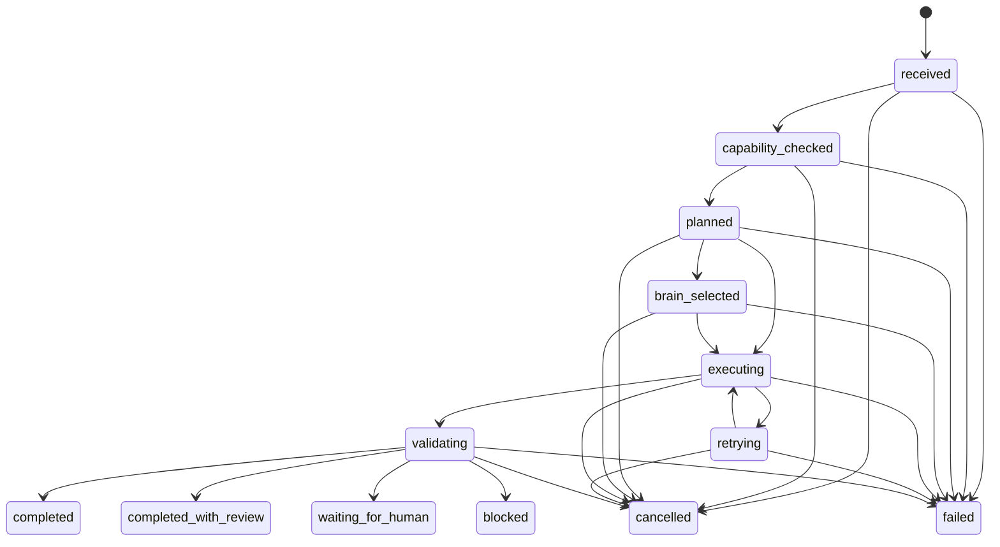

# Durable Agent Runtime v1

Updated: 2026-07-14  
Project: REALYTICS x PLATFORM9  
Status: Controlled Implementation  
Implementation level: Level 2

## 1. Purpose

The Durable Agent Runtime makes every contract-based Agent execution traceable,
idempotent, retryable under an explicit policy, and cooperatively cancellable.
It is the execution control plane around existing deterministic engines and Pod
artifacts. It does not replace CalculationRun, Shared Deal State, Evidence Graph,
Risk Register, or AgentHandoffEnvelope.

```text
AgentRequest
  -> idempotency/input-hash check
  -> capability check
  -> execution plan
  -> optional Brain selection
  -> execution attempt(s)
  -> output validation
  -> terminal AgentResult
  -> Pod artifact / handoff / Deal State materialization
```

## 2. First-class records

### `agent_runs`

One row per logical Agent execution. It stores the current state, optimistic
`stateVersion`, request/input fingerprints, attempt count, cancellation flag,
selected Brain identity, terminal result envelope, artifact IDs, and error history.
The request payload and transient API key are never persisted here.

DB idempotency constraint:

```text
UNIQUE (tenant_id, agent_id, idempotency_key)
```

The same key and same canonical input replays the existing terminal result. The
same key with a different input hash fails with `AGENT_IDEMPOTENCY_CONFLICT`.
An active run fails with `AGENT_RUN_IN_PROGRESS`; a failed run without a terminal
result requires a newly issued request/idempotency key.

### `agent_run_steps`

Ordered lifecycle and attempt records. Each row preserves stage, step type,
attempt number, start/end time, input/output hash, status, and structured error.
Execution attempts are updated from `running` to `completed`, `failed`, or
`cancelled`; a failed retry attempt remains in history.

### `brain_usage_events`

Secret-free AI usage ledger linked to the Agent run and execution step. It stores
Brain profile, provider, model, prompt policy version, tokens, estimated cost,
latency, status, and fallback reason. It must not contain prompts, responses,
authorization headers, API keys, or provider credentials.

## 3. State machine



`completed`, `completed_with_review`, `blocked`, `failed`, and `cancelled` are
terminal and immutable. Every update uses optimistic version matching.

## 4. Retry and cancellation

- Maximum attempts are `1 + manifest.failurePolicy.maxRetries`.
- Only an exception explicitly marked retryable or whose code appears in
  `retryableErrorCodes` may be retried.
- Generic exceptions are not silently retried.
- Cancellation is persisted first and then observed at each lifecycle boundary.
- Agent implementations may call `context.is_cancellation_requested()` during
  long work for finer-grained cooperative cancellation.
- Python cannot safely terminate arbitrary synchronous code mid-instruction. A
  cancellation arriving during a legacy handler is therefore applied immediately
  after the handler returns, and its output is discarded instead of becoming
  authoritative.

## 4.1 Deadline, budget, and worker recovery

- Every run persists `deadlineAt`, its current lease owner, lease expiry, and last
  heartbeat.
- The runtime checks the deadline before and after a synchronous Agent call. A late
  result fails as `AGENT_EXECUTION_TIMEOUT` and cannot become authoritative.
- Result metadata and normalized Brain usage increment consumed cost, LLM-call, and
  tool-call counters. A limit breach fails as `AGENT_BUDGET_EXCEEDED` before output
  validation and materialization.
- Runtime transitions renew the worker lease. `recover_expired_runs()` closes an
  abandoned non-terminal run with `WORKER_LEASE_EXPIRED` and atomically emits an
  `agent_run_recovery_required` outbox event.
- Hard termination of a hung in-process Python callable is intentionally not
  claimed. That requires an isolated process/container worker.

## 5. Current integration

Chief Deal Room Pod AI Review, all six Chief Pods, and principal inner Domain Agents
now use the durable contract. Each execution:

1. creates an independent Agent run ID;
2. retains the Chief orchestration run as correlation/trace ID;
3. persists capability, planning, execution-attempt, and validation steps;
4. persists token usage when an LLM was actually used;
5. stores the Agent run and Brain usage IDs in the `agentPlatform` envelope;
6. links the run ID back to the Pod AI Review and Chief Pod artifact reference.

The selected workflow and full PF review paths preserve `agentRuntimeExecutions`
for their migrated Land, Legal, Market, Feasibility, Cash Flow, PF Structuring,
Risk Register, Credit Review, Report, and Evidence Graph calls. Existing
CalculationRun, handoff, and Deal State records remain the domain source of truth.

Operational APIs:

```text
GET  /projects/{project_id}/chief-orchestration/agent-runs
GET  /projects/{project_id}/chief-orchestration/agent-runs/{agent_run_id}
POST /projects/{project_id}/chief-orchestration/agent-runs/{agent_run_id}/cancel
POST /agent-platform/runtime/recover
GET  /agent-platform/runtime/outbox
POST /agent-platform/runtime/outbox/dispatch
POST /agent-platform/runtime/outbox/{event_id}/requeue
```

Read uses `project:read`. Cancellation uses `project:analyze` and emits the
`agent_run_cancellation_requested` audit event.

## 6. Persistence backends

- SQLite: typed tables with unique idempotency and ordered indexes.
- PostgreSQL: typed JSONB tables in the fresh schema plus the idempotent
  `0002_durable_agent_runtime.sql` upgrade, DB uniqueness, and optimistic
  state-version updates.
- JSON: controlled single-process compatibility path protected by a process lock.

PostgreSQL remains the required production backend. JSON does not provide
cross-process concurrency guarantees.

AgentRun state transitions and their outbox event are written in one transaction
for SQLite and PostgreSQL. Outbox workers claim rows with leases, apply retry
backoff, move exhausted work to dead-letter, and support audited manual requeue.
CalculationRun and AgentHandoffEnvelope writes also enqueue their integration event
inside the same domain transaction.

## 7. Remaining production gates

- isolate long-running Domain Agents in process/container workers so timeout and
  cancellation can terminate execution rather than wait for a synchronous callable
- automatically reconstruct a new linked AgentRequest after an expired worker lease;
  current recovery emits a durable event and requires orchestrator replay
- deploy scheduled provider health probes and external broker-backed outbox workers
- add a manual Agent retry API that creates a new `retryOfRunId` instead of mutating
  an immutable terminal run
- enforce strict tenant/project ownership on every legacy project endpoint, not only
  the Agent Platform endpoints
- run isolated live PostgreSQL migration, uniqueness, lease, and outbox concurrency
  tests in CI
- migrate remaining report, visualization, optimization, and export helper Agents

These are tracked as production blockers; v1 must not be described as a fully
distributed production Agent scheduler.

## 8. Acceptance tests implemented

- terminal transition prohibition
- capability-check and output-validation exceptions close as durable failures
- idempotent replay executes the handler once
- mismatched input hash rejects key reuse
- policy-limited transient retry preserves failed attempt history
- cancellation during execution discards the produced output
- SQLite reopen preserves runs, steps, and Brain usage
- secret redaction from persisted result envelopes, including provider-prefixed
  API-key, token, authorization-header, password, and client-secret fields
- Chief Deal Room API returns the persisted run and ordered steps
- deadline and budget breaches cannot publish authoritative output
- expired worker leases create recovery outbox events
- outbox delivery retries and enters dead-letter after exhaustion
- failed Brain calls produce a secret-free usage record and route to a different
  eligible provider when policy permits
- selected workflow Domain Agents create persisted child AgentRuns
