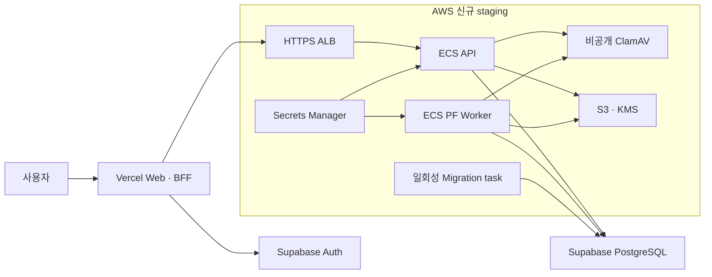

# 신규 API·Worker 운영 기반 구성안

**진행 상태: 사용자 후속 요청으로 신규 유료 구성을 보류했다.** 먼저
[Pod·Agent 코드 진단과 무료 로컬 검증](pod-agent-code-audit-2026-09-15.md)을
진행한다. 아래 내용은 향후 검토용 제안 이력이며 구매·배포 지시가 아니다.

2026-09-15. 사용자가 기존 API/Worker 호스팅과 비밀 저장소가 없다고 확인하고
새 구성안을 요청했다. 아래는 검토 가능한 설계와 예산이며 리소스 생성·결제·배포를
실행한 기록이 아니다.

**제안은 기존 Vercel Web과 Supabase DB/Auth를 유지하고, AWS ECS Fargate에
API·PF Worker·ClamAV를 분리해 배치하는 구성이다.** S3, KMS, Secrets Manager를
같은 계정·리전에서 연결한다. 저장소의 승인된
[아키텍처 경계](../architecture/architecture-boundary.md)와
[기존 배포 설계](deployment-plan.md)의 AWS 구성에 맞춘다.

## 위치와 데이터 범위

실제 Supabase `iorpwxxzvryuxhraiuhs`는 **도쿄 `ap-northeast-1`**이며,
2026-09-15 조회에서 ACTIVE_HEALTHY / PostgreSQL 17.6이다. 서울로 오인하면 안 된다.

이 구성안의 초기 인수 환경은 기존 DB와 같은 **도쿄 리전의 합성·비식별 시험 자료**를
기준으로 비용을 계산한다. Vercel의 동적 BFF 실행 리전도 검증 후 도쿄 `hnd1`로
맞추는 안이다. 현재 Vercel 설정이 이미 도쿄라는 뜻은 아니다.
[Vercel 리전 설정](https://vercel.com/docs/functions/configuring-functions/region),
[리전 목록](https://vercel.com/docs/regions).

국내 보관이 필수인 고객의 PF 원본을 취급하려면 **서울 `ap-northeast-2` DB와
객체 저장소를 먼저 구성**해야 한다. API/S3만 서울로 옮기고 DB를 도쿄에 두면
국내 보관 구성이 아니다. Supabase는 리전 변경 시 새 프로젝트로 이전해야 하며,
Auth provider/callback/키·회원 주체·원장·원본 연결의 이전과 검증이 필요하다.
서울 BFF 실행만으로 글로벌 CDN·로그·지원 접근까지 국내 한정임을 보장하지 않는다.
[Supabase 리전](https://supabase.com/docs/guides/platform/regions),
[프로젝트 리전 변경](https://supabase.com/docs/guides/troubleshooting/change-project-region-eWJo5Z).

실제 원본의 처리 리전, 국외 이전 근거와 보존 기간은
[개인정보·보존 정책](privacy-retention-support-policy.md)의 업무 결정 사항이다.
[LLM 라우팅 정책](llm-provider-routing.md)에 따라 민감 PF 자료를 임의의 외부 AI로
보내지 않는다. 첫 인수 단계는 외부 LLM 키 없이 결정론적 계산·검증을 실행하고,
AI 설명 기능은 승인된 데이터 분류·전송 범위·처리 위치가 준비된 뒤 연결한다.

## 제안 구조

| 구성 요소 | 초기 크기·실행 | 접근과 권한 |
|---|---|---|
| API | Fargate Linux/x86, 0.5 vCPU / 2 GiB, 1 task | ALB에서만 애플리케이션 포트 접근; API/identity 전용 DB 연결 |
| PF Worker | Fargate 1 vCPU / 2 GiB, 1 task, 승인한 시험 tenant 한 개 | 공개 listener 없음; `pf_worker` 풀과 전용 DB 역할; 사람 승인 권한 없음 |
| ClamAV | Fargate 1 vCPU / 4 GiB, 1 task | 별도 SG; API/Worker SG에서 TCP 3310만; DB·S3 비밀 없음 |
| Migration | 동일 API 이미지의 일회성 task | 배포 전용 DSN; serving task에 전달하지 않음 |
| ALB/ACM | public ALB 1개, HTTPS 인증서, 2 AZ subnet | API target type `ip`; readiness를 target health로 사용 |
| S3 | 원본/격리·검증 산출물과 복구 사본 분리 | 공개 접근 차단, versioning, KMS, Object Lock; 역할별 prefix 제한 |
| Secrets Manager | 프로세스별 secret ARN | task execution role은 주입 대상 secret만 읽기; application task role은 별도 최소 권한 |
| ECR/CloudWatch | commit SHA와 digest 기준 이미지, 구조화 로그 | 사용자 원문·토큰·DSN 로깅 금지; 오류·queue age·실패 횟수·DB 연결 알림 |

크기는 초기 측정값을 얻기 위한 가정이다. 큰 Excel/PDF, 병렬 계산의 최대 메모리와
ClamAV signature 갱신 중 메모리를 측정해 조정한다. ClamAV 공식 권장 메모리는
3–4 GiB이므로 512 MiB급 서비스로 예산을 잡지 않았다.
[ClamAV Docker 요건](https://docs.clamav.net/manual/Installing/Docker.html).

API·Worker·scanner는 public IP 없는 private subnet에 두고, 초기에는 NAT gateway
1개로 필요한 외부 DB/API와 signature update에 나간다. ALB는 2 AZ에 놓되 compute
1개와 NAT 1개인 pilot은 고가용성 운영 구성이 아니다. S3 gateway endpoint를 두고
불필요한 NAT 경유를 줄인다. 외부 Supabase까지 자동으로 private network가 되는
구성은 아니며 TLS와 연결 제약을 검증한다.
[Fargate 네트워크](https://docs.aws.amazon.com/AmazonECS/latest/developerguide/fargate-task-networking.html),
[NAT 비용 요소](https://docs.aws.amazon.com/vpc/latest/userguide/nat-gateway-pricing.html).

**별도 Agent outbox Worker, Legal corpus Worker, Coding Pod Worker는 첫 배포에서
제외한다.** Agent outbox의 전용 풀·tenant claim·handler·lease 저장 경로가 미완성이다.
이번 후속 작업의 hardened 시작 차단은 실행 사고를 막는 조치이며 전체 구현 완료가
아니다. PF Worker의 제한 역할 검증으로 다른 Worker까지 운영 가능하다고 판단하지 않는다.

## 비밀값을 넣을 위치

아래 경로는 생성 예정인 논리 이름이며 실제 ARN/secret이 존재한다는 뜻이 아니다.

| 정보 | 제안 목적지 | 주입 대상 |
|---|---|---|
| API DB DSN | `/realytics/staging/db/api` | API의 `REALYTICS_API_DATABASE_URL` |
| Identity DB DSN | `/realytics/staging/db/identity` | API의 `REALYTICS_IDENTITY_DATABASE_URL` |
| PF Worker DB DSN | `/realytics/staging/db/pf-worker` | PF Worker의 `REALYTICS_PF_WORKER_DATABASE_URL` |
| Migration DB DSN | `/realytics/staging/db/migration` | 일회성 migration/preflight task만 |
| 승인된 외부 API 키 | `/realytics/staging/providers/<provider>` | 해당 호출을 수행하는 process만 |
| 사용자 BYOK | 별도 `/realytics/user-ai/…` namespace | 서버 `secret_vault`의 기존 사용자·tenant·session 결합 계약 |
| Google/Kakao OAuth·SMTP secret | Supabase Auth 설정 | Web/Worker에 복제하지 않음 |
| Supabase URL·publishable key | Vercel 환경 설정 | 공개 클라이언트용; DB/service-role 키는 전달 금지 |
| API HTTPS origin·Web origin | Vercel의 server-only 환경 설정 | `REALYTICS_API_ORIGIN`, `REALYTICS_WEB_ORIGIN` |

AWS 서비스 접근은 장기 access key보다 ECS task IAM role을 사용한다.
DB LOGIN 비밀은 역할별로 생성·회전하고, ECS 환경으로 주입한 비밀을 회전하면 새
task를 띄워야 한다. Secrets Manager 값을 바꾸는 것만으로 실행 중인 process가
자동 갱신되지 않는다.
[Task IAM role](https://docs.aws.amazon.com/AmazonECS/latest/developerguide/task-iam-roles.html),
[ECS secret 주입·회전](https://docs.aws.amazon.com/AmazonECS/latest/developerguide/secrets-envvar-secrets-manager.html).

API는 `api,identity` 풀, PF Worker는 `pf_worker` 풀만 연다. 전체 최대 연결은
초기 기본값 기준 API 5 + identity 2 + PF Worker 3 = 10개이며 배포 교체 시
구·신 task가 겹치는 연결과 migration/admin 여유까지 계산한다. replica를 늘릴 때
각 process의 설정만이 아니라 Supabase 전체 연결 예산을 다시 검증한다.
전용 역할 LOGIN, owner/BYPASSRLS 거부, 정확한 테이블·컬럼 권한은 preflight로 확인한다.

## 월 예산

USD, 세금·환율 별도. 2026-09-15 공식 공개 가격을 확인했다. 월 730시간 상시 실행,
Linux/x86 On-Demand, 위 task 3개, ALB 평균 1 LCU, 원본·버전 합계 100 GB,
저사용량 내부 pilot을 가정한 **예산 추정**이다. 할인·무료 credit은 반영하지 않았다.

| 항목 | 계산 또는 가정 | 월 USD |
|---|---|---:|
| API compute | 730 × (0.5 × 0.05056 + 2 × 0.00553) | 26.53 |
| PF Worker compute | 730 × (1 × 0.05056 + 2 × 0.00553) | 44.98 |
| ClamAV compute | 730 × (1 × 0.05056 + 4 × 0.00553) | 53.06 |
| ALB | 730 × (0.0243 + 1 × 0.008) | 23.58 |
| Public IPv4 | ALB 최소 2개 + NAT 1개 가정, 3 × 730 × 0.005 | 10.95 |
| NAT | 리전별 gateway 시간·처리량 재견적용 예산 여유; 확정 단가 아님 | 50–65 |
| S3 Standard | 100 GB × 도쿄 첫 구간 0.025; 요청/추가 버전 별도 | 2.50 |
| Secrets Manager | 기본 secret 8개 × 0.40; API 호출·BYOK 건수 별도 | 3.20 |
| KMS | 신규 customer-managed key 2개; 요청·회전 추가분 별도 | 2.00 |
| ECR·로그·모니터링·DNS·복구 사본·통신 | 실제 사용량 전 예산 여유 | 20–50 |
| 합계 계산 | 일부 항목은 고정 요금이 아닌 여유 예산 | **236.80–281.80** |

예상 밖 사용량을 포함해 **신규 AWS 월 예산은 $250–320**으로 잡는다.
NAT 항목은 현재 지역별 확정 견적을 받지 못했으므로, 생성 전에 AWS Pricing
Calculator의 도쿄 요금으로 대체한다. 작은 앱에서도 NAT·ALB·scanner의 상시 비용은
요청 수가 적다고 사라지지 않는다.

도쿄 compute/ALB/S3 단가는 AWS의 지역별 공개 Price List에서 읽었다:
[Fargate 지역 가격](https://pricing.us-east-1.amazonaws.com/offers/v1.0/aws/AmazonECS/current/ap-northeast-1/index.json),
[ALB 지역 가격](https://pricing.us-east-1.amazonaws.com/offers/v1.0/aws/AWSELB/current/ap-northeast-1/index.json),
[S3 지역 가격](https://pricing.us-east-1.amazonaws.com/offers/v1.0/aws/AmazonS3/current/ap-northeast-1/index.json).
과금 구조와 나머지 단가:
[Fargate](https://aws.amazon.com/fargate/pricing/),
[VPC·IPv4](https://aws.amazon.com/vpc/pricing/),
[Secrets Manager](https://aws.amazon.com/secrets-manager/pricing/),
[KMS](https://aws.amazon.com/kms/pricing/).

기존 서비스의 실제 계약 요금은 조회하지 않았다. 새로 유료 기본 요금을 적용한다고
가정하면 Vercel Pro는 $20/월부터, Supabase Pro는 $25/월부터이므로,
**전체 pilot 계획은 $295–365/월 + 초과 사용량**이다. 이미 지불 중인 항목을
신규 비용에 이중 가산하지 않는다. 추가 Supabase 프로젝트/compute, SMTP,
유료 AI/GPU, 대용량 통신, 보존 버전 증가는 별도다.
[Vercel 가격](https://vercel.com/pricing), [Supabase 가격](https://supabase.com/pricing).

상용 운영은 2 AZ의 API/Worker/scanner 복제, NAT 이중화, DB 용량, 사고 대응과
복구 목표가 추가된다. 같은 낮은 트래픽을 가정해도 초기 검토 예산을 **$600–900/월**로
구분하고 실제 부하 시험으로 다시 계산한다. Supabase PITR는 7일 보존 기준
$100/월부터 별도이며, 요금 가입 자체가 복원 시험이나 무손실 SLA를 증명하지 않는다.
[Supabase 백업](https://supabase.com/docs/guides/platform/backups),
[PITR 요금](https://supabase.com/pricing).

## 단계별 실행안과 완료 조건

| 단계 | 만들거나 확인할 것 | 다음 단계 조건 |
|---|---|---|
| 0. 코드 준비 | 실제 권한 postflight, PF Worker preflight, Agent Worker 시작 차단, CI | 코드/실제 DB 증거 구분; 실패한 gate 없음 |
| 1. 검토 가능한 IaC | VPC/subnet/SG/NAT, ALB/ECS/ECR, S3/KMS/Secrets Manager, 로그·예산 알림 | 리전·계정·보존 정책·예산과 `plan`의 생성/변경 목록 확정 |
| 2. 계정 연결·기반 생성 | 사용자 AWS 계정의 위임 역할; IaC 적용 | 장기 root/key 없이 연결; 리소스별 이름·ARN·비용 기록 |
| 3. 비밀과 이미지 | 비밀을 지정 저장소에 등록·회전; SHA 이미지 build/scan | DB/s3/scanner 비밀은 이미지·Git·로그에 없음 |
| 4. Migration·preflight | 일회성 task로 ledger·실제 LOGIN·권한 검사 | API/PF 각각 자기 계정으로 통과; migration 비밀을 serving에서 제거 |
| 5. API·PF staging | 합성 tenant, ClamAV, S3, API 1개, PF 1개 순서 기동 | cross-tenant 거부, claim/retry/lease loss, quarantine 및 원본 해시 검증 |
| 6. Web·Auth·복구 | Vercel Preview origin 연결, 실제 사용자 로그인, 복원 rehearsal | 두 실제 사용자의 권한·AAL2, SMTP와 원장/원본 복구 증거 |
| 7. 제한 pilot | 데이터 분류·리전·보존 검토 후 승인한 자료만 투입 | 751 근거/단위/승인·새 계산 확인; operational blocker 처리 |
| 8. 운영 승격 | HA·부하·복구 목표·알림·권한 회전 검증, PR 검토 | main 병합과 운영 배포 대상으로 승인한 revision 고정 |

GitHub Actions 배포는 OIDC로 짧은 수명의 AWS 역할을 사용하고 저장소·branch 또는
environment의 `sub`와 audience를 제한한다. PR의 임의 코드에 배포·DB secret을
넘기지 않는다. staging/production 실행과 권한을 분리한다.
[GitHub → AWS OIDC](https://docs.github.com/en/actions/how-tos/secure-your-work/security-harden-deployments/oidc-in-aws).

S3 pilot은 시험 자료용 버킷과 실제 원본용 버킷을 분리한다. Object Lock의 모드·기간은
별도 확정하고, 긴 COMPLIANCE 보존을 임의로 적용하지 않는다. COMPLIANCE 잠금은
보존 중 관리자도 삭제할 수 없으므로 비용·정리 계획에 반영해야 한다.
[S3 Object Lock](https://docs.aws.amazon.com/AmazonS3/latest/userguide/object-lock.html).
DB 백업과 객체 원본을 각각 복원한 뒤 ID·버전·SHA-256 연결을 검증한다.

현재는 AWS 계정 연결, 실제 secret store, 배포 manifest, 외부 API origin, S3,
scanner, 통합 복구 smoke가 없다. 설계 완료를 인프라 생성 완료로 표시하지 않는다.
[현재 인벤토리](deployment-readiness-2026-09-15.md)에 확인 근거를 보관했다.
