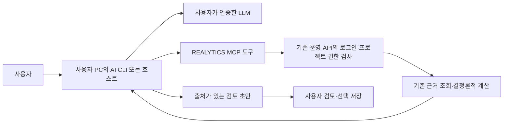

# LLM Provider Routing & Hybrid Model Strategy

Updated: 2026-11-09

## 명시적 개인 AI 실행과 순수 조회 (2026-11-09)

계정 설정의 저장 프로필과 현재 탭의 실행 선택을 분리한다. 시스템 기본은 기존
PostgreSQL 경로에서 개인 프로필을 읽지 않는다. `X-AI-Selection-Source` 또는 기존
`ai_context.selection_source=user_ai_profile`로 명시한 개인 실행만 서버에서 검증한
사용자·테넌트·세션에 결합해 프로필/키를 조회한다. 선택 헤더는 권한 증거가 아니며
클라이언트의 사용자/테넌트/세션 헤더는 계속 제거한다. 원문 키는 저장 모드에 포함하지
않고 선택만 사용자·테넌트별 탭 상태로 보관하며 로그아웃·계정 전환 시 정리한다.

프로필 미구성·권한/저장소 실패·만료·세션 불일치는 실제 상태로 거절한다. 명시 개인
선택을 시스템으로 자동 바꾸거나 같은 제공자의 공통 키로 대체하지 않는다. 개인
프로필 장애는 프로젝트 DB 장애와 다른 안내로 표시한다. 일반 업로드·규칙 기반
사전 검토·예산 계산은 이 선택을 하지 않으면 개인 프로필 권한을 요구하지 않는다.

GET 프로필·키 상태 확인은 만료 여부만 반환하고 프로필 갱신·키 삭제를 하지 않는다.
기존 POST의 `clearApiKey:true`는 DB 변경 성공 후 현재 사용자·세션의 키만 폐기한다.
프로필 DELETE도 저장된 키 참조의 사용자·공간·검증 세션을 먼저 확인하고 DB 삭제가
성공한 뒤에만 그 세션 키를 폐기한다. 다른 세션·저장소 장애·DB 삭제 실패·삭제 0건은
키를 지우지 않는다.
키 저장 체계나 IAM을 새로 만들지 않는다.

개인 AI·키 변경과 로그아웃의 감사 이벤트는 기존 정규화 `user_activity_logs`에
서버가 검증한 사용자·작업공간으로 추가한다. 키·키 참조·세션 ID는 메타데이터에
넣지 않으며 `app_state` DDL이나 전체 JSON 저장으로 우회하지 않는다. 프로필 변경과
감사 추가는 현재 별도 commit이므로 감사 실패는 `ai_profile_audit_unavailable`,
`mutationState:may_have_applied`, `retryable:false`로 응답한다. 사용자는 재저장하기
전에 현재 설정을 조회해야 한다. 두 작업의 원자성을 보장한다고 표시하지 않는다.

사용자는 2026-11-09 기존 `realytics_runtime` 역할의 `user_ai_profiles` 조회·저장·수정·삭제를
승인했다. 현재 사용자와 테넌트가 모두 일치하는 restrictive ALL 정책을 추가하고
TRUNCATE·REFERENCES·TRIGGER는 금지한다. 다른 역할·PUBLIC의 권한은 변경하지 않는다.
PF Worker는 API manifest에서 개인 프로필 조회 권한을 상속하지 않는다.

`db/user_ai_profile_privileges.py`의 동일 계약을 필수/금지 manifest, 전체 및 전용
provisioner, strict startup preflight가 공유한다. RLS 비활성·역할/소유권 경계 위반·허용
기반 정책 부재·동명 다른 정책은 적용을 중단하며 기존 정책을 임의로 교체하지 않는다.
전용 `scripts/provision_user_ai_profiles.py`는 연결 없는 SQL/롤백 렌더와 승인된 배포 DSN의
트랜잭션 적용·audit를 제공한다. 운영에 승인된 CRUD/RLS를 적용했고 새 API에서 실제
설정값·키 상태를 보존한 저장·재조회와 해당 감사 이벤트를 확인했다.
배포별 역할 정책이므로 불변 numbered schema migration을 수정하지 않는다.
읽기 전용 MCP·CLI 자체에는 이 권한 확대가 필요 없다.

## 사용자 AI의 운영 Excel 읽기 (2026-11-09)

사용자가 1번 구현을 승인했다. `HostedProjectApi`의 기존 HTTPS·Bearer 연결에 최근
프로젝트, 원본 문서, 후보, 시트, 셀 GET을 추가하고 CLI와 MCP가 같은 응답을 사용한다.
웹의 공개 `/api/cli/config`는 API 주소·Supabase URL·issuer·publishable 키만 제공한다.
프로필·토큰·서버 키·DSN은 공개하지 않는다. 잘못된 설정은 503, 인증 응답은 no-store다.

새 연결은 `server.py --hosted-only`의 읽기 도구 8개로 한정한다. 이 모드는 개발용
`.env`나 로컬 Agent를 로드하지 않으며 원본 경로 읽기·재추출·쓰기·승인을 받지 않는다.
이전 모드의 동적 Agent 호출과 명시적 토지 요약 저장은 보존한다. 새 클라이언트는
신뢰되지 않은 문서 내용을 지시로 취급하지 않도록 표시한다. 응답은 네트워크 4MiB와
모델 전달 512KiB, 후보 페이지와 셀 최대 400개로 제한하고 초과를 실패로 표시한다.

로그인은 기존 이메일·비밀번호 또는 Google 브라우저 S256 PKCE로 새로운 Supabase
세션을 발급받는 방식이다. 이메일 방식은 사용자 터미널의 숨김 입력만 허용하고
비밀번호를 보관하지 않는다. Google 전용 계정에는 `login --provider google`을 안내한다.
API `/auth/me`에서 실제
프로젝트 계정·테넌트를 확인하고 Windows 사용자 DPAPI로 새 세션만 암호화한다.
만료·갱신·토큰 회전·원자 저장·프로세스 잠금·외부 로그아웃 후 다음 조회를 처리한다.
서버 조회 실패를 계정 없음이나 자료 0건으로 숨기지 않는다. 다른 OS의 평문 영구
저장은 제공하지 않으며 CLI Kakao 로그인은 미지원이다.
기존 브라우저 쿠키·다른 AI의 자격증명과 운영 LLM 키를 가져오지 않는다.

2026-11-09 실제 계정 진단에서 등록 제공자가 Google이며 비밀번호 grant는
`invalid_credentials`로 거절됨을 확인했다. 인증 실패를 DB 파싱 장애로 취급하지 않는다.
Google CLI는 기존 `http://127.0.0.1:3000/auth/callback`을 먼저 단독 점유하고 신선한
S256 verifier/challenge를 사용한다. 고정 issuer의 PKCE 교환이 성공하기 전에는 세션을
보관하지 않는다. OAuth BCP의 PKCE CSRF 방어를 따르며 별도 state 우회·implicit
fallback은 없다. [RFC 9700 §4.7.1](https://www.rfc-editor.org/rfc/rfc9700.html#section-4.7.1).
Host·요청 경로·loopback 연결·단일 code·응답 크기·5분 대기 상한을 검증한다.
Google authorize 302만으로 Supabase 허용 목록 확인 또는 로그인 성공을 주장하지
않는다. 실제 callback 도착·코드 교환·API 본인 권한 확인이 완료 기준이며 설정 변경은
없다. 코드·토큰·verifier·Google 인증 URL은 출력하거나 로그에 남기지 않는다.

같은 원본 SHA·버전과 프로젝트·파싱 실행을 검증하고 실제 미검토·검토 결정·승인
스냅샷 상태를 구분한다. 일반 archive ID와 해시를 혼동하지 않고, 식별자가 없는
문서끼리 후보를 공유하지 않는다. 연결을 검증할 수 없는 건수는 미확인으로 남긴다.
현재 브리지 현황의 referenceOnly·금액 기준 미확인을 그대로 전달하며 미래 PF
입력으로 투영하거나 수식 캐시를 승인 사실로 격상하지 않는다.

이 읽기 전용 CLI 확장 자체는 DB 구조·권한과 Supabase 인증 설정을 변경하지 않는다.
별도 개인 AI 프로필 권한은 상단의 2026-11-09 승인 계약을 따른다. 새 조회 도구가
읽기 전용이라는 것은 사용자 JWT의 계정 권한을 축소했다는
뜻이 아니다. 이 CLI의 세션 폐기와 앱 캐시 정리는 웹의 모든 세션 폐기와 구분한다.
설치·명령·만료·재연결·지원 범위는 [실행 안내](../../services/mcp-server/README.md)를 따른다.

로컬 검증에서 Windows DPAPI·암호화 저장·원본과 계정 경계·GET 401 1회 갱신과
실제 MCP stdio 통신을 포함한 59개 테스트, 공개 설정의 PC·모바일 6개 및 타입·린트를
통과했다. API 패키지와 충돌하는 MCP 의존성은 사용 중인 별도 `.runtime/mcp-venv`
약 65MiB에 설치했다. 초기 f8220c1 배포와 원격 전체 CI(API 3,615건, 브라우저 734건,
PostgreSQL 62건, Windows MCP 59건)도 통과했다. Google 보완 후 Windows DPAPI와 실제
로컬 HTTP callback·mock provider 교환을 포함한 전체 73건이 통과했다. 새 11건은
fresh S256·Host/Origin/issuer·중복 query·코드 주입·거부·시간 초과·포트 충돌·민감 출력
차단을 검증한다. 실제 사용자가 Google에서 로그인해 기존 고정 loopback 도착·PKCE
교환·API 본인 권한 확인·DPAPI 저장까지 성공했다. 강제 세션 갱신 후 같은 사용자와
테넌트를 확인했고, 실제 MCP stdio의 8개 읽기 도구·로그인 상태·최근 조회도 성공했다.
초기 Google 계정은 최근 프로젝트 0건·기존 프로젝트 404였다. 기존 웹의 본인확인
응답과 정규화 멤버십을 대조해 자료 계정과 Google 계정의 subject·공간이 다름을
확인했다. 기존 웹과 같은 자료 계정으로 별도 CLI 로그인을 완료해 프로젝트 3개와
검증 프로젝트 2의 문서 2개·후보 31개·미검토 31개·승인 입력 0개를 읽었다.
프로젝트 이동·계정 합치기·멤버십 추가·DB 권한 변경은 하지 않았다.

실자료 검증에서 문서 목록의 `latestParsingRun`에 전체 구조 추출 artifact가 포함돼
JSON 577,048바이트로 MCP의 512KiB 상한을 넘는 문제가 드러났다. 목록을 실행 ID·
버전·상태·시각·해시·제한된 진단코드 요약으로 바꾸고, 원문 chunk와 전체 artifact를
제외했다. 후보 상세·출처·미검토/승인 집계는 보존한다. 합성 대형 artifact 회귀를
추가한 hosted 전체 75건이 통과했다.

실제 MCP stdio에서 읽기 도구 8개를 확인하고 로그인·최근 프로젝트·문서·후보·시트·
셀 도구를 호출했다. 문서 목록은 4,415바이트, 후보 31개는 266,352바이트, A1:G20
셀은 59,784바이트로 전달됐고 모든 호출이 성공했다. 문서/후보의 snapshotHash,
원본 SHA·보관 버전, 각 후보의 문서 버전·파싱 실행·원본 셀 값이 일치했다.
대출금 11개·대주명 11개·금리 4개·금리유형 4개·만기 1개를 확인했으며 금액의
억원→원 환산 합계는 74,500,000,000원이다. B17의 `=SUM(B4:B14)` 저장 캐시 745는
재계산 또는 승인값으로 취급하지 않았다. referenceOnly·noFuturePfProjection·금액
기준 미확인 차단과 승인 입력 0개를 보존했다. 강제 갱신 후에도 같은 사용자·공간·
스냅샷·후보 31개가 조회돼 이 범위의 로그인→조회→원본 대조→재연결을 완료했다.
개인 용어집 조회의 `DOCUMENT_GLOSSARY_UNAVAILABLE` 경고는 별도 보류 범위이며
문서·후보·셀 조회를 막지 않는다. 사용자별 AI 프로필 권한은 이 CLI 범위와 별개이며
상단의 승인·운영 검증 상태를 따른다.

## 운영 OpenAI 연결 (2026-11-06 사용자 승인)

사용자가 제공한 새 OpenAI 비밀 키로 공식 모델 조회와 비민감 합성 연결 문장의 실제
응답을 확인했다. 운영 API의 `OPENAI_API_KEY`는 기존 Google Secret Manager의
전용 `realytics-openai-key` 버전 1을 참조한다. 도쿄 한 지역에 저장하며 API 서비스
계정에만 이 항목의 Secret Accessor를 연결했다. 키 값은 코드·문서·브라우저·로그에
넣지 않는다. 전용 시크릿 1개의 생성·연결과 무료 할당량 초과 비용 가능성은 사용자가
별도로 승인했다. 새 서버나 DB 스키마는 만들지 않는다.

운영 환경은 `REALYTICS_AI_PROVIDER=openai`, `OPENAI_MODEL=gpt-4.1-mini`로
선택한다. 코드 자체의 기본값과 사용자별 명시적 제공자·모델 설정은 유지한다.
기존 LLM 호출이 연결된 문서 해석·조정·설명 단계에서 이 모델을 사용하며, 수치 계산과
교차검사·입력 근거·사람 승인 절차는 기존 결정론적 경로를 따른다. 키 연결만으로
미구현 데이터 연결이나 미지원 금융 조건을 완료로 취급하지 않는다.

기존 제공자·사용자 프로필 회귀 29개를 통과했고, 같은 API 이미지의
`realytics-api-00053-soz`에 비밀 참조·제공자·모델 환경을 반영했다. readiness와
기동 점검을 통과한 리비전에 운영 트래픽 100%를 연결했다. 합성 인증 시험에는
실제 사업자료를 보내지 않았다. 사용자별 개인 LLM 설정은 계정 화면에서 따로 확인한다.

## 사용자 AI 프로필 권한 검토 기록 — 2026-11-06 승인 전

아래 선택지와 SQL은 당시 검토 기록이다. 사용자는 2026-11-09 편집 범위를
승인했고 현재 계약·적용 상태는 이 문서 상단을 따른다. 조회 전용 선택지는
현재 운영 옵션이 아니다.

2026-11-06 사용자는 권한 변경을 승인하지 않고 상세 설명과 MD 재검토를 요청했다.
따라서 아래 SQL은 실행하지 않는다. Excel 수정·검증·코드 배포는 이 결정과 독립적이다.

### 어떤 장애를 고치는가

| 구분 | 현재 확인한 상태 | 이 권한 변경이 필요한가 |
|---|---|---|
| Excel 원본 미리보기·후보 추출 | 보관 원본 API와 기존 Parser V2 테이블을 사용한다. 후보 없는 원본 열람 조건과 추출 매핑을 수정했다. | 필요 없음. 기존 DB 권한으로 진행한다. |
| 공통 OpenAI 연결 | 키는 Secret Manager에 있고 API가 참조한다. 모델 인증·비민감 합성 응답과 운영 기동을 확인했다. | 키 연결 자체에는 필요 없음. |
| 사용자별 AI 설정 조회 | `/auth/ai-profile`가 구형 `app_state` 생성 경로를 호출해 500을 냈다. 정규화 저장소로 코드를 수정하되 현재 테이블 SELECT 권한은 없다. | 개인 설정을 정상 조회하려면 필요하다. |
| 사용자별 AI 설정 저장·삭제 | 제공자·모델·대체 허용과 세션 비밀 참조를 저장하는 기존 기능이다. | 저장까지 사용할 때만 INSERT·UPDATE·DELETE가 추가로 필요하다. |
| Pod 계산·입력 승인 | 기존 계산·근거·승인 권한을 따른다. | 이 테이블 권한으로 계산이나 승인이 활성화되지 않는다. |

운영 사업 API의 `_request_ai_context`는 현재 PostgreSQL에서 `use_legacy_profile=False`로
개인 프로필 조회를 사용하지 않고 시스템 설정을 선택한다. 따라서 이 변경 없이도
연결된 공통 OpenAI를 기존 LLM 단계에서 선택할 수 있다. 반대로 **개인 설정 화면에
저장했다는 사실만으로 모든 운영 Pod가 그 개인 설정을 사용한다고 주장할 수 없다.**
사용자별 제공자 선택을 운영 전체에 적용하려면 같은 검증된 사용자·테넌트·세션을
전달하도록 호출자도 연결하고, 서로 다른 두 계정과 대체 금지 조건까지 검증해야 한다.
이 부분은 후속 연결 범위이며 Excel 복구의 전제 조건으로 사용하지 않는다.

### 무엇을 저장하고 무엇을 저장하지 않는가

`user_ai_profiles`에는 사용자 ID, 테넌트 ID, 제공자(OpenAI 등), 모델명, 상태,
시스템 대체 사용 허용 여부, 비밀 저장소 참조, 생성·수정 시각을 저장한다.
새 개인 키는 전용 비밀 저장소로 보내며 프로필에는 참조와 마스킹값만 둔다.
이전 암호화된 키 열은 기존 호환용이며, 키 평문·문서 본문·토지 조회 결과·재무 계산
결과를 이 테이블에 넣는 변경이 아니다. 공통 OpenAI 키는 기존 Secret Manager에 유지한다.

### 권한은 누구에게 생기는가

권한 대상은 사람 계정이나 브라우저가 아니라 **운영 API의 PostgreSQL 역할
`realytics_runtime` 하나**다. API는 검증된 로그인에서 사용자와 테넌트를 얻고,
트랜잭션 안에서만 `realytics.tenant_id`와 `realytics.user_id`를 설정한다.
SQL의 두 조건과 RLS를 함께 적용한다. 같은 조직에 속해도 다른 사용자의 개인 AI
설정을 읽거나 바꾸지 못하게 한다. 기존 테넌트 정책에 사용자 정책을 `AS RESTRICTIVE`로
추가하므로 둘 중 하나만 맞아도 허용하는 OR 조건이 아니라 둘 다 맞아야 한다.

읽기 전용 운영 메타데이터 확인 결과 테이블은 존재하고 RLS가 활성화돼 있다.
당시 운영 역할은 superuser·BYPASSRLS·테이블 소유자가 아니며 CRUD는 모두 없었다.
이는 필요한 제한을 확인한 것이며 새 권한 적용이나 실제 교차 사용자 검증을 마친 것은 아니다.
브라우저 `anon`·`authenticated`, 로그인 초기화용 `realytics_identity`, 다른 테이블,
스키마 생성 권한에는 새 접근을 주지 않는다. 비공개 `realytics` 스키마를 Data API에
노출하는 설정도 바꾸지 않는다.

이 제한은 인증된 API가 설정한 컨텍스트를 신뢰한다. API 자체가 침해돼 임의 컨텍스트를
설정하는 경우까지 막는 절대 격리는 아니다. 그래서 클라이언트가 보낸 사용자·테넌트
헤더를 신뢰하지 않는 기존 인증, 매 요청 범위 검사, 키 응답 제거가 함께 필요하다.

### 검토할 선택지

| 선택 | DB 변경 | 가능한 동작 | 남는 제한 |
|---|---|---|---|
| 지금은 보류 | 없음 | Excel 복구와 기존 공통 OpenAI 경로 사용 | 개인 AI 설정 조회·저장은 사용할 수 없음을 표시한다. |
| 개인 설정 조회만 복구 | SELECT + 사용자 제한 RLS | 본인의 저장 설정과 실제 기본 정책 조회 | 저장·변경·삭제는 계속 차단한다. 쓰기 UI도 함께 제한해야 한다. |
| 개인 설정 편집까지 복구 | SELECT·INSERT·UPDATE·DELETE + 사용자 제한 RLS | 본인의 설정 조회·저장·삭제 | 모든 Pod의 개인 설정 소비 연결과 실제 계정 검증은 별도다. |

당시 우선순위에 대한 판단은 **Excel은 그대로 배포하고, 개인별 AI 사용 방식을
API·MCP 호스트·CLI 중에서 정한 뒤 필요한 프로필 권한만 결정하는 것**이다.
조회 오류 하나를 고치기 위해 반드시 CRUD 전부를 승인할 필요는 없다. 아래 CRUD 초안은
기존 개인 설정 편집 기능까지 사용할 경우의 안이며, 조회 전용을 선택하면 SELECT만
부여하고 쓰기 API·화면은 활성화하지 않는 별도 변경으로 줄인다.

권한 적용 전에는 정규화 저장소의 범위·오류 처리와 대체 금지 테스트를 통과시킨다.
적용 후에는 통제된 검증 데이터로 본인 CRUD, 같은 테넌트 다른 사용자,
다른 테넌트와 사용자 컨텍스트 누락의 읽기·쓰기를 확인하고 검증 자료를 정리한다.
공통 키를 사용자의 개인 키인 것처럼 표시하거나 DB 조회 실패를 ‘설정 없음’으로
간주해 자동 대체하지 않는다. 실패는 503과 재시도로 드러낸다.

운영 `/auth/ai-profile`의 500은 기본 모델 선택과 별개의 저장 경로 오류다.
기존 코드는 PostgreSQL에서도 `app_state`를 열고 테이블 생성까지 시도했다.
기존 `realytics.user_ai_profiles`를 요청의 검증된 사용자·테넌트로 읽도록 수정한다.
조회 실패를 ‘개인 설정 없음’으로 바꾸지 않고 `503 ai_profile_authority_unavailable`로
표시한다. 확인된 현재 상태는 테이블 존재·RLS 활성·기존 테넌트 정책 존재,
`realytics_runtime`의 이 테이블 CRUD 권한 없음이다.

아래는 **사용자 검토 전까지 실행하지 않는 SQL 초안**이다. API 런타임 역할 하나에
기존 프로필 테이블의 CRUD만 부여한다. 기존 테넌트 정책과 함께 적용되는 제한적
사용자 정책을 추가한다. identity 역할·anon·authenticated의 권한, 다른 테이블,
스키마 생성 권한은 변경하지 않는다. 저장소는 기존 `api_tenant_transaction`을
사용하고 매 트랜잭션에서 검증된 `realytics.user_id`를 transaction-local로 설정한다.
서비스가 사용하는 모든 SQL에도 `tenant_id`와 `user_id` 조건을 함께 넣는다.

```sql
BEGIN;

CREATE POLICY user_scope_user_ai_profiles_runtime
ON realytics.user_ai_profiles
AS RESTRICTIVE
FOR ALL
TO realytics_runtime
USING (
  user_id = NULLIF(current_setting('realytics.user_id', true), '')
)
WITH CHECK (
  user_id = NULLIF(current_setting('realytics.user_id', true), '')
);

GRANT SELECT, INSERT, UPDATE, DELETE
ON TABLE realytics.user_ai_profiles
TO realytics_runtime;

COMMIT;
```

적용 전에는 기존 테넌트 RLS 정책이 유지되는지, 같은 이름의 사용자 정책이 없는지,
런타임 역할에 `BYPASSRLS`나 테이블 소유권이 없는지 확인한다. 적용 후 검증 대상은
본인 프로필 조회·생성·수정·삭제, 같은 테넌트의 다른 사용자 행 거절, 다른 테넌트
행 거절, 사용자 컨텍스트가 없는 요청 거절이다. 실행 가능한 최종 마이그레이션은
검토 승인 후 현재 저장소의 Supabase CLI 생성·렌더링 규칙으로 준비한다.

기존 PostgreSQL 테이블에는 `credential_ref` 열이 없으므로 세션 비밀 저장소의
참조·종류만 기존 `metadata_json`의 내부 항목으로 보관한다. 응답 메타데이터에서
이 내부 항목을 제거하며 새 개인 키 평문을 프로필에 저장하지 않는다. 기존 암호화된
이전 키 필드는 호환성을 유지한다. 원본 키를 문서·로그·SQL 검증 자료에 넣지 않는다.

기본 선택은 런타임의 `REALYTICS_AI_PROVIDER`와 해당 공급자 모델 설정을 우선한다.
설정이 없을 때만 기존 Gemini 기본값을 사용한다. 개인 키가 없어 대체를 허용하면
이 시스템 기본값을 사용하고, 대체 금지는 글로벌 키·다른 공급자로의 자동 전환을
금지한다. 이 선택은 개인정보·예산·중앙 Brain 라우팅 제한을 우회하지 않는다.

## EGO Lite와 사용자 LLM·CLI 연결 검토 (2026-11-06, 구현 승인 전)

공식 저장소 [citrolabs/ego-lite](https://github.com/citrolabs/ego-lite)의 공개 구현은
사용자가 사용하는 Codex·Claude Code 등의 Agent에 브라우저 도구를 제공한다.
공개 [로컬 런타임 설명](https://github.com/citrolabs/ego-lite/blob/main/docs/local-runtime-development.md)과
[패키지](https://github.com/citrolabs/ego-lite/blob/main/package/ego-browser/package.json)는
설치된 Ego CLI와 네이티브 브라우저를 연결하는 구조다. 공개 코드에서 모든 제공자의
구독 인증·추론을 대신 처리하는 범용 LLM 중계기는 확인하지 못했다. 저장소의 MIT
라이선스와 별도 다운로드 브라우저 앱도 구분한다. 설치나 인증 정보 복사는 하지 않았다.

REALYTICS에 적용할 수 있는 설계는 **사용자가 선택한 AI가 REALYTICS 도구를 호출하도록
하는 방향**이다. 아래는 소스·공식 문서에 근거한 제안이며 이미 구현된 기능으로 표시하지 않는다.



LLM 로그인과 REALYTICS 로그인은 별개다. ChatGPT/Codex에 로그인했다고 프로젝트
접근 권한이 생기지 않는다. REALYTICS 도구 호출은 기존 사용자 토큰과 테넌트·프로젝트
권한을 계속 검사한다. 개인 CLI의 인증 파일·쿠키를 서버로 복사할 필요도 없다.
CLI를 쓰더라도 분석 대상 문맥은 선택한 모델 제공자에게 전송될 수 있으므로 조회만
로컬에서 한다는 이유로 모델 추론까지 PC 내부에서 끝난다고 표시하지 않는다.

### 현재 코드에서 되는 부분과 남은 부분

| 부분 | 현재 소스 확인 | 추가 구현·검증 |
|---|---|---|
| 여러 API 제공자 | ai_connection의 OpenAI·Anthropic·Gemini 등 어댑터 | 개인별 실제 선택을 모든 운영 호출자가 소비하는지 검증 |
| MCP 호스트 모드 | claude_desktop/host_llm 별칭과 호스트 판독 요청 반환 | 웹 서버에서 호스트 LLM을 직접 호출하는 기능과는 구분 |
| 운영 MCP·CLI | services/mcp-server의 토지·법률 미리보기, 선택 요약 저장, 목록 조회가 같은 운영 API 사용 | Excel 검토·6개 Pod 전체 작업을 운영 API 도구로 확장 |
| 기존 기타 MCP 도구 | 로컬 Agent 직접 호출과 파일 경로 기반 도구도 존재 | 운영 권한·저장·감사 규칙을 우회하지 않도록 도구별 전환 범위 점검 |
| 자동 CLI 선택 | 현재 전용 연결 프로그램·로그인 상태 탐지 없음 | 지원 CLI 상태 확인, 사용자가 선택·동의, 연결/중단/취소와 한도 표시 |
| 웹의 ‘내 AI로 검토’ | 현재 없음 | 웹과 사용자 PC의 인증된 연결 계층, 실행 입력·결과 바인딩, PC 꺼짐·로그아웃 처리 |

순서는 기존 운영 MCP 도구를 사용자 CLI에서 실제 계정으로 읽기 검증하는 것이 먼저다.
이어 Excel 원본·후보 조회와 검토 초안까지 확장하고, 웹 버튼의 자동 연결은 작은
사용자 측 연결 프로그램 또는 공식 호스트 연결로 검토한다. 이는 로컬 개발 DB나
별도 localhost 사업 서버를 다시 운영 데이터의 권위로 만드는 변경이 아니다.
PC가 꺼지거나 CLI 로그인이 끊기면 사용자 CLI 작업은 대기·중단으로 표시해야 한다.
그때 별도 동의 없이 유료 API로 전환하지 않는다.

### ChatGPT 구독으로 쓸 수 있는가

현재 OpenAI는 [공식 ChatGPT plan usage](https://developers.openai.com/siwc/token-sharing-open-source)에서
사용자가 동의한 OAuth 권한으로 OSS·로컬 앱이 적격 Responses 요청을 수행하는 경로를
안내한다. 따라서 API 키 방식만 가능하다고 단정하지 않는다. 다만 유료·원격 호스팅
앱은 별도 신청 경로를 안내하므로 공개 GitHub 저장소라는 이유만으로 REALYTICS의
Vercel·Cloud Run 서비스에 같은 자격이 자동 적용된다고 보지 않는다.

[Codex app-server 연동](https://developers.openai.com/siwc/token-sharing-open-source/codex-app-server)은
OAuth 토큰과 stdio 연결을 공식 지원한다. [현재 제한](https://developers.openai.com/siwc/token-sharing-open-source/preview-limitations)에
맞춘 Responses 스트리밍·저장 설정과 만료·갱신·중단 처리가 필요하다. 기존
Chat Completions API 호출에 구독 토큰만 끼워 넣는 변경은 하지 않는다.
계정별 지원 모델과 실제 요청 완료를 확인해야 하며 구독 한도와 API 종량제 비용을
구분해 표시한다. 모든 LLM 제공자가 동일 인증·사용 조건을 가진다고 가정하지 않는다.

2026-11-06 당시 판단은 **Excel 복구 배포를 완료하고, DB 개인 프로필 권한은 보류하며,
사용자 CLI→기존 운영 MCP 연결을 다음 후보로 삼는 것**이다. CLI 연결 구현·설치나
기존 공통 API 키 삭제·중단은 이번 조사만으로 실행하지 않는다.

REALYTICS handles sensitive PF data (loan amounts, owner names, accounts, PNU, registry) and Korean-language documents under finance/public-sector compliance. LLM use must therefore be **routed by sensitivity, difficulty, and residency**, not fixed to one vendor.

> Note: model version numbers and prices change frequently. Confirm current versions/limits/pricing on each vendor's page before production rollout.

## 1. Multi-provider adapter (implemented)

`services/api-server/agents/ai_connection.py` calls LLMs through the **OpenAI Chat Completions-compatible** interface, so one code path reaches many providers by overriding `base_url`. Anthropic uses its native SDK; Claude Desktop stays host-LLM only.

| Provider (`REALYTICS_AI_PROVIDER`) | Runtime | API key env | Default model | base_url |
|---|---|---|---|---|
| `openai` (aliases: gpt, chatgpt) | native OpenAI | `OPENAI_API_KEY` | `gpt-4o` | default |
| `anthropic` (claude) | native Anthropic | `ANTHROPIC_API_KEY` | `claude-sonnet-4-6` | default |
| `claude_desktop` (mcp_host) | MCP host LLM | — | host | — |
| `gemini` (google) | OpenAI-compat | `GEMINI_API_KEY` | `gemini-2.5-flash` | Google AI Studio OpenAI endpoint |
| `groq` | OpenAI-compat | `GROQ_API_KEY` | `llama-3.3-70b-versatile` | api.groq.com/openai/v1 |
| `openrouter` | OpenAI-compat | `OPENROUTER_API_KEY` | llama-3.3-70b-instruct | openrouter.ai/api/v1 |
| `deepseek` | OpenAI-compat | `DEEPSEEK_API_KEY` | `deepseek-chat` | api.deepseek.com |
| `together` | OpenAI-compat | `TOGETHER_API_KEY` | Llama-3.3-70B | api.together.xyz/v1 |
| `local` (ollama, vllm, self_hosted) | OpenAI-compat | `REALYTICS_LLM_API_KEY` (optional) | `qwen2.5` | `REALYTICS_LLM_BASE_URL` |

Per-provider model override env: `<PROVIDER>_MODEL` (e.g. `GEMINI_MODEL`, `GROQ_MODEL`, `OPENAI_MODEL`, `ANTHROPIC_MODEL`); local uses `REALYTICS_LLM_MODEL`. All calls run at `temperature=0`; JSON mode is used where the provider supports it.

## 2. Hybrid routing policy

| Tier | When | Recommended target |
|---|---|---|
| **Sensitive** (PF amounts, owner/account/PNU/registry, internal review docs) | Any data that must not leave the network | **Self-hosted open model** (`local`: Ollama/vLLM running DeepSeek/Qwen/Llama) or **Korean domestic LLM** (HyperCLOVA X / EXAONE) for residency |
| **Non-sensitive / high-volume** (generic extraction, classification, routing) | Bulk, low-risk text | Cloud **cheap tier**: Gemini Flash / GPT mini / Groq (free tier ok) |
| **High-stakes judgment** (credit opinion, legal/permit interpretation, hard feasibility) | Decisions affecting approval, with human gate | **Top tier**: Claude Opus 4.8 / GPT o-series / Gemini 2.5 Pro / DeepSeek-R1 |

Rules: every LLM judgment must (1) run at `temperature=0`, (2) cite evidence and link into the Evidence Graph, and (3) pass a human review gate before it affects approval. Deterministic calculators (feasibility, cash flow, PF metrics, scenario, stress, credit enhancement) stay rule-based for auditability — LLMs interpret and narrate, they do not replace the math.

## 3. Model recommendations by use case (cross-provider)

| Use case | Claude | OpenAI | Gemini | xAI | Open / free |
|---|---|---|---|---|---|
| Document parsing/extraction (current LLM use) | Sonnet 4.6 | GPT-4.1 / GPT-5 | **Gemini 2.5 Flash** (cheap) / Pro (long docs) | Grok-3 | **DeepSeek-V3**, **Qwen3** |
| Hard/ambiguous docs, complex feasibility | Opus 4.8 | o-series (o3/o4) | Gemini 2.5 Pro | Grok-4 | **DeepSeek-R1** |
| Credit/legal judgment & memo (high-stakes) | Opus 4.8 | GPT-5 / o3 | Gemini 2.5 Pro | Grok-4 | DeepSeek-R1 + human gate |
| Planner intent classification / routing | Haiku 4.5 | GPT mini | Gemini Flash-Lite | Grok-3 mini | Groq+Llama 3.3, small Qwen |

## 4. Free / low-cost options

- **Free API tiers**: Google AI Studio (Gemini), Groq, OpenRouter free slots, Mistral/Cohere trials. Fastest to prototype.
- **Self-hosted open weights (compute-only cost)**: Llama 3.3/4, DeepSeek V3/R1, Qwen3, Gemma 3, Mistral — via Ollama/vLLM. **Best fit for the deck's "Private AI / 회사 노하우 학습"** because data never leaves the network.
- **Korean-specialised**: HyperCLOVA X (Naver), EXAONE (LG AI) — strong Korean + domestic data residency for finance/public-sector PoCs.

## 5. Configuration examples

```bash
# Free Gemini (prototype)
REALYTICS_AI_PROVIDER=gemini
GEMINI_API_KEY=...
GEMINI_MODEL=gemini-2.5-flash

# Free/fast Groq with an open model
REALYTICS_AI_PROVIDER=groq
GROQ_API_KEY=...

# Sensitive / on-prem (no data leaves the network)
REALYTICS_AI_PROVIDER=local
REALYTICS_LLM_BASE_URL=http://localhost:11434/v1   # Ollama
REALYTICS_LLM_MODEL=qwen2.5:14b
```

## 6. Open follow-ups

- Per-step tiered routing: `resolve_ai_context` currently resolves one provider per request. A routing layer that picks tier (sensitive/cheap/high-stakes) per orchestration step is future work.
- Native adapters for Korean LLMs (HyperCLOVA X / EXAONE) if their APIs are not OpenAI-compatible.
- LLM judgment layer (Planner intent, credit/legal narrative) with evidence + human gate — see `docs/product/ir-deck-implementation-gap.md`.
