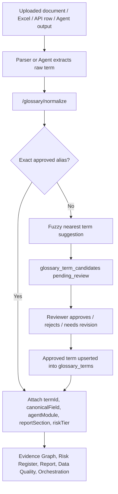

# REALYTICS Term Standard Database Operating Model

Updated: 2026-07-02

## Purpose

The term standard database is the controlled vocabulary layer for REALYTICS x PLATFORM9. It standardizes real estate development, PF, legal, land, marketability, cash-flow, REIT, fund, and real-asset finance terms before those terms are used by parsers, agents, reports, calculations, and the future institutional database.

This is not just a label dictionary. It is a DB-backed operating control.

```text
raw term / new expression / uploaded document phrase
  -> exact alias normalization
  -> canonical term + canonical field mapping
  -> agent routing / report section / calculation metadata
  -> evidence locator and audit trail
  -> unresolved terms enter review queue
  -> approved terms become reusable institutional memory
```

## Source Assets

The current external REALYTICS AI LAB term-standard package contains:

| Asset | Role |
|---|---|
| `realytics_term_seed_v3.json` | Canonical seed pack for 450 standard terms plus operational metadata. |
| `realytics_term_standard_v3.sqlite` | SQLite reference database with `terms`, `synonym_mapping`, `llm_new_term_queue`, `calculation_registry`, `agent_routing_rules`, `report_templates`, and prompt/RAG policy tables. |
| `realytics_term_standard_v3_postgres_ddl.sql` | Production PostgreSQL DDL reference. |
| `realytics_fastapi_sample_v3.py` | Reference API behavior for normalize, route, calculation lookup, and new-term queue. |
| `realytics_term_standard_v3.xlsx` | Human-reviewable workbook version of the standard vocabulary. |

## Current Repo Integration

Implemented in the current app:

| Layer | File / API | Status |
|---|---|---|
| Runtime glossary storage | `services/api-server/storage.py` `glossary_terms`, `glossary_term_candidates` | Done |
| Use case | `services/api-server/use_cases/glossary.py` | Done |
| Router | `services/api-server/routers/glossary.py` | Done |
| Candidate review UI | `apps/web/app/glossary/page.tsx`, `apps/web/app/glossary/candidates/page.tsx` | Done |
| Term annotation agent | `services/api-server/agents/term_annotation_agent.py` | Done |
| v3 seed import | `POST /glossary/standard-pack/import` and `scripts/import_term_standard_seed.py` | Done |
| Raw term normalization | `POST /glossary/normalize` | Done |
| Unmapped term-surface candidate capture | `capture_unmapped_term_surface_candidates_use_case`, Evidence Graph orchestration hook | Done |
| DB-to-Pod term surface payload | `core.text_normalization.build_term_surface_record`, `Parser field provenance`, `TermAnnotationAgent`, `DataQualityAgent`, Chief Pod artifact persistence | Done |

## DB-to-Pod Terminology Normalization Layer

The term standard database must sit between the persistent deal database and every Agent Pod. Pods should not directly consume arbitrary Korean labels, English labels, Excel header text, parser field names, or UI strings. They should consume canonical field paths and term IDs.

```text
source document / Excel / API / user input
  -> raw text preserved in Evidence Vault
  -> Unicode and surface normalization for matching only
  -> glossary exact alias / approved term resolution
  -> canonical field map
  -> Shared Deal State Graph
  -> Pod input contract
```

This layer solves two different problems that should not be mixed:

| Problem | Control |
|---|---|
| Korean text appears broken or fails to match because of encoding, BOM, zero-width characters, or composed/decomposed Hangul. | `core.text_normalization` normalizes matching surfaces with UTF-8-safe Unicode NFC/NFKC, removes invisible control characters, and attempts reversible UTF-8 mojibake repair. |
| Different source documents use different professional wording for the same business concept. | `glossary_terms`, aliases, `synonym_mapping`, and `canonical_field_map` map every approved wording to one canonical field. |

Operating rule:

1. Source text is never overwritten. The system stores `rawText`, `normalizedSurface`, `termId`, `canonicalField`, `sourceLocator`, and quality flags separately.
2. Code identifiers remain stable English canonical fields, such as `feasibility_input.total_revenue`.
3. Korean business wording is rendered from the term database, not hard-coded in each Pod.
4. New high-impact terms become `glossary_term_candidates` before being used by automation.
5. Agent Pods must write unmapped or low-confidence terms back to the candidate queue instead of inventing new variables.

The shared term surface payload is:

| Field | Meaning |
|---|---|
| `rawText` | Original text as received from source, parser, check row, or artifact label. |
| `normalizedSurface` | Matching-only normalized surface. |
| `textQualityFlags` | Encoding and Unicode diagnostics such as BOM/zero-width, replacement character, mojibake suspicion, repairability, and normalization status. |
| `termId` | Approved standard term ID when known. |
| `canonicalField` | Canonical operational field when known. |
| `sourceField` | Parser/check/artifact field path where the surface was observed. |
| `sourceLocator` | Document, Excel cell, API row, or artifact locator when available. |
| `matchType` | How the surface was created or matched. |
| `confidence` | Matching or attribution confidence. |

Target boundary:

| Boundary | Required behavior |
|---|---|
| Parser -> Shared Deal State Graph | Normalize every extracted high-impact field and attach term metadata. |
| DB -> Pod input | Hydrate canonical values by `canonicalField`, not by raw document wording. |
| Pod -> DB artifact | Store `termId`, `canonicalField`, and source locator for every claim/metric/risk where possible. |
| Report/UI output | Render Korean display labels from the glossary and finance term map. |
| New term discovery | Create candidate with source example, project/run, candidate category, and nearest approved term. |

Unmapped term-surface rule:

When Evidence Graph sees a `term_surface` node without both `termId` and
`canonicalField`, orchestration routes the surface through the glossary
normalization layer. Exact approved aliases are matched automatically. New
surfaces become `glossary_term_candidates` with project ID, run ID, source field,
source locator, text-quality flags, and nearest-term suggestion.

Current parser provenance behavior:

| Parser output | Term-surface behavior |
|---|---|
| `project`, `land`, `regulation`, `architectural_plan`, `sales_assumptions`, `cost_assumptions`, `feasibility_input`, `pf_structure`, `developer_info`, `contractor_info`, `schedule`, `covenants` | Non-market leaf fields are recorded in `_meta.parserFieldProvenance.fields` with `termId`, `canonicalField`, and `termSurface`. |
| Located parsed field | Keeps document page, Excel cell, API row, or evidence locator when available. |
| Unlocated parsed field | Keeps `sourceType: parsed_field_path` without fabricating document evidence. |
| Tranche fields | `Tr.A` / Senior, `Tr.B` / Mezzanine, and `Tr.C` / Junior are mapped to senior, mezzanine, and junior canonical fields where possible. |
| Project-level summary | `parser_term_surfaces` provides a flat list of term surfaces for DB-to-Pod hydration and Evidence Graph linkage. |

Production DB tables should therefore include:

| Table | Purpose |
|---|---|
| `terms` | Canonical term identity and Korean/English labels. |
| `synonym_mapping` | Raw Korean/English/source aliases to canonical term IDs. |
| `canonical_field_map` | Approved operational field path, datatype, unit, owner, and review status. |
| `term_surface_normalizations` | Optional audit table for raw surface, normalized surface, text-quality flags, and match result. |
| `llm_new_term_queue` | Terms proposed by Parser, Data Quality, Pod AI Reviewer, or Human Review. |
| `term_review_history` | Approval, merge, reject, supersede, and tenant override history. |

## Data Flow



## Sample Corpus Learning Loop

The local sample folder is now treated as the first REALYTICS domain corpus.
It contains land ledgers, Bonri-style feasibility workbooks, real PF review
reports, real-asset/logistics materials, and development/PF training material.
The goal is not to let uploaded samples mutate production logic directly. The
goal is to mine source-located term surfaces, compare them with the approved
glossary, and queue unknown terms for AI-assisted review.

```text
sample folder
  -> mine source-located term surfaces
  -> exact approved alias match
  -> fuzzy nearest-term suggestion
  -> unmapped / needs_ai_review candidate
  -> glossary candidate review UI
  -> approved term + canonicalField
  -> Parser / Pod / Report reuse on the next run
```

### Candidate review resolutions (human gate)

AI only proposes; the reviewer decides one of four resolutions per candidate on
`/glossary/candidates` (`POST /glossary/candidates/{id}/review`):

| Resolution | `status` | Effect |
|---|---|---|
| 같은 용어로 병합 (same-as) | `merged` | Requires a target `termId` (or the AI `suggestedTermId`). The candidate surface is **registered as an alias** on the existing term (+sourceExample), so the next normalize resolves it exactly instead of re-queueing. No target → 400 (never guessed). |
| 새 표준어 생성 (new-term) | `approved` | Requires `canonicalField`; creates a new approved glossary term with the surface as alias. |
| 자유문구 처리 (free-text) | `free_text` | Marks the surface as narrative text that must not map to a canonical field; no term is created or edited. |
| 반려 (reject) | `rejected` | Drops the candidate with a reason. |

The UI shows the AI rationale per candidate (nearest term + similarity %, the
suggested canonicalField, or a weak-signal free-text hint) and the merge button
is enabled only when the AI actually found a similar term. Ambiguity stays
honest: if a surface exactly matches aliases on two terms, `/glossary/resolve`
reports `matched=false` with both candidates instead of picking one.

Implementation:

| Layer | File / Command | Purpose |
|---|---|---|
| Use case | `services/api-server/use_cases/sample_term_mining.py` | Extract sample-corpus term surfaces and classify them as `matched`, `candidate`, or `needs_ai_review`. |
| CLI | `services/api-server/scripts/mine_sample_terms.py` | Read `.pdf`, `.docx`, `.xlsx/.xlsm`, `.xls`, `.csv`, `.txt`, `.md`, and `.json` sample files. |
| Dry-run report | `.runtime/sample-term-mining-report.json` | Local generated report; not committed or uploaded. |
| Candidate persistence | `--persist-candidates` | Writes unresolved surfaces into `glossary_term_candidates` through the existing normalization use case. |

Local command:

```powershell
cd "C:\Users\User\Documents\real estate os\realytics-platform9-monorepo\services\api-server"
python scripts\mine_sample_terms.py --sample-dir "C:\Users\User\Documents\real estate os\sample" --output ".runtime\sample-term-mining-report.json"
```

If the reviewer wants to create candidate records:

```powershell
python scripts\mine_sample_terms.py --sample-dir "C:\Users\User\Documents\real estate os\sample" --persist-candidates
```

Latest dry-run result from the current local sample package:

| Metric | Count |
|---|---:|
| Source files read | 11 |
| Term surfaces extracted | 1,431 |
| Exact approved matches | 57 |
| Fuzzy candidate suggestions | 95 |
| Needs AI/reviewer classification | 1,279 |

Early review priorities from the sample package:

| Source family | Examples | Why it matters |
|---|---|---|
| Land ledger | `지번`, `지목`, `소유자`, `건축허가 승인후` | Required for PNU, ownership, permit, and land-evidence workflows. |
| Feasibility workbook | `실대지면적`, `공사비`, `순공사비`, `평당분양가`, `연면적비` | Required for FeasibilityStudyV2, Cash Flow, and Data Quality reconciliation. |
| PF review report | Tranche, repayment, covenant, trigger, EOD expressions | Required for PF structure, Risk Register, and Phase 11 report generation. |
| Real-asset/logistics | lease, NOI, Cap Rate, master lease, forward sale expressions | Required for real-asset finance and logistics tracks. |

AI usage policy:

1. Deterministic exact alias matches may be applied automatically.
2. Fuzzy matches and unknown expressions are suggestions only.
3. An LLM may propose `same-as`, `new-term`, `free-text`, or `reject`, but it must not approve a production canonical mapping by itself.
4. Approval writes must go through glossary candidate review with reviewer, reason, source examples, and canonical field.

## Canonical Field Policy

The v3 source database is a term-standard database. Its `source_key` is a source/document key, not always an app automation field. The app therefore uses this policy:

1. High-impact known automation terms retain domain canonical fields.
   - `LTV` -> `pf_metrics.ltv`
   - `Exit 분양률` -> `scenario.exitSalesRate`
   - `총분양수입` -> `feasibility_input.total_revenue`
   - `개별공시지가` -> `landEvidence.officialLandPrice.pricePerSqm`
   - `책임준공` -> `credit_enhancement.responsible_completion`
2. Other v3 terms are preserved under `term_standard.<term_id>` until a domain owner maps them to an operational field.
3. New terms that affect numbers, legal status, risk, report conclusions, or approval readiness must not remain free text.
4. If a term cannot be exact-matched, the system creates a review candidate rather than silently inventing a mapping.

## API

| Method | Path | Purpose |
|---|---|---|
| `GET` | `/glossary/terms` | List standard terms. |
| `GET` | `/glossary/resolve?term=...` | Resolve exact approved alias/canonical term. |
| `POST` | `/glossary/normalize` | Batch normalize raw terms. Exact aliases map automatically; unresolved terms become candidates. |
| `GET` | `/glossary/candidates` | List unmapped/new term candidates. |
| `POST` | `/glossary/candidates/{candidate_id}/review` | Approve/reject/merge a candidate. |
| `POST` | `/glossary/standard-pack/import` | Import v3-compatible term-standard seed payload. |
| `GET` | `/glossary/canonical-field-map` | Return canonical field map for approved terms. |

## CLI Import

Use this for local and pilot seed loading:

```powershell
cd "C:\Users\User\Documents\real estate os\realytics-platform9-monorepo\services\api-server"
python scripts\import_term_standard_seed.py "C:\Users\User\Desktop\REALYTICS AI LAB 데이터베이스\realytics_term_seed_v3.json" --replace-existing
```

The script writes into the configured runtime store:

| Environment Variable | Meaning |
|---|---|
| `REALYTICS_STORAGE_BACKEND` | `sqlite` or `json`; production should move to PostgreSQL. |
| `REALYTICS_SQLITE_FILE` | Runtime SQLite path for pilot/dev. |
| `REALYTICS_TERM_STANDARD_SEED_FILE` | Optional seed file used when seeding an empty glossary store. |

## Production DB Direction

Recommended production stack:

| Component | Recommended Store |
|---|---|
| Terms / aliases / candidates / review history | PostgreSQL |
| Source documents and term evidence files | Object storage |
| Semantic similar-term search | PostgreSQL `pgvector` or OpenSearch |
| Audit log | PostgreSQL append-only table |
| Tenant-specific overrides | PostgreSQL with tenant isolation |

## Required Tables for Production

The current runtime tables should become explicit PostgreSQL tables:

| Table | Purpose |
|---|---|
| `terms` | Canonical standard vocabulary. |
| `synonym_mapping` | Raw term and alias to canonical term map. |
| `term_operational_metadata` | Agent routing, report section, calculation, validation, risk metadata. |
| `llm_new_term_queue` | New/unmapped term proposals. |
| `term_review_history` | Human/AI review decisions and reasons. |
| `term_source_examples` | Document, Excel cell, API row, or evidence examples. |
| `canonical_field_map` | Domain automation field map and owner approval status. |

## Guardrails

1. Exact approved alias matches may be mapped automatically.
2. Fuzzy matches must enter the review queue unless a domain owner has approved auto-merge rules.
3. Legal, collateral, PNU, public price, PF covenant, and credit-decision terms require source locators.
4. Every approved mapping must keep `reviewedBy`, `reviewedAt`, and `reviewReason`.
5. Tenant-specific aliases are allowed, but canonical fields must remain globally controlled unless tenant override policy is enabled.
6. Report and calculation agents should consume `termId` and `canonicalField`, not raw document wording.

## Next Work

| Priority | Work | Status |
|---|---|---|
| P0 | Load v3 seed into pilot runtime DB and verify Korean aliases. | Ready |
| P0 | Attach term-surface payload to Parser field provenance, Data Quality rows, and Chief Pod artifact persistence. | Done |
| P0 | Use `/glossary/normalize` in Parser Agent, Data Quality Agent, and Evidence Graph for unresolved free-text terms. | Done |
| P0 | Add UI filters for term-surface candidates created from Evidence Graph. | Next |
| P1 | Store v3 `synonym_mapping`, `agent_routing_rules`, and `calculation_registry` as first-class tables instead of only term payload metadata. | Planned |
| P1 | Add similarity search with vector index for candidate nearest-term suggestions. | Planned |
| P1 | Add tenant-specific term packs and override approvals. | Planned |
| P2 | Connect historical case search so term usage can be compared across prior PF reviews. | Planned |
