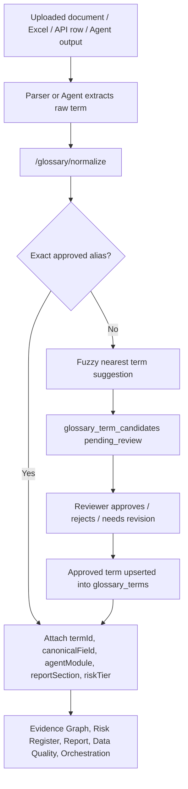

# REALYTICS Term Standard Database Operating Model

Updated: 2026-06-30

## Purpose

The term standard database is the controlled vocabulary layer for REALYTICS x PLATFORM9. It standardizes real estate development, PF, legal, land, marketability, cash-flow, REIT, fund, and real-asset finance terms before those terms are used by parsers, agents, reports, calculations, and the future institutional database.

This is not just a label dictionary. It is a DB-backed operating control.

```text
raw term / new expression / uploaded document phrase
  -> exact alias normalization
  -> canonical term + canonical field mapping
  -> agent routing / report section / calculation metadata
  -> evidence locator and audit trail
  -> unresolved terms enter review queue
  -> approved terms become reusable institutional memory
```

## Source Assets

The current external REALYTICS AI LAB term-standard package contains:

| Asset | Role |
|---|---|
| `realytics_term_seed_v3.json` | Canonical seed pack for 450 standard terms plus operational metadata. |
| `realytics_term_standard_v3.sqlite` | SQLite reference database with `terms`, `synonym_mapping`, `llm_new_term_queue`, `calculation_registry`, `agent_routing_rules`, `report_templates`, and prompt/RAG policy tables. |
| `realytics_term_standard_v3_postgres_ddl.sql` | Production PostgreSQL DDL reference. |
| `realytics_fastapi_sample_v3.py` | Reference API behavior for normalize, route, calculation lookup, and new-term queue. |
| `realytics_term_standard_v3.xlsx` | Human-reviewable workbook version of the standard vocabulary. |

## Current Repo Integration

Implemented in the current app:

| Layer | File / API | Status |
|---|---|---|
| Runtime glossary storage | `services/api-server/storage.py` `glossary_terms`, `glossary_term_candidates` | Done |
| Use case | `services/api-server/use_cases/glossary.py` | Done |
| Router | `services/api-server/routers/glossary.py` | Done |
| Candidate review UI | `apps/web/app/glossary/page.tsx`, `apps/web/app/glossary/candidates/page.tsx` | Done |
| Term annotation agent | `services/api-server/agents/term_annotation_agent.py` | Done |
| v3 seed import | `POST /glossary/standard-pack/import` and `scripts/import_term_standard_seed.py` | Done |
| Raw term normalization | `POST /glossary/normalize` | Done |

## Data Flow



## Canonical Field Policy

The v3 source database is a term-standard database. Its `source_key` is a source/document key, not always an app automation field. The app therefore uses this policy:

1. High-impact known automation terms retain domain canonical fields.
   - `LTV` -> `pf_metrics.ltv`
   - `Exit 분양률` -> `scenario.exitSalesRate`
   - `총분양수입` -> `feasibility_input.total_revenue`
   - `개별공시지가` -> `landEvidence.officialLandPrice.pricePerSqm`
   - `책임준공` -> `credit_enhancement.responsible_completion`
2. Other v3 terms are preserved under `term_standard.<term_id>` until a domain owner maps them to an operational field.
3. New terms that affect numbers, legal status, risk, report conclusions, or approval readiness must not remain free text.
4. If a term cannot be exact-matched, the system creates a review candidate rather than silently inventing a mapping.

## API

| Method | Path | Purpose |
|---|---|---|
| `GET` | `/glossary/terms` | List standard terms. |
| `GET` | `/glossary/resolve?term=...` | Resolve exact approved alias/canonical term. |
| `POST` | `/glossary/normalize` | Batch normalize raw terms. Exact aliases map automatically; unresolved terms become candidates. |
| `GET` | `/glossary/candidates` | List unmapped/new term candidates. |
| `POST` | `/glossary/candidates/{candidate_id}/review` | Approve/reject/merge a candidate. |
| `POST` | `/glossary/standard-pack/import` | Import v3-compatible term-standard seed payload. |
| `GET` | `/glossary/canonical-field-map` | Return canonical field map for approved terms. |

## CLI Import

Use this for local and pilot seed loading:

```powershell
cd "C:\Users\User\Documents\real estate os\realytics-platform9-monorepo\services\api-server"
python scripts\import_term_standard_seed.py "C:\Users\User\Desktop\REALYTICS AI LAB 데이터베이스\realytics_term_seed_v3.json" --replace-existing
```

The script writes into the configured runtime store:

| Environment Variable | Meaning |
|---|---|
| `REALYTICS_STORAGE_BACKEND` | `sqlite` or `json`; production should move to PostgreSQL. |
| `REALYTICS_SQLITE_FILE` | Runtime SQLite path for pilot/dev. |
| `REALYTICS_TERM_STANDARD_SEED_FILE` | Optional seed file used when seeding an empty glossary store. |

## Production DB Direction

Recommended production stack:

| Component | Recommended Store |
|---|---|
| Terms / aliases / candidates / review history | PostgreSQL |
| Source documents and term evidence files | Object storage |
| Semantic similar-term search | PostgreSQL `pgvector` or OpenSearch |
| Audit log | PostgreSQL append-only table |
| Tenant-specific overrides | PostgreSQL with tenant isolation |

## Required Tables for Production

The current runtime tables should become explicit PostgreSQL tables:

| Table | Purpose |
|---|---|
| `terms` | Canonical standard vocabulary. |
| `synonym_mapping` | Raw term and alias to canonical term map. |
| `term_operational_metadata` | Agent routing, report section, calculation, validation, risk metadata. |
| `llm_new_term_queue` | New/unmapped term proposals. |
| `term_review_history` | Human/AI review decisions and reasons. |
| `term_source_examples` | Document, Excel cell, API row, or evidence examples. |
| `canonical_field_map` | Domain automation field map and owner approval status. |

## Guardrails

1. Exact approved alias matches may be mapped automatically.
2. Fuzzy matches must enter the review queue unless a domain owner has approved auto-merge rules.
3. Legal, collateral, PNU, public price, PF covenant, and credit-decision terms require source locators.
4. Every approved mapping must keep `reviewedBy`, `reviewedAt`, and `reviewReason`.
5. Tenant-specific aliases are allowed, but canonical fields must remain globally controlled unless tenant override policy is enabled.
6. Report and calculation agents should consume `termId` and `canonicalField`, not raw document wording.

## Next Work

| Priority | Work | Status |
|---|---|---|
| P0 | Load v3 seed into pilot runtime DB and verify Korean aliases. | Ready |
| P0 | Use `/glossary/normalize` in Parser Agent and Data Quality Agent for all newly extracted terms. | Next |
| P1 | Store v3 `synonym_mapping`, `agent_routing_rules`, and `calculation_registry` as first-class tables instead of only term payload metadata. | Planned |
| P1 | Add similarity search with vector index for candidate nearest-term suggestions. | Planned |
| P1 | Add tenant-specific term packs and override approvals. | Planned |
| P2 | Connect historical case search so term usage can be compared across prior PF reviews. | Planned |
